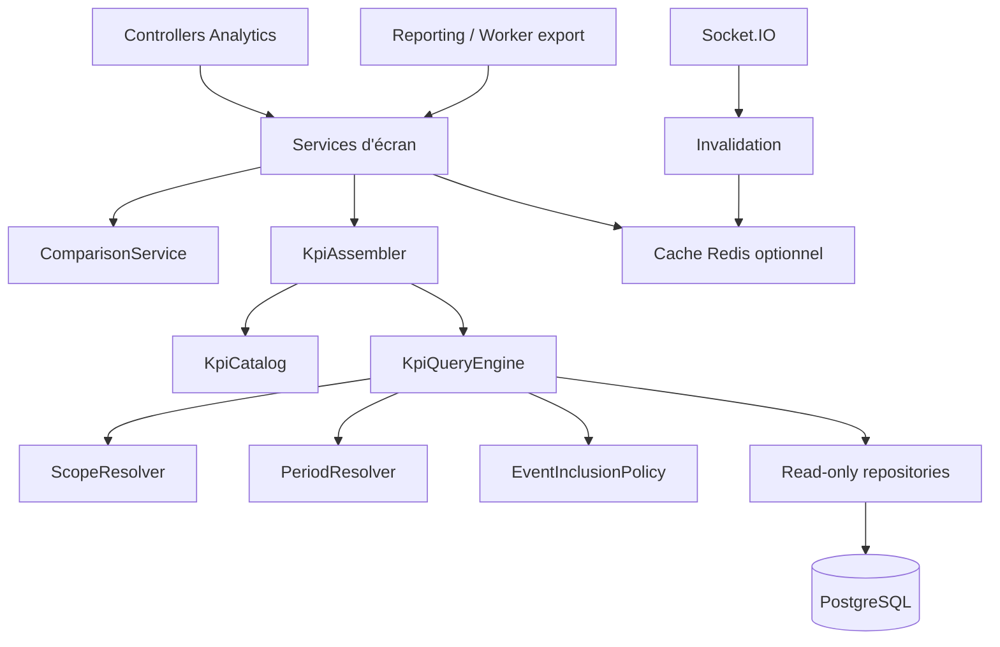
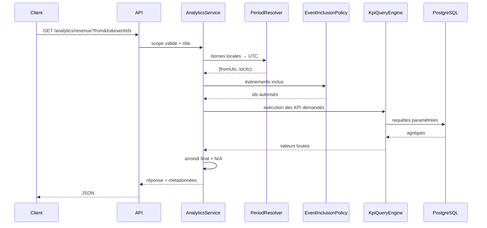

# ANALYTICS_ARCHITECTURE.md — EventPulse Analytics

**Phase :** 3 — Software Architecture & Database Design
**Version :** 1.0
**Date :** 2026-11-18
**Source fonctionnelle :** `KPI_DEFINITIONS.md` v1.0 (24 KPI)
**Compléments :** `API_DESIGN.md`, `DATABASE_DESIGN.md`, `WORKERS_ARCHITECTURE.md`

> Aucune formule nouvelle n'est introduite. Les formules ci-dessous sont la transcription stricte de `KPI_DEFINITIONS.md`. En cas d'écart, le document Phase 1 fait foi.

---

## 1. Contraintes fondatrices

1. **24 KPI, ni plus ni moins.** Tout calcul exposé correspond à un identifiant `KPI-*` validé.
2. **Aucun arrondi intermédiaire.** Seul le résultat final est arrondi à 2 décimales.
3. **Période semi-ouverte `[from, to)`** : `from` inclus, `to` exclu.
4. **Dates d'activité** : `registered_at`, `checked_in_at`, `paid_at`, `refunded_at`, `reserved_at`. Jamais la date de début d'événement par défaut.
5. **N/A distinct de 0.**
6. **Aucun double comptage.**
7. **Devise unique EUR.**
8. **L'email n'est jamais une clé de décompte.**
9. **Le serveur est l'unique source de calcul**, y compris pour le temps réel.
10. **Aucune table de snapshot KPI** en V1.

---

## 2. Catalogue des 24 KPI

### 2.1 Inscriptions et participants

| ID | KPI | Unité | Formule | Date | N/A si |
|---|---|---|---|---|---|
| REG-001 | Confirmed Registrations | count | `COUNT(registrations WHERE status = CONFIRMED)` dans le scope et la période | `registered_at` | Aucune inscription dans le scope |
| REG-002 | Registration Confirmation Rate | % | `CONFIRMED / (PENDING + CONFIRMED) × 100` | `registered_at` | Dénominateur nul |
| PAR-001 | Unique Participants | count | `COUNT(DISTINCT participant_id)` avec inscription `PENDING`, `CONFIRMED` ou `WAITLISTED` | `registered_at` | Aucune inscription |
| PAR-002 | Returning Attendee Rate | % | Présents du scope avec ≥ 1 check-in `VALID` sur un **autre** événement antérieur / présents distincts du scope × 100 | `checked_in_at` du scope ; antériorité stricte | Aucun présent |

### 2.2 Présence

| ID | KPI | Unité | Formule | Date | N/A si |
|---|---|---|---|---|---|
| CHK-001 | Valid Check-ins | count | `COUNT(check_ins WHERE status = VALID)` | `checked_in_at` | Aucun check-in |
| CHK-002 | Attendance Rate | % | Participants distincts avec ≥ 1 `VALID` / participants distincts avec ≥ 1 inscription `CONFIRMED`, **event-scoped** × 100 | Cohorte événement | Aucun confirmé |
| CHK-003 | No-Show Rate | % | `100 − Attendance Rate` ou `(confirmés − présents) / confirmés × 100` | Cohorte événement | Aucun confirmé |
| CHK-004 | Invalid Check-ins | count | `COUNT(check_ins WHERE status = INVALID)` groupé par `reason` | `checked_in_at` | Aucun check-in |
| CHK-005 | Unique Attendees | count | `COUNT(DISTINCT participant_id)` avec ≥ 1 `VALID` | `checked_in_at` | Aucun check-in |

**Précisions CHK-002/003 :**

- Le dénominateur est la population des inscriptions `CONFIRMED` de l'événement, pas une population filtrée par la période.
- Un participant avec plusieurs inscriptions confirmées ne compte qu'une fois.
- En agrégat multi-événements, le calcul utilise des **paires participant-événement** : un participant présent à deux événements compte deux fois.
- Le filtre de période sélectionne les événements inclus, pas les individus.
- Un check-in `INVALID` ne vaut jamais présence.

### 2.3 Financier

| ID | KPI | Unité | Formule | Date | N/A si |
|---|---|---|---|---|---|
| REV-001 | Ticket Revenue | EUR | `SUM(amount)` transactions `TICKET` ayant atteint `PAID` | `paid_at` | Aucune transaction `TICKET` |
| REV-002 | Booth Revenue | EUR | `SUM(amount)` transactions `BOOTH` ayant atteint `PAID` | `paid_at` | Aucune transaction `BOOTH` |
| REV-003 | Gross Revenue | EUR | REV-001 + REV-002 | `paid_at` | Aucune transaction source |
| REV-004 | Total Refunds | EUR | `SUM(refunds.amount)` rattachés à des transactions du scope | `refunded_at` | Aucune transaction source |
| REV-005 | Net Revenue | EUR | REV-003 − REV-004 | `paid_at` / `refunded_at` | REV-003 N/A |
| REV-006 | Paid Tickets | count | `COUNT` transactions `TICKET` payées | `paid_at` | Aucune transaction `TICKET` |
| REV-007 | Average Ticket Value | EUR | REV-001 / REV-006 | `paid_at` | REV-006 = 0 |
| REV-008 | Transactions by Status | count / EUR | `COUNT(*)` et `SUM(amount)` groupés par `status` | `created_at` | Aucune transaction |

**Précisions financières :**

- Les transactions `PARTIALLY_REFUNDED` et `REFUNDED` restent incluses dans le brut : elles ont atteint `PAID`.
- `PENDING`, `FAILED` et `CANCELLED` sont exclues du brut.
- REV-004 peut concerner des transactions payées avant la période.
- REV-005 peut être négatif ; aucun plancher.
- REV-008 utilise `created_at`, seule date homogène pour tous les statuts.

### 2.4 Exposants et stands

| ID | KPI | Unité | Formule | Date | N/A si |
|---|---|---|---|---|---|
| EXH-001 | Total Exhibitors | count | `COUNT(DISTINCT exhibitor_id)` avec ≥ 1 réservation `ACTIVE` | Snapshot ; `reserved_at` si filtre | Aucun stand dans l'événement |
| EXH-002 | Stands Booked | count | `COUNT(DISTINCT booth_id)` avec réservation `ACTIVE` | Snapshot ; `reserved_at` si filtre | Aucun stand |
| EXH-003 | Stand Booking Value | EUR | `SUM(price_amount)` des réservations `ACTIVE` valorisées | Snapshot ; `reserved_at` si filtre | Aucune réservation active valorisée |
| EXH-004 | Stand Occupancy Rate | % | Réservés `ACTIVE` / (`total stands` − `UNAVAILABLE`) × 100 | Snapshot | Dénominateur nul |

**Précisions :**

- EXH-003 exclut les prix nuls de la somme et expose la couverture « X sur Y valorisées ».
- EXH-004 exclut les stands `UNAVAILABLE` du dénominateur.
- En agrégat, sommer les numérateurs et dénominateurs par événement, jamais moyenner les taux.

### 2.5 Audience

| ID | KPI | Unité | Formule | Date | N/A si |
|---|---|---|---|---|---|
| AUD-001 | Demographic Distribution | % | Participants d'une modalité / participants avec valeur connue pour la dimension × 100 | `registered_at` | Aucune valeur connue |
| AUD-002 | Geographic Distribution | % | Participants d'une modalité / participants avec valeur connue pour le niveau × 100 | `registered_at` | Aucune valeur connue |
| AUD-003 | Registration Source Distribution | % | Inscriptions d'une source / inscriptions non annulées à source connue × 100 | `registered_at` | Aucune source connue |

**Précisions :**

- AUD-001 : tranches `< 18`, `18–24`, `25–34`, `35–44`, `45–54`, `55–64`, `65+`, `UNKNOWN` ; genres `FEMALE`, `MALE`, `NON_BINARY`, `UNDISCLOSED`, `UNKNOWN`.
- Les valeurs inconnues sont exclues du dénominateur et affichées « non renseigné ». Les pourcentages ne totalisent donc pas nécessairement 100 %.
- AUD-003 exclut les inscriptions `CANCELLED` ; sources `MANUAL`, `IMPORT`, `INGESTION_API`, `PARTNER`, `OTHER`.
- L'âge est calculé à la date de référence : début d'événement en mode événement, fin de période en mode organisation.

---

## 3. Architecture des services

### 3.1 Composants

| Composant | Responsabilité |
|---|---|
| `KpiCatalog` | Registre immuable des 24 définitions : code, nom, unité, famille, date, type de portée, raisons N/A |
| `ScopeResolver` | Normalise organisation, événements, type, fuseau et périmètre autorisé |
| `PeriodResolver` | Convertit `[from, to)` local en instants UTC, gère l'absence de période et les fenêtres de comparaison |
| `EventInclusionPolicy` | Applique les règles `DRAFT`/`PUBLISHED`/`ONGOING`/`COMPLETED`/`ARCHIVED`/`CANCELLED` |
| `KpiQueryEngine` | Exécute les requêtes SQL paramétrées par famille de KPI |
| Read-only repositories | Requêtes Prisma/SQL en lecture seule, une par famille |
| `KpiAssembler` | Assemble valeurs, N/A, unités, comparaisons et métadonnées |
| `ComparisonService` | Produit la fenêtre précédente de même longueur et calcule les deltas |
| Services d'écran | Overview, Event, Revenue, Audience, Exhibitor, Advanced |
| Cache | Redis optionnel, clé déterministe, TTL court |
| `ExportDatasetProvider` | Réutilise les mêmes services pour les rapports et exports |

### 3.2 Règle de dépendance

- Les services d'écran ne contiennent aucune formule : ils sélectionnent des codes KPI et des dimensions.
- Les formules vivent dans `KpiQueryEngine` et les repositories de lecture.
- Aucun service analytique n'écrit en base.
- Aucun module opérationnel n'appelle un service analytique pour prendre une décision métier.
- Aucun calcul n'est dupliqué côté frontend ni côté Socket.IO.

---

## 4. Pipeline de calcul

### 4.1 Étapes

1. **Autorisation** : rôle, portée, événements accessibles.
2. **Résolution du scope** : organisation active, événements, type, fuseau.
3. **Résolution de période** : locale → UTC, `[from, to)`.
4. **Inclusion des événements** : selon mode courant ou historique.
5. **Exécution** : requêtes parallèles par famille, avec un budget de latence.
6. **Assemblage** : valeur, unité, statut `OK` ou `N_A`, motif, comparaison.
7. **Mise en cache** : si activée, après calcul.
8. **Réponse** : métadonnées de période, de scope et de fraîcheur.

---

## 5. Périodes et fuseaux

### 5.1 Résolution

| Cas | Fuseau utilisé |
|---|---|
| Un seul événement | Fuseau de l'événement |
| Plusieurs événements | Fuseau de l'organisation |
| Vue organisation | Fuseau de l'organisation |

- Les bornes locales sont converties en instants UTC, puis utilisées telles quelles.
- Une journée locale peut durer 23 ou 25 heures lors d'un changement d'heure.
- L'heure d'été est couverte par des tests dédiés.
- L'affichage frontend utilise le fuseau de l'événement, sinon celui de l'organisation.

### 5.2 Absence de période

- Une période omise signifie **tout l'historique du scope**, et non « 30 derniers jours ».
- Les KPI snapshot (EXH-001 à EXH-004) restent des snapshots courants.
- Le frontend peut proposer une période par défaut, mais cette valeur est explicite dans la requête.

### 5.3 Comparaison

- Fenêtre précédente immédiatement antérieure, de même durée.
- Même fuseau, mêmes règles d'inclusion.
- Les KPI de cohorte (CHK-002/003) comparent des cohortes d'événements distinctes, jamais des populations glissantes.
- Aucune fenêtre de comparaison n'est inventée si l'utilisateur n'en demande pas.

---

## 6. Inclusion des événements

| Statut | Performance courante | Analyse historique | Vue dédiée |
|---|---|---|---|
| `DRAFT` | Exclu | Exclu | Brouillons |
| `PUBLISHED` | Inclus | Inclus | — |
| `ONGOING` | Inclus | Inclus | — |
| `COMPLETED` | Inclus | Inclus | — |
| `ARCHIVED` | Exclu par défaut | **Inclus** | Archives |
| `CANCELLED` | Exclu | Exclu | Annulés |

**Modes :**

- `CURRENT` (défaut) : `PUBLISHED`, `ONGOING`, `COMPLETED`.
- `HISTORICAL` : ajoute `ARCHIVED`.
- `DEDICATED` : permet d'interroger explicitement `DRAFT`, `CANCELLED` ou `ARCHIVED` selon les droits.

**Restrictions de rôle :**

- ANALYST et VIEWER ne voient que `PUBLISHED`, `ONGOING`, `COMPLETED`, `ARCHIVED`.
- EVENT_MANAGER : événements assignés, tous statuts de son périmètre.
- OWNER/ADMIN : organisation entière.

Un filtre de période ne change jamais l'inclusion : il sélectionne les dates d'activité, pas le statut des événements.

---

## 7. Prévention du double comptage

| Risque | Règle |
|---|---|
| Revenus billet + stand | Une transaction a un seul `type` ; REV-001 et REV-002 sont disjoints |
| Remboursements | Jamais soustraits du brut ; une seule soustraction dans REV-005 |
| Jointure transaction/remboursements | Pré-agréger les remboursements par transaction avant jointure |
| Participants uniques | `COUNT(DISTINCT participant_id)` sur l'identité interne |
| Présence multi-événements | Paires participant-événement pour CHK-002/003 |
| Taux d'occupation agrégé | Somme des numérateurs / somme des dénominateurs par événement |
| Check-ins valides | Index partiel unique par événement et participant |
| Inscriptions supprimées | `deleted_at IS NOT NULL` exclu |
| Participants fusionnés | L'identité conservée fait foi |
| Inscriptions annulées | Exclues des KPI d'inscriptions et d'audience selon la définition |

---

## 8. Gestion du N/A

### 8.1 Modèle de réponse

Chaque KPI retourne :

| Champ | Valeur |
|---|---|
| `code` | Identifiant KPI |
| `value` | Nombre, chaîne décimale ou `null` |
| `unit` | `count`, `percent`, `EUR` |
| `status` | `OK` ou `N_A` |
| `reason` | Motif borné si `N_A` |
| `coverage` | Couverture éventuelle (EXH-003) |
| `comparison` | Valeur et delta si demandé |

### 8.2 Motifs

| Motif | Signification |
|---|---|
| `NO_DATA` | Aucune donnée source dans le scope |
| `ZERO_DENOMINATOR` | Dénominateur nul |
| `NO_CONFIRMED_REGISTRATIONS` | Aucun confirmé pour un taux de présence |
| `NO_CHECKINS` | Aucun check-in |
| `NO_TRANSACTIONS` | Aucune transaction source |
| `NO_BOOTHS` | Aucun stand |
| `NO_VALUED_RESERVATIONS` | Aucune réservation active valorisée |
| `NO_KNOWN_VALUES` | Aucune valeur connue pour une distribution |
| `NO_ATTENDEES` | Aucun présent pour PAR-002 |

### 8.3 Règles

- N/A n'est jamais converti en 0.
- 0 est une valeur calculée lorsque des données existent.
- Une valeur inconnue est exclue du dénominateur, pas comptée comme zéro.
- Un taux dont le dénominateur est nul est N/A, jamais 0 %.
- Un montant partiel (EXH-003) est affiché avec sa couverture, pas comme un total complet.

---

## 9. Requêtes et performance

### 9.1 Formes de requêtes

| Famille | Approche |
|---|---|
| Comptages d'inscriptions | Agrégation directe sur `registrations`, filtre statut/date/événement |
| Participants uniques | `COUNT(DISTINCT)` avec index organisation/date |
| Présence | Deux agrégats distincts (confirmés, présents) puis ratio |
| Revenus | Agrégation `transactions` par type et `paid_at` |
| Remboursements | Pré-agrégation par transaction, puis rattachement au scope |
| Répartition par statut | `GROUP BY status` sur `created_at` |
| Exposants | Agrégation `booth_reservations` actives + `booths` |
| Distributions | `GROUP BY` sur valeurs connues, exclusion des null |

### 9.2 Règles SQL

- Requêtes **paramétrées**, jamais de concaténation.
- Aucune jointure en éventail entre transactions et remboursements.
- Filtres `organization_id` en première position.
- Index composites alignés sur les colonnes de filtre et de date.
- `FILTER (WHERE ...)` pour les comptages conditionnels.
- Aucun `SELECT *`.
- Les requêtes de lecture n'utilisent pas les repositories d'écriture.
- Chaque requête respecte un budget de temps ; une requête lente est optimisée, pas masquée par un cache.

### 9.3 Parallélisation

- Les familles indépendantes sont exécutées en parallèle.
- Un écran vise 4 à 8 requêtes agrégées.
- Les KPI dérivés (REV-003, REV-005, REV-007, CHK-003) réutilisent les valeurs calculées, sans requête supplémentaire.

### 9.4 Volumétrie cible

| Donnée | Volume |
|---|---|
| Événements | ~20 |
| Inscriptions | ~50 000 |
| Check-ins | ~30 000 |
| Exposants | ~200 |
| Stands | ~500 |
| Historique | 24 mois |

**Cible :** dashboards < 2 s sur cette volumétrie, hors latence réseau.

### 9.5 Cache

- Redis **optionnel**.
- TTL court (30 à 60 s), jamais présenté comme temps réel.
- Clé : hash de `(organizationId, kpiCodes, eventIds, period, filters, mode, comparison)`.
- Invalidation sur événements de domaine : inscription, annulation, check-in, paiement, remboursement, réservation, import, changement de statut d'événement.
- Aucun cache de données PII.
- Le cache ne corrige jamais une requête incorrecte.

### 9.6 Pas de matérialisation en V1

- Aucune vue matérialisée, aucune table d'agrégats.
- Aucun snapshot KPI persisté.
- Une matérialisation future devrait rester dérivable des tables sources et ne jamais devenir une seconde source de vérité.

---

## 10. Temps réel

- Socket.IO diffuse uniquement des **invalidations**.
- Aucun KPI, aucun delta, aucune série n'est calculé ou transmis par le socket.
- Après commit, un événement de domaine déclenche une notification scopée `org:{orgId}` et éventuellement `event:{eventId}`.
- Le client invalide les requêtes concernées et refait un appel REST.
- Les valeurs REST et temps réel proviennent donc du même service et des mêmes formules.
- En cas de perte de connexion, le client revient au polling et se resynchronise.
- VIEWER et ANALYST ne reçoivent que des invalidations compatibles avec leurs droits, sans PII.

---

## 11. Services par écran

| Écran | Service | KPI principaux |
|---|---|---|
| Overview | `OverviewService` | REG-001, REG-002, PAR-001, REV-003, REV-004, REV-005, EXH-004, CHK-002 |
| Event Analytics | `EventAnalyticsService` | REG-001, REG-002, CHK-001 à 005, REV-003, EXH-004 |
| Revenue Analytics | `RevenueAnalyticsService` | REV-001 à 008 |
| Audience Analytics | `AudienceAnalyticsService` | PAR-001, PAR-002, AUD-001 à 003, CHK-002/003/005 |
| Exhibitor Analytics | `ExhibitorAnalyticsService` | EXH-001 à 004 |
| Advanced Analytics | `AdvancedAnalyticsService` | Tous, filtres avancés |
| Rapports et exports | `ExportDatasetProvider` | Selon rapport |

### 11.1 Drill-down

- OWNER/ADMIN : tout.
- EVENT_MANAGER : événements assignés.
- ANALYST : agrégats uniquement.
- VIEWER : aucun drill-down détaillé.

Le service refuse une demande de granularité non autorisée ; le frontend ne fait que masquer.

---

## 12. Exports

- Les exports utilisent `AnalyticsFacade`, jamais des requêtes opérationnelles directes.
- Les cinq rapports réutilisent les mêmes KPI, sans formule alternative.
- Les exports ANALYST et EVENT_MANAGER sont pseudonymisés avant génération.
- Un export VIEWER est refusé côté serveur.
- Les paramètres figés dans `exports.parameters` déterminent le dataset, pas l'état courant.
- Un export ne inclut jamais de PII pour les rôles pseudonymisés.
- Les totaux d'export doivent être identiques aux valeurs API de la même période, à l'arrondi final près.

---

## 13. Cohérence et tests

### 13.1 Invariants vérifiés

1. Gross stable après remboursement.
2. Net = Gross − Refunds.
3. Un participant multi-événements est distinct en org-wide et multiple en paires.
4. Un check-in `INVALID` n'alimente jamais la présence.
5. Un stand `UNAVAILABLE` n'est pas dans le dénominateur d'occupation.
6. Une réservation sans prix ne vaut pas 0 €.
7. Une valeur démographique inconnue est exclue du pourcentage.
8. N/A et 0 ne sont jamais confondus.
9. Les bornes `[from, to)` excluent `to`.
10. Le changement d'heure ne décale pas les agrégats.

### 13.2 Jeux de données de référence

Les 10 cas de `KPI_DEFINITIONS.md` §9 constituent la base des tests d'intégration analytique.

### 13.3 Tests croisés

- REST vs export : mêmes valeurs.
- REST vs Socket.IO : même fraîcheur après refetch.
- Isolation : un KPI ne contient jamais de données d'une autre organisation.
- Rôle : un VIEWER ne reçoit aucune dimension nominative.
- Performance : jeu de 50 000 inscriptions, seuil < 2 s.

---

## 14. Observabilité

| Mesure | Usage |
|---|---|
| Durée par endpoint | Détection de régression |
| Durée par requête KPI | Optimisation ciblée |
| Taux de N/A | Qualité des données |
| Taux de cache hit | Utilité du cache |
| Erreurs de calcul | Sentry |
| Nombre d'événements inclus | Diagnostic de scope |

Les logs ne contiennent ni PII ni valeurs nominatives. Les paramètres sont hachés si nécessaire.

---

## 15. Traçabilité

| Élément | Source |
|---|---|
| 24 KPI et formules | `KPI_DEFINITIONS.md` |
| Périodes `[from, to)` | BR-KPI-002 |
| Dates d'activité | BR-KPI-003 |
| N/A | BR-KPI-004 |
| Inclusion des événements | PRD Annexe B, BR-KPI-006 |
| Anti-double comptage | BR-KPI-005 |
| Cohorte event-scoped | Q-13.2 |
| Gross stable | H-03, Q-04 |
| Répartition par statut | Q-04 |
| Temps réel sans calcul | BR-RT-001 |
| Exports pseudonymisés | H-09 |
| Viewer Revenue | Arbitrage post-Phase 2 |

---

## 16. Points ouverts

- Limite maximale d'événements comparés : valeur de sécurité à fixer.
- Politique de cache : Redis activé par défaut ou seulement en démonstration ?
- Granularité des séries temporelles (`day`, `week`, `month`) : règles de début de semaine à confirmer.
- Normalisation des libellés géographiques.
- Calcul de l'âge à la date de référence en vue organisation : fin de période retenue, à valider.
- Aucune matérialisation avant que la volumétrie ne le justifie.

---

*Fin de ANALYTICS_ARCHITECTURE.md — Version 1.0.*
