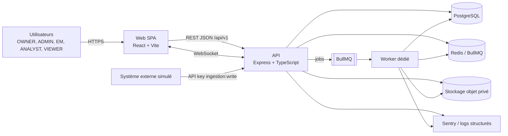
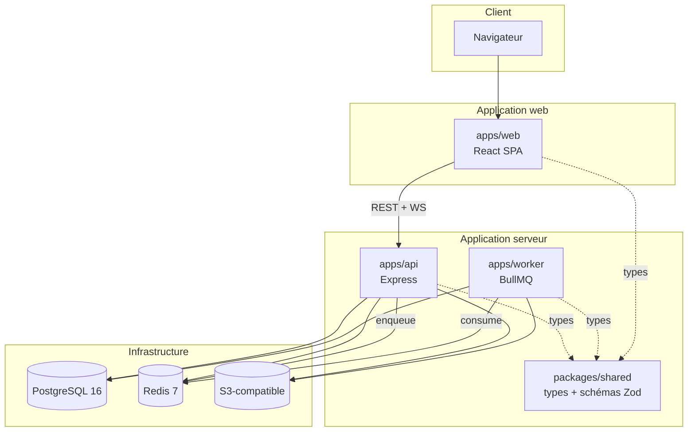
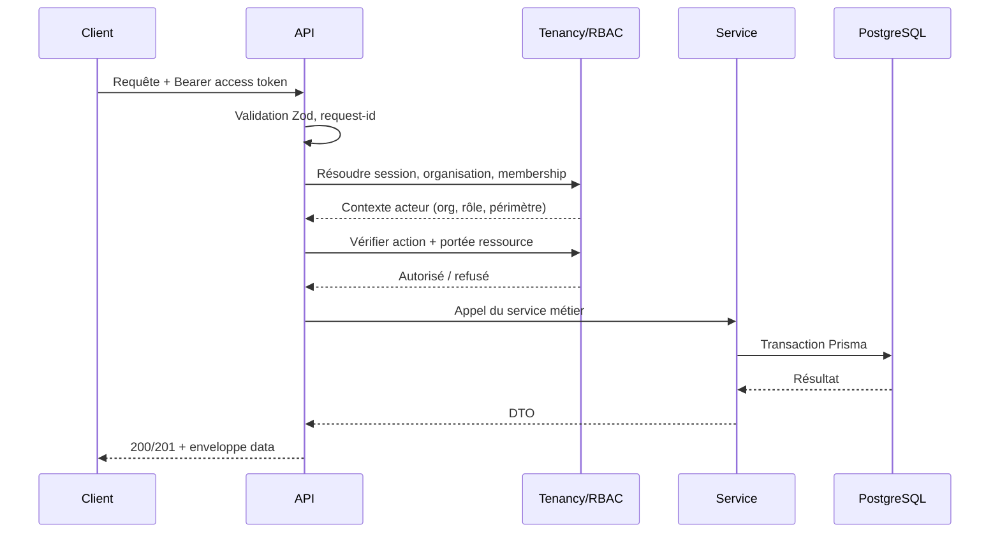
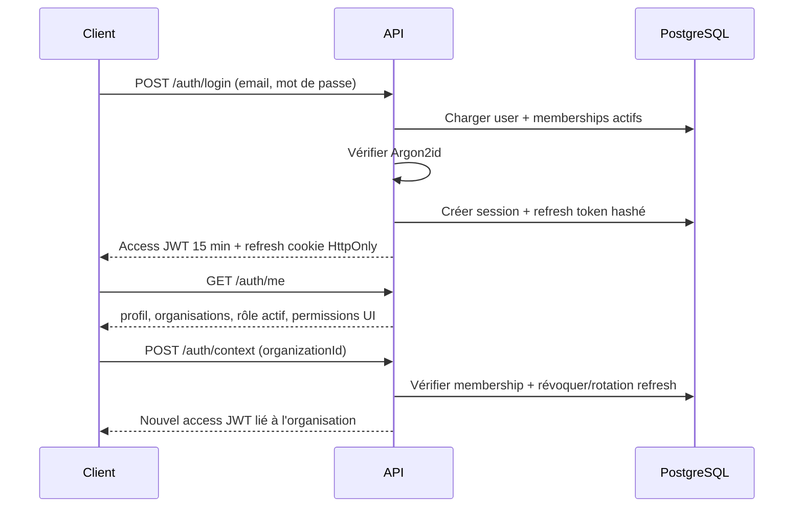
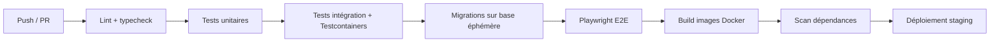

# ARCHITECTURE_OVERVIEW.md — EventPulse Analytics

**Phase :** 3 — Software Architecture & Database Design

**Version :** 1.0

**Date :** 2026-11-18

**Statut :** Conception technique — aucun développement applicatif

**Références :** `docs/phase-1-discovery/*`, `docs/phase-2-ui-ux/*`

---

## 1. Objectif et périmètre

Ce document définit l'architecture générale d'EventPulse Analytics : un SaaS B2B multi-organisations de gestion événementielle et d'analytique. Il sert de cadre aux onze autres livrables de la Phase 3.

**Périmètre de démonstration :**

| Élément | Volume cible |
|---|---|
| Événements | ~20 |
| Inscriptions | ~50 000 |
| Check-ins | ~30 000 |
| Exposants | ~200 |
| Stands | ~500 |
| Historique | 24 mois |

Ces volumes sont une cible de démonstration, pas une garantie de capacité de production.

**Hors périmètre :** microservices, traitement bancaire réel, multi-devises, visiteurs web, IA, notifications produit, haute disponibilité multi-région, SLA commercial.

---

## 2. Principes architecturaux

1. **Monolithe modulaire.** Un seul déploiement API, un worker dédié, des frontières de modules explicites. Pas de microservices.
2. **Le serveur est l'autorité.** Toute permission, tout filtrage d'organisation et toute règle métier sont vérifiés côté backend.
3. **Isolation multi-tenant par construction.** `organization_id` sur chaque entité métier, contraintes de clés étrangères composites, filtrage systématique.
4. **Le worker ne contourne aucune règle.** Il réutilise les services métier du monolithe ; il ne réimplémente ni les transitions ni les KPI.
5. **Idempotence aux frontières.** Imports, exports, ingestion API et workers sont rejouables sans doublon.
6. **Une seule source de calcul analytique.** REST et Socket.IO partagent les mêmes services KPI.
7. **Simplicité avant scalabilité spéculative.** PostgreSQL direct, index ciblés, cache optionnel. Aucun entrepôt de données en V1.
8. **Traçabilité et minimisation.** Audit append-only, PII restreinte, exports pseudonymisés pour les rôles concernés.
9. **Erreurs prévisibles.** Un format unique, des codes stables, des transitions refusées explicitement.
10. **Le frontend réutilise le Design System.** Aucune duplication de règles métier ni de calculs KPI.

---

## 3. Contexte système

### 3.1 Acteurs

| Acteur | Interaction |
|---|---|
| OWNER / ADMIN | Administration, configuration, audit, exports non pseudonymisés |
| EVENT_MANAGER | Gestion des événements assignés, opérations, analytics de son périmètre |
| ANALYST | Analytics agrégés, exports pseudonymisés |
| VIEWER | Lecture de tous les dashboards, y compris Revenue Analytics, sans PII, export ni administration |
| Système externe simulé | Endpoint d'ingestion authentifié par API key |
| Worker | Imports, exports, purge, notifications techniques |

**Arbitrages de clôture (2026-11-18) :** Advanced Analytics est réservé à OWNER et ANALYST (`D-06`) ; un événement a au plus un EVENT_MANAGER responsable, sans co-responsabilité en V1 (`D-09/A-01`).

### 3.2 Diagramme de contexte



---

## 4. Architecture des conteneurs



### 4.1 Responsabilités

| Composant | Responsabilités | Ce qu'il ne fait pas |
|---|---|---|
| **Web SPA** | Navigation, formulaires, affichage des KPI, permissions visuelles, appels REST/WS | Ne calcule aucun KPI, n'applique aucune règle métier, ne stocke aucun secret durable |
| **API** | Authentification, autorisation, validation, orchestration métier, transactions, contrats REST, émission Socket.IO | Ne génère pas de fichiers lourds de façon synchrone |
| **Worker** | Imports, exports, purge, reprises, rapports d'erreurs | Ne décide pas des permissions, ne modifie pas les règles métier |
| **PostgreSQL** | Source de vérité, intégrité, contraintes, historique | Ne contient pas de fichiers binaires volumineux |
| **Redis** | Files BullMQ, rate limiting, cache optionnel | N'est pas une source de vérité métier |
| **Stockage objet** | Fichiers d'import, exports privés | N'est jamais exposé publiquement sans URL signée |

---

## 5. Stack et usages

| Couche | Technologie | Usage précis |
|---|---|---|
| Frontend | React, TypeScript, Vite | SPA desktop-first |
| UI | Tailwind CSS, shadcn/ui, Recharts | Design System Phase 2, graphiques |
| Routage frontend | React Router | Routes définies en Phase 2 |
| État serveur | TanStack Query | Cache, invalidation, reprises |
| Formulaires | React Hook Form + Zod | Validation alignée sur le backend |
| Backend | Node.js, Express.js, TypeScript | API REST modulaire |
| Validation | Zod | Entrées HTTP, variables d'environnement, payloads de jobs |
| ORM | Prisma | Accès typé, migrations versionnées |
| SQL avancé | Requêtes paramétrées + migrations SQL | Contraintes partielles, triggers, index trigram |
| Base | PostgreSQL 16 | Modèle relationnel |
| Files | Redis + BullMQ | Imports, exports, purge |
| Temps réel | Socket.IO | Invalidation des KPI, Should |
| Auth | JWT + refresh rotation, Argon2id | Sessions et RBAC |
| Tests | Vitest, Supertest, Playwright | Unités, API, E2E |
| Docs | OpenAPI 3.1, ADR | Contrats et décisions |
| DevOps | Docker, Docker Compose, GitHub Actions, Sentry | Exécution locale, CI, observabilité |

---

## 6. Organisation du dépôt

```
eventpulse-analytics/
├── apps/
│   ├── web/                    # React + Vite
│   ├── api/                    # Express + TypeScript
│   └── worker/                 # Processus BullMQ
├── packages/
│   └── shared/                 # Types, enums, schémas Zod, constantes
├── prisma/
│   ├── schema.prisma
│   ├── migrations/
│   └── seed/
├── openapi/
│   └── openapi.yaml            # Contrat futur
├── docs/
│   ├── phase-1-discovery/
│   ├── phase-2-ui-ux/
│   └── phase-3-architecture/
├── docker/
│   └── docker-compose.yml
├── .github/workflows/
└── README.md
```

**Justification :** monorepo simple à trois applications et un package partagé. `packages/shared` évite la divergence des enums et des schémas Zod entre web, API et worker.

---

## 7. Cartographie des 15 modules

| # | Module fonctionnel | Module backend | Écrans Phase 2 |
|---|---|---|---|
| 1 | Événements | `events` | Events List, Create/Edit, Event Details |
| 2 | Participants, inscriptions, billets | `participants`, `registrations` | Participants, Participant Details, Registrations |
| 3 | Paiements et remboursements | `payments` | Payments & Refunds |
| 4 | Check-ins | `checkins` | Check-ins |
| 5 | Exposants et stands | `exhibitors` | Exhibitors & Booths |
| 6 | Ingestion | `ingestion` | Imports & Ingestion |
| 7 | Overview | `analytics` | Overview |
| 8 | Event Analytics | `analytics` | Event Analytics |
| 9 | Revenue Analytics | `analytics` | Revenue Analytics |
| 10 | Audience Analytics | `analytics` | Audience Analytics |
| 11 | Exhibitor Analytics | `analytics` | Exhibitor Analytics |
| 12 | Advanced Analytics (Should) | `analytics` (sous-ensemble) | Analytics avancées |
| 13 | Reports & Exports | `reports` | Reports & Exports |
| 14 | Real-time (Should) | `realtime` | Indicateur « En direct » |
| 15 | Administration | `organizations`, `audit` | Membres, Paramètres, Audit |

**Modules transverses :** `auth`, `sessions`, `rbac`, `tenancy`, `storage`, `queue`, `observability`.

---

## 8. Flux de données

### 8.1 Requête REST authentifiée



### 8.2 Import de fichier

1. `POST /imports` dépose le fichier et produit un aperçu validé.
2. `POST /imports/:id/confirm` enqueue un job `import.process`.
3. Le worker applique la stratégie de doublons et écrit par lots.
4. Le rapport d'erreurs est stocké et le statut passe à `COMPLETED` ou `FAILED`.
5. L'audit et le job conservent la référence de fichier et la volumétrie.

### 8.3 Export

1. `POST /exports` crée une ligne `exports` et enqueue `export.generate`.
2. Le worker interroge les services analytiques avec les mêmes filtres.
3. Le fichier est écrit dans le stockage privé, `expires_at` est calculé.
4. `GET /exports/:id/download` délivre une URL signée de 15 minutes.
5. La purge quotidienne supprime les fichiers expirés ; l'accès renvoie 410.

### 8.4 Check-in

1. L'API résout le participant, l'événement et l'inscription dans l'organisation active.
2. Le service vérifie l'éligibilité, la fenêtre et l'unicité du check-in valide.
3. Une opération `VALID` ou `INVALID` est enregistrée avec motif.
4. Aucune mise à jour ni suppression n'est possible ; une correction crée une nouvelle opération.
5. Émission d'une invalidation KPI et d'une activité récente.

### 8.5 Temps réel

1. Le client se connecte à Socket.IO avec son access token.
2. Le serveur l'abonne aux rooms `org:{id}` et, si autorisé, `event:{id}`.
3. Après une écriture métier, le serveur émet `kpi.invalidate` avec la portée concernée.
4. Le client invalide les requêtes TanStack Query et refait un appel REST.
5. Aucun KPI n'est poussé en valeur : le REST reste l'unique source de calcul.

---

## 9. Flux d'authentification



**Règles :**
- L'organisation active est portée par la session et par le claim `org` de l'access token.
- Le rôle n'est pas une vérité durable du token : le backend recharge le membership à chaque requête (ou via un cache court invalidé).
- Le changement d'organisation renouvelle le contexte et le refresh token.
- Une réutilisation de refresh token révoque toute la famille de sessions.

---

## 10. Gestion des erreurs

### 10.1 Chaîne de traitement

```
Erreur métier typée → mapper HTTP → enveloppe Problem Details → log structuré → Sentry si 5xx
```

- Les erreurs attendues (`DomainError`) ne déclenchent pas d'alerte Sentry.
- Les erreurs inattendues sont journalisées avec `request_id`, sans PII ni secret.
- Le worker convertit les erreurs en statut `FAILED` avec motif borné, et applique les retries.
- Le frontend affiche un message actionnable ; les erreurs de validation sont rattachées aux champs.

### 10.2 Catégories

| Catégorie | HTTP | Exemple |
|---|---|---|
| Validation d'entrée | 400/422 | Champ manquant, format invalide |
| Authentification | 401 | Token absent, expiré, session révoquée |
| Autorisation | 403 | Rôle insuffisant sur une ressource connue |
| Introuvable | 404 | Ressource inexistante ou hors organisation |
| Conflit d'état | 409 | Transition invalide, stand déjà réservé |
| Ressource expirée | 410 | Export expiré |
| Limite | 429 | Trop de tentatives, débit d'ingestion |
| Interne | 500 | Erreur non prévue |
| Indisponible | 503 | Dépendance indisponible |

Le détail du format figure dans `API_DESIGN.md` §7.

---

## 11. Configuration par environnement

### 11.1 Environnements

| Environnement | Usage | Données |
|---|---|---|
| `development` | Docker Compose local | Seed synthétique |
| `test` | CI, tests d'intégration | Base éphémère, fixtures |
| `staging` | Démonstration | Données synthétiques |
| `production` | Portfolio déployé | Données fictives uniquement |

### 11.2 Variables principales

| Groupe | Variables | Règles |
|---|---|---|
| Application | `NODE_ENV`, `APP_URL`, `API_PORT`, `LOG_LEVEL` | Validées par Zod au démarrage |
| Base | `DATABASE_URL`, `DATABASE_POOL_MAX` | Secret, jamais loggé |
| Redis | `REDIS_URL`, `QUEUE_PREFIX` | Prefix par environnement |
| Auth | `JWT_ACCESS_SECRET`, `JWT_REFRESH_PEPPER`, `ACCESS_TTL`, `REFRESH_TTL` | Secrets ≥ 32 octets |
| Stockage | `S3_ENDPOINT`, `S3_BUCKET`, `S3_REGION`, `S3_ACCESS_KEY`, `S3_SECRET_KEY` | Bucket privé |
| Exports | `EXPORT_URL_TTL_SECONDS=900`, `EXPORT_DEFAULT_RETENTION_DAYS=30` | Valeurs par défaut Phase 1 |
| Observabilité | `SENTRY_DSN`, `SENTRY_ENVIRONMENT` | Optionnel en local |
| Sécurité | `CORS_ORIGINS`, `RATE_LIMIT_*` | Liste explicite |

**Règle :** l'application refuse de démarrer si une variable obligatoire est absente ou invalide.

---

## 12. Dépendances entre modules

### 12.1 Matrice

Légende : `→` dépend de ; `—` aucune dépendance ; `A` = analytics (lecture seule).

| Module | Dépend de | Ne doit jamais dépendre de |
|---|---|---|
| `auth` | sessions, memberships | analytics, reports |
| `organizations` | memberships, audit | payments, checkins |
| `events` | organizations, audit | analytics |
| `participants` | organizations, audit | payments, reports |
| `registrations` | events, participants, tickets, audit | reports |
| `payments` | registrations, booth_reservations, audit | analytics |
| `checkins` | registrations, events, participants, audit | payments |
| `exhibitors` | events, audit | participants |
| `ingestion` | services des modules ciblés, queue, audit | controllers |
| `analytics` | lecture de tous les modules métier | écriture dans un module métier |
| `reports` | analytics, storage, queue, audit | transitions métier |
| `realtime` | auth, events | calcul KPI propre |
| `audit` | aucune dépendance métier | services métier (sauf journalisation) |

### 12.2 Règles de frontière

- Un module expose un **service public** et des DTO ; il n'expose jamais son repository.
- Les controllers d'un module ne sont jamais appelés par un autre module.
- `analytics` et `reports` sont strictement lecteurs.
- `ingestion` orchestre les services métier ; elle ne duplique pas leurs validations.
- `audit` est un puits append-only ; il ne lit pas les tables métier pour reconstruire l'historique.
- Les dépendances circulaires sont interdites et vérifiées en revue.

---

## 13. Déploiement et exploitation

### 13.1 Topologie Docker Compose

| Service | Rôle | Exposition |
|---|---|---|
| `web` | Build statique servi par Nginx | `:8080` |
| `api` | Express | `:3000` |
| `worker` | BullMQ | Interne |
| `postgres` | PostgreSQL 16 | Interne |
| `redis` | Redis 7 | Interne |
| `minio` | Stockage S3 local | `:9000` (dev) |

### 13.2 CI/CD



- Aucune migration destructive en production.
- Les migrations sont appliquées avant le démarrage API/worker.
- Le déploiement est un rolling restart simple ; pas d'orchestrateur multi-région.

### 13.3 Observabilité

| Signal | Outil | Contenu |
|---|---|---|
| Logs | Pino JSON | `request_id`, `org_id`, `user_id`, `route`, `status`, latence, erreur bornée |
| Erreurs | Sentry | Exceptions 5xx, jobs échoués, frontend |
| Files | BullMQ Board / métriques | Profondeur, échecs, retries, jobs bloqués |
| Santé | `/health/live`, `/health/ready` | Processus, base, Redis |
| Audit | `audit_logs` | Actions sensibles, 11 champs |

**Interdit dans les logs :** mots de passe, tokens, secrets, clés API en clair, PII brute non nécessaire.

---

## 14. Performance et capacité

| Contrainte | Cible | Moyens |
|---|---|---|
| Dashboards | < 2 s sur 50k inscriptions / 30k check-ins | Index composites, agrégations SQL, pagination |
| Listes | < 500 ms | Pagination, index, colonnes projetées |
| Imports | Asynchrones | BullMQ, traitement par lots |
| Exports | Asynchrones | BullMQ, stockage objet |
| Temps réel | Invalidation < 2 s | Socket.IO, rooms ciblées |
| Base | < 5 Go pour le dataset cible | Modèle normalisé, pas de duplication inutile |

**Cache Redis :** optionnel (Should). Clés `org:{id}:kpi:{code}:{hash(params)}`, TTL 30–60 s, invalidées par portée après écriture. Son absence ne dégrade pas la correction.

---

## 15. Risques architecturaux et parades

| Risque | Impact | Parade |
|---|---|---|
| Fuite cross-tenant | Critique | `organization_id` obligatoire, FK composites, repository scopé, tests CI |
| Permission uniquement frontend | Critique | Guards serveur, tests RBAC, revue de matrice |
| Double comptage KPI | Élevé | Requêtes par type, contraintes d'unicité, tests de référence |
| Import partiel dupliqué | Élevé | Idempotence déterministe, transactions par lot, statut explicite |
| Export orphelin | Moyen | Suivi backend, `expires_at`, purge quotidienne |
| Croissance des check-ins | Moyen | Tables append-only, index, pagination |
| Worker en panne | Moyen | Retries, jobs bloqués, supervision, reprise idempotente |
| Requêtes analytiques lentes | Moyen | Index dédiés, `EXPLAIN`, cache optionnel, limites de plage |
| Divergence REST/WS | Élevé | Invalidation uniquement, aucun calcul côté socket |

---

## 16. Décisions architecturales

Les décisions majeures sont détaillées dans `ADR.md` :

| ADR | Décision |
|---|---|
| ADR-001 | Monolithe modulaire + worker dédié |
| ADR-002 | Multi-tenant à schéma partagé avec `organization_id` |
| ADR-003 | RBAC par registre d'actions et portées |
| ADR-004 | JWT court + sessions refresh rotatives liées à l'organisation |
| ADR-005 | Prisma + migrations SQL pour contraintes avancées |
| ADR-006 | Analytique sur base opérationnelle, sans entrepôt |
| ADR-007 | BullMQ avec jobs idempotents |
| ADR-008 | Stockage objet privé + URL signées |
| ADR-009 | REST `/api/v1`, pagination par curseur, Problem Details |
| ADR-010 | Temps réel par invalidation, pas par poussée de valeurs |
| ADR-011 | Soft delete, anonymisation et effacement distincts |

---

## 17. Traçabilité Phase 1 / Phase 2

| Élément | Source |
|---|---|
| 15 modules | PRD §10 |
| Rôles et matrice | PRD §9, Annexe A (Q-09), arbitrage VIEWER 2026-11-18 |
| Règles métier | `BUSINESS_RULES.md` (77 règles) |
| KPI | `KPI_DEFINITIONS.md` (24 KPI) |
| User Stories | `USER_STORIES.md` (53 stories) |
| Écrans et navigation | Phase 2 `INFORMATION_ARCHITECTURE.md`, `SCREEN_SPECIFICATIONS.md` |
| Design System | Phase 2 `DESIGN_SYSTEM.md` |
| NFR | PRD §16 |
| Audit | PRD §18.3, BR-AUD |
| Workers | PRD §18.6, Annexe C |
| Exports | PRD §13.1, Annexes D.5 |

---

## 18. Points en attente

Les points non résolus sont centralisés dans `ARCHITECTURE_VALIDATION_REPORT.md` §6. Les plus structurants :

- Livraison des emails d'invitation et de réinitialisation (aucun fournisseur dans la stack).
- Rétention du journal d'audit (non définie en Phase 1).
- Contenu exact des 5 rapports prédéfinis.
- Colonnes exactes des modèles CSV.
- Choix du fournisseur S3-compatible en staging.

Aucun de ces points ne bloque la conception.

---

*Fin de ARCHITECTURE_OVERVIEW.md — Version 1.0.*
