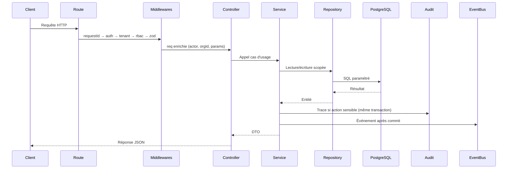
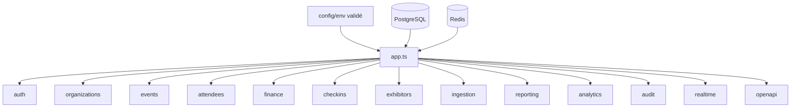

# BACKEND_ARCHITECTURE.md — EventPulse Analytics

**Phase :** 3 — Software Architecture & Database Design
**Version :** 1.0
**Date :** 2026-11-18
**Runtime :** Node.js 22 LTS, Express.js 5, TypeScript 5
**Compléments :** `ARCHITECTURE_OVERVIEW.md`, `DATABASE_DESIGN.md`, `API_DESIGN.md`, `SECURITY_ARCHITECTURE.md`

---

## 1. Principes

1. **Modular monolith** : un seul déploiement API, des modules à frontières explicites.
2. **Couches unidirectionnelles** : route → middleware → controller → service → repository → Prisma.
3. **Aucune logique métier dans les controllers** ni dans les middlewares.
4. **Aucun accès Prisma hors du module propriétaire** de l'entité.
5. **Le tenant est un invariant de service** : aucune méthode métier ne s'exécute sans contexte d'acteur et d'organisation.
6. **Les règles métier restent dans les services**, pas dans les triggers ni dans les schémas Zod.
7. **Prisma est un détail d'infrastructure** : les services dépendent d'interfaces de repository, pas du client Prisma.

---

## 2. Organisation des dossiers

```
apps/api/
  src/
    server.ts                  // bootstrap HTTP, graceful shutdown
    app.ts                     // composition Express
    config/
      env.ts                   // validation Zod des variables d'environnement
      constants.ts
      feature-flags.ts
    shared/
      errors/
        app-error.ts
        error-codes.ts
        http-status-map.ts
        not-found.error.ts
        conflict.error.ts
        forbidden.error.ts
        validation.error.ts
      http/
        async-handler.ts
        responses.ts
        pagination.ts
        problem-details.ts
      middleware/
        request-id.middleware.ts
        authenticate.middleware.ts
        tenant-context.middleware.ts
        authorize.middleware.ts
        validate.middleware.ts
        rate-limit.middleware.ts
        error-handler.middleware.ts
        not-found.middleware.ts
      logger/
        logger.ts
        redact.ts
      events/
        domain-event-bus.ts
      ports/
        audit.port.ts
        storage.port.ts
        mail.port.ts
        realtime.port.ts
        clock.port.ts
      types/
        actor-context.ts
        authenticated-request.ts
        paginated.ts
      utils/
        ids.ts
        dates.ts
        money.ts
        slug.ts
    modules/
      auth/
      organizations/
      events/
      attendees/
      finance/
      checkins/
      exhibitors/
      ingestion/
      reporting/
      analytics/
      audit/
      realtime/
    jobs/
      queues.ts
      producers/
    openapi/
      registry.ts
      document.ts
    tests/
      setup/
      helpers/
  test/
    integration/
    contract/
    e2e/ (Playwright côté web)
```

### 2.1 Structure interne d'un module

```
modules/<module>/
  <module>.routes.ts
  <module>.controller.ts
  <module>.service.ts
  <module>.facade.ts          // interface publique du module
  <module>.schemas.ts         // Zod : params, query, body, réponses
  <module>.dto.ts             // DTO d'entrée/sortie
  <module>.mapper.ts          // entité ⇄ DTO
  <module>.types.ts
  <module>.errors.ts          // erreurs métier spécifiques
  repositories/
    <entity>.repository.ts
  services/
    <use-case>.service.ts     // quand le service principal devient trop large
  __tests__/
    <module>.service.test.ts
    <module>.routes.test.ts
```

**Règle :** un module n'importe jamais un fichier interne d'un autre module. Il n'utilise que son `facade`, ses `types` publics et les ports partagés.

---

## 3. Rôle des couches

| Couche | Responsabilité | Interdit |
|---|---|---|
| Route | Déclaration du chemin, middlewares, mapping vers controller | Logique métier, accès données |
| Controller | Extraire contexte, appeler le service, sérialiser la réponse | Prisma, règles métier, transactions |
| Service | Orchestration, règles métier, transactions, audit, événements | Accès HTTP, formatage de réponse |
| Repository | Requêtes Prisma, filtres tenant, mapping persistance | Règles métier, HTTP |
| Schema Zod | Forme et typage des entrées/sorties | Règles métier inter-entités |
| Mapper | Transformation entité ↔ DTO | Requêtes, effets de bord |
| Middleware | Authentification, tenant, RBAC, validation, erreurs | Accès métier |

### 3.1 Flux d'une requête



### 3.2 Transactions

- `withTransaction(fn)` expose un client Prisma transactionnel aux repositories du module.
- Niveau d'isolation par défaut : `READ COMMITTED`.
- Verrous explicites (`SELECT ... FOR UPDATE`) uniquement pour :
  - plafond de remboursement ;
  - réservation de stand ;
  - protection du dernier OWNER ;
  - transitions d'import.
- Un service ne réalise jamais d'appel HTTP externe à l'intérieur d'une transaction.

### 3.3 Événements internes

| Événement | Producteur | Consommateur |
|---|---|---|
| `registration.confirmed` | attendees | analytics (invalidation), realtime, audit |
| `registration.cancelled` | attendees | analytics, realtime, audit |
| `checkin.recorded` | checkins | analytics, realtime, audit |
| `transaction.paid` | finance | analytics, realtime, audit |
| `refund.created` | finance | analytics, realtime, audit |
| `booth.reserved` / `booth.released` | exhibitors | analytics, realtime, audit |
| `import.completed` / `import.failed` | ingestion | realtime, audit |
| `export.completed` / `export.failed` | reporting | realtime, audit |
| `membership.changed` | organizations | audit, realtime |

Règles :

- Émission **après commit** uniquement.
- Bus in-process synchrone et non bloquant ; aucune garantie de livraison persistée.
- L'audit critique n'utilise pas le bus : il est écrit dans la transaction.
- Les consommateurs sont idempotents et ne recalculent jamais une règle métier.

---

## 4. Modules métier

### 4.1 `auth`

**Responsabilités :** inscription implicite via invitation, connexion, déconnexion, refresh rotation, mot de passe oublié/réinitialisation, sélection d'organisation, sessions actives.

| Élément | Contenu |
|---|---|
| Entités | `users`, `sessions`, `password_reset_tokens` |
| Services | `AuthService`, `TokenService`, `PasswordService`, `SessionService` |
| Dépendances autorisées | `organizations.facade` (memberships de l'utilisateur), `audit.port` |
| Dépendances interdites | `analytics`, `finance`, `reporting`, `ingestion` |
| Interface publique | `AuthFacade.verifyCredentials`, `AuthFacade.getActorContext`, `AuthFacade.revokeUserSessions` |

**Règles portées :** Argon2id, access token 15 min, refresh 7 jours glissants, détection de réutilisation, session liée à l'organisation active, verrouillage après échecs répétés (rate limit).

### 4.2 `organizations`

**Responsabilités :** organisations, memberships, invitations, rôles, dernières protections OWNER, clés API, paramètres de l'organisation.

| Élément | Contenu |
|---|---|
| Entités | `organizations`, `memberships`, `invitations`, `api_keys` |
| Services | `OrganizationService`, `MembershipService`, `InvitationService`, `ApiKeyService` |
| Dépendances autorisées | `auth.facade` (création utilisateur), `audit.port`, `mail.port` |
| Dépendances interdites | `analytics`, `finance`, `checkins`, `exhibitors` |
| Interface publique | `OrganizationsFacade.getActiveMembership`, `assertRole`, `listUserOrganizations`, `getSettings` |

**Règles portées :** dernier OWNER protégé, ADMIN ne modifie pas OWNER, portée des rôles, invitation unique en attente, clé API restreinte à `ingestion:write` ; le `CHECK` SQL laisse passer `{}` et les doublons, à refuser côté service.

### 4.3 `events`

**Responsabilités :** CRUD événements, transitions de statut, affectation du manager, billets, paramètres de fenêtre de check-in.

| Élément | Contenu |
|---|---|
| Entités | `events`, `tickets` |
| Services | `EventService`, `EventStatusService`, `TicketService`, `EventScopeService` |
| Dépendances autorisées | `organizations.facade` (vérification membership), `attendees.facade` (comptages bloquants), `audit.port` |
| Dépendances interdites | `finance` (écritures), `analytics`, `reporting` |
| Interface publique | `EventsFacade.getEvent`, `assertEventAccess`, `assertEventWritable`, `listManagedEventIds`, `getCheckInWindow` |

**Règles portées :** transitions `DRAFT → PUBLISHED → ONGOING → COMPLETED → ARCHIVED`, annulation, `CANCELLED`/`ARCHIVED` terminaux, soft delete limité, billet lié à l'événement, manager actif de la même organisation.

### 4.4 `attendees`

**Responsabilités :** participants, inscriptions, cycle de vie de l'inscription, fusion, anonymisation et effacement définitif des participants.

| Élément | Contenu |
|---|---|
| Entités | `participants`, `registrations` |
| Services | `ParticipantService`, `ParticipantMergeService`, `RegistrationService`, `RegistrationImportHandler` |
| Dépendances autorisées | `events.facade`, `finance.facade` (paiement associé), `checkins.facade` (blocage de suppression), `audit.port` |
| Dépendances interdites | `analytics`, `reporting`, `exhibitors` |
| Interface publique | `AttendeesFacade.getRegistration`, `countByEvent`, `existsPaidRegistration`, `importRows` |

**Règles portées :** statuts d'inscription, transitions, email non unique, source d'inscription, fusion manuelle, anonymisation, effacement définitif conditionnel, suppression conditionnelle.

### 4.5 `finance`

**Responsabilités :** transactions billet et stand, statuts de paiement, remboursements, plafond cumulé.

| Élément | Contenu |
|---|---|
| Entités | `transactions`, `refunds` |
| Services | `TransactionService`, `RefundService`, `RevenueLedgerService` |
| Dépendances autorisées | `attendees.facade`, `exhibitors.facade`, `audit.port` |
| Dépendances interdites | `analytics`, `reporting`, `ingestion` |
| Interface publique | `FinanceFacade.hasPaidTransaction`, `hasRefund`, `getTransactionForRegistration`, `createBoothTransaction` |

**Règles portées :** montant original immuable, remboursement indépendant, cumul ≤ montant, devise EUR, une transaction par inscription/réservation.

### 4.6 `checkins`

**Responsabilités :** enregistrement des check-ins, validation d'éligibilité, motifs d'invalidation, historique immuable.

| Élément | Contenu |
|---|---|
| Entités | `check_ins` |
| Services | `CheckInService`, `CheckInEligibilityService`, `CheckInIngestService` |
| Dépendances autorisées | `events.facade` (fenêtre), `attendees.facade` (inscription), `audit.port`, `realtime.port` |
| Dépendances interdites | `finance` (écritures), `reporting`, `exhibitors` |
| Interface publique | `CheckInsFacade.record`, `existsValidCheckIn`, `countByEvent`, `importRows` |

**Règles portées :** inscription CONFIRMED requise, fenêtre `[start − ouvert, end + fermé]`, 8 motifs, doublon VALID interdit, 3 modes de saisie, immuabilité.

### 4.7 `exhibitors`

**Responsabilités :** exposants, stands, réservations, libération, occupation.

| Élément | Contenu |
|---|---|
| Entités | `exhibitors`, `booths`, `booth_reservations` |
| Services | `ExhibitorService`, `BoothService`, `BoothReservationService`, `OccupancyService` |
| Dépendances autorisées | `events.facade`, `finance.facade`, `audit.port` |
| Dépendances interdites | `analytics`, `attendees`, `ingestion` |
| Interface publique | `ExhibitorsFacade.getReservation`, `listForEvent`, `countActiveReservations` |

**Règles portées :** une réservation active par stand, `UNAVAILABLE` non réservable, libération horodatée, prix figé, transaction stand unique.

### 4.8 `ingestion`

**Responsabilités :** dépôt d'import, validation du fichier, calcul d'idempotence, création des jobs, suivi, rapport d'erreurs.

| Élément | Contenu |
|---|---|
| Entités | `imports` |
| Services | `ImportService`, `ImportUploadService`, `ImportPreviewService`, `ImportStatusService` |
| Dépendances autorisées | `events.facade`, `attendees.facade` (délégation d'écriture), `checkins.facade`, `storage.port`, `audit.port`, `queue` |
| Dépendances interdites | `analytics`, `reporting`, `finance` (écriture directe) |
| Interface publique | `IngestionFacade.acceptUpload`, `getStatus`, `handleJob` |

**Règles portées :** CSV obligatoire, Excel Should, idempotence déterministe, aperçu obligatoire, traitement asynchrone, stratégies de doublons, isolation par organisation.

### 4.9 `reporting`

**Responsabilités :** demandes d'export, 5 rapports prédéfinis, génération asynchrone, métadonnées, expiration, liens signés.

| Élément | Contenu |
|---|---|
| Entités | `exports` |
| Services | `ExportRequestService`, `ExportJobService`, `ReportCatalogService`, `ExportAccessService` |
| Dépendances autorisées | `analytics.facade`, `organizations.facade` (rétention), `storage.port`, `audit.port`, `queue` |
| Dépendances interdites | écritures dans les modules opérationnels |
| Interface publique | `ReportingFacade.request`, `getStatus`, `authorizeDownload` |

**Règles portées :** cinq rapports nommés, PDF/Excel/CSV, pseudonymisation selon rôle, URL signée 15 min, 410 après expiration, suivi backend obligatoire.

### 4.10 `analytics`

**Responsabilités :** calcul et exposition des 24 KPI, agrégations, filtres temporels, comparaisons, séries.

| Élément | Contenu |
|---|---|
| Entités | Aucune écriture ; lecture des tables opérationnelles |
| Services | `KpiCatalog`, `OverviewService`, `EventAnalyticsService`, `RevenueAnalyticsService`, `AudienceAnalyticsService`, `ExhibitorAnalyticsService`, `ComparisonService` |
| Dépendances autorisées | `events.facade`, `organizations.facade` (périmètre), `shared/dates` |
| Dépendances interdites | Tout repository d'écriture, tout service opérationnel modifiant l'état |
| Interface publique | `AnalyticsFacade.getOverview`, `getEventKpis`, `getRevenueKpis`, `getAudienceKpis`, `getExhibitorKpis`, `getReportDataset` |

**Exception assumée :** analytics possède une couche de requêtes SQL en lecture seule sur les tables opérationnelles pour la performance. Cette couche est isolée dans `analytics/repositories/readonly/` et n'expose aucune écriture. Voir `ANALYTICS_ARCHITECTURE.md`.

### 4.11 `audit`

**Responsabilités :** écriture et consultation du journal d'audit, catégories, filtres, export d'audit (si autorisé).

| Élément | Contenu |
|---|---|
| Entités | `audit_logs` |
| Services | `AuditWriter`, `AuditQueryService` |
| Dépendances autorisées | Aucune dépendance métier |
| Dépendances interdites | Tous les modules métier (sens unique entrant) |
| Interface publique | `AuditPort.record(event)`, `AuditFacade.list` |

**Règles portées :** 6 catégories, 12 champs, append-only, métadonnées bornées, jamais de secret ni de PII.

### 4.12 `realtime`

**Responsabilités :** diffusion Socket.IO des invalidations et notifications, authentification de socket, rooms par organisation et événement.

| Élément | Contenu |
|---|---|
| Entités | Aucune |
| Services | `RealtimeGateway`, `RealtimePublisher`, `SocketAuthService` |
| Dépendances autorisées | `auth.facade` (vérification token), `organizations.facade` (rôle) |
| Dépendances interdites | `analytics` (aucun calcul), tous les repositories |
| Interface publique | `RealtimePort.publish(orgId, event, payload)` |

**Règles portées :** Should, pas de KPI calculé côté socket, rooms strictement scopées, aucune donnée PII.

### 4.13 `platform` (transverse, non métier)

| Composant | Responsabilité |
|---|---|
| `config/env` | Validation Zod des variables au démarrage |
| `logger` | Pino, requestId, redaction |
| `storage` | S3-compatible, URLs signées |
| `mail` | Invitations, réinitialisation |
| `queue` | Producteurs BullMQ |
| `events` | Bus interne |
| `openapi` | Registre de schémas |
| `errors` | Taxonomie commune |

---

## 5. Matrice de dépendances

`→` signifie « peut dépendre de ». L'absence de flèche signifie interdiction.

| Module | Peut dépendre de |
|---|---|
| auth | organizations (facade), audit (port), platform |
| organizations | auth (facade), audit, platform |
| events | organizations, attendees (facade lecture), audit, platform |
| attendees | events, finance (facade), checkins (facade lecture), audit, platform |
| finance | attendees, exhibitors, audit, platform |
| checkins | events, attendees, audit, realtime, platform |
| exhibitors | events, finance, audit, platform |
| ingestion | events, attendees, checkins, storage, queue, audit, platform |
| reporting | analytics, organizations, storage, queue, audit, platform |
| analytics | events (facade), organizations (facade), platform |
| audit | platform |
| realtime | auth (facade), organizations (facade), platform |

### 5.1 Règles de frontière

**Autorisé :**

- Appel à une `facade` publique.
- Utilisation des ports partagés (`audit`, `storage`, `mail`, `realtime`, `clock`).
- Événements de domaine après commit.
- Requêtes analytics en lecture seule.

**Interdit :**

- Import d'un repository d'un autre module.
- Import direct du client Prisma dans un autre module.
- Dépendance circulaire entre modules.
- Appel d'un service d'écriture d'un autre module pour contourner sa facade.
- Accès aux tables d'un autre module hors analytics (lecture) et audit.
- Middleware portant une règle métier.
- Controller réalisant une transaction.

**Contrôle :** règles ESLint `no-restricted-imports` + revue de PR + test d'architecture.

---

## 6. Middlewares

| Ordre | Middleware | Rôle |
|---|---|---|
| 1 | `requestId` | Génère/propage `X-Request-Id` |
| 2 | `requestLogger` | Log structuré, durée, statut |
| 3 | `securityHeaders` | Helmet, CORS, body limit |
| 4 | `rateLimit` | Global et renforcé sur auth/ingestion |
| 5 | `authenticate` | Vérifie JWT ou API key |
| 6 | `tenantContext` | Résout l'organisation active et le membership |
| 7 | `authorize` | Vérifie le rôle et la portée événement |
| 8 | `validate` | Zod params/query/body |
| 9 | `handler` | Controller |
| 10 | `notFound` | 404 Problem Details |
| 11 | `errorHandler` | Traduction des erreurs |

**Points d'attention :**

- `authenticate` ne charge pas les permissions métier détaillées.
- `tenantContext` recharge le membership à chaque requête : un changement de rôle est immédiatement effectif.
- L'API key ne peut pas atteindre `tenantContext` utilisateur : elle est limitée aux routes d'ingestion.
- Un token dont le claim `org` diffère de l'organisation résolue est rejeté.

---

## 7. Gestion des erreurs

### 7.1 Taxonomie

| Classe | HTTP | Usage |
|---|---|---|
| `ValidationError` | 400 | Corps, query ou params invalides |
| `AuthenticationError` | 401 | Token absent, invalide, expiré |
| `ForbiddenError` | 403 | Rôle ou portée insuffisants |
| `NotFoundError` | 404 | Ressource absente **ou hors tenant** |
| `ConflictError` | 409 | Doublon, transition invalide, réservation concurrente |
| `UnprocessableEntityError` | 422 | Règle métier violée sur une entité valide |
| `PayloadTooLargeError` | 413 | Fichier ou corps trop volumineux |
| `RateLimitError` | 429 | Quota |
| `GoneError` | 410 | Export expiré |
| `InternalError` | 500 | Erreur non prévue |
| `ServiceUnavailableError` | 503 | Dépendance indisponible |

### 7.2 Format

Toutes les erreurs suivent un format unique inspiré de Problem Details :

```json
{
  "type": "https://api.eventpulse.dev/errors/registration-not-confirmed",
  "title": "Registration not confirmed",
  "status": 422,
  "code": "CHK_REGISTRATION_NOT_CONFIRMED",
  "detail": "Check-in requires a confirmed registration.",
  "instance": "/api/v1/check-ins",
  "requestId": "req_01J...",
  "errors": [
    { "path": "registrationId", "code": "invalid", "message": "..." }
  ]
}
```

### 7.3 Règles

- Aucun message interne, stack trace ou requête SQL exposé.
- Les erreurs Prisma sont traduites (`P2002` → 409, `P2025` → 404).
- Les erreurs de trigger PostgreSQL sont traduites par code applicatif connu.
- Toute erreur 500 est journalisée avec `requestId`, sans PII.
- Un accès cross-tenant retourne 404, jamais 403.

---

## 8. Configuration

- Validation **Zod** au démarrage ; l'application refuse de démarrer si une variable obligatoire manque.
- Aucune valeur secrète par défaut.
- Variables par environnement, jamais commitées.

| Catégorie | Variables |
|---|---|
| Runtime | `NODE_ENV`, `PORT`, `LOG_LEVEL`, `TRUST_PROXY_HOPS` |
| Base | `DATABASE_URL`, `DATABASE_RUNTIME_URL`, `DATABASE_POOL_SIZE` |
| Auth | `JWT_ACCESS_SECRET`, `REFRESH_TOKEN_PEPPER`, `PASSWORD_RESET_TOKEN_PEPPER`, `JWT_ACCESS_TTL_SECONDS`, `REFRESH_SLIDING_TTL_SECONDS`, `SESSION_ABSOLUTE_TTL_SECONDS` |
| Redis | `REDIS_URL`, `REDIS_KEY_PREFIX` |
| Storage | `S3_ENDPOINT`, `S3_REGION`, `S3_BUCKET`, `S3_ACCESS_KEY`, `S3_SECRET_KEY` |
| Mail | `SMTP_URL`, `MAIL_FROM` |
| Observabilité | `SENTRY_DSN`, `LOG_LEVEL` |
| Limites | `RATE_LIMIT_*`, `MAX_UPLOAD_MB` |
| Workers | `WORKER_CONCURRENCY_*` |

---

## 9. Logging

- **Pino** en JSON, un log par requête avec `requestId`, `userId` (identifiant opaque), `organizationId`, `route`, `status`, `duration`.
- **Redaction** : `authorization`, `cookie`, `password`, `token`, `refreshToken`, `apiKey`, `email`, `phone`, `firstName`, `lastName`.
- Les logs métier (`registration.cancelled`) sont structurés et sans PII.
- Sentry reçoit les exceptions 500 et les erreurs de jobs, avec tags `organizationId` et `requestId`.
- Aucun log de payload complet sur les imports.

---

## 10. Tests backend

| Niveau | Emplacement | Portée |
|---|---|---|
| Unitaires | `modules/**/__tests__/*.test.ts` | Services, règles, mappers |
| Intégration | `tests/integration` | Repository + PostgreSQL réel |
| API | `tests/integration` via Supertest | Routes, middlewares, statuts |
| Isolation | `tests/integration/tenant` | Accès cross-organization |
| RBAC | `tests/integration/rbac` | 5 rôles × routes sensibles |
| Workers | `apps/worker/test` | Jobs, retries, idempotence |

Détail et couverture cible : `TESTING_STRATEGY.md`.

---

## 11. Composition et démarrage



- Arrêt gracieux : arrêt des nouvelles requêtes, attente des requêtes en cours, fermeture Prisma, Redis et Socket.IO.
- Le worker est un processus séparé, voir `WORKERS_ARCHITECTURE.md`.

---

## 12. Traçabilité

| Élément | Source |
|---|---|
| 15 modules produit → 12 modules backend | PRD §10 |
| 5 rôles | PRD §11.1 |
| RBAC serveur | PRD §18.2, BR-ORG-003 |
| Audit 6 catégories | PRD §18.3, BR-AUD-003 |
| Imports/exports asynchrones | BR-IMP, BR-EXP |
| KPI en lecture seule | `KPI_DEFINITIONS.md` |
| Socket.IO sans calcul | BR-RT-001 |
| Check-ins immuables | BR-CHK-006 |

---

## 13. Points ouverts

- Express 5 vs Express 4 : le comportement des erreurs asynchrones diffère ; à figer en Phase 4.
- Bibliothèque de validation OpenAPI : `zod-to-openapi` retenu conceptuellement, à confirmer.
- Bus interne vs outbox : l'absence d'outbox est assumée pour un monolithe ; à réévaluer si les consommateurs deviennent critiques.
- Politique de retry sur le mail d'invitation : à préciser.

---

*Fin de BACKEND_ARCHITECTURE.md — Version 1.0.*
