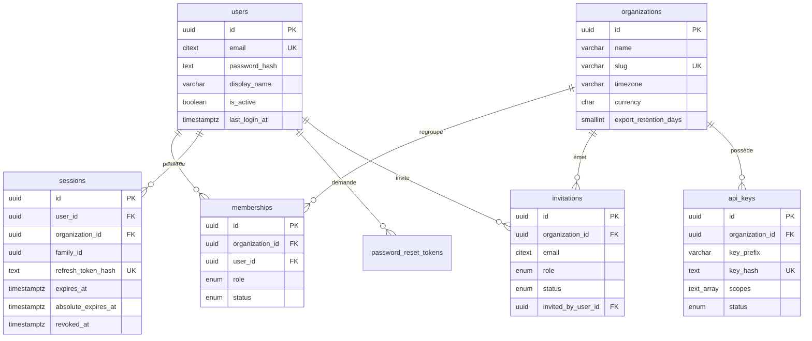
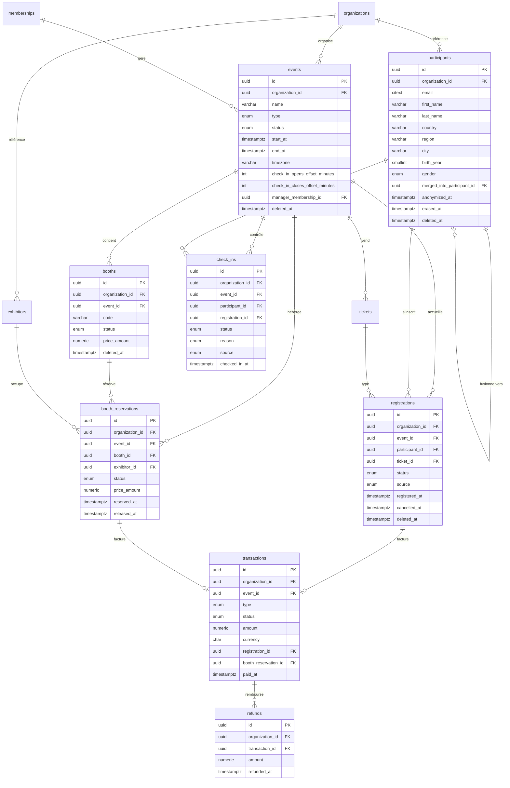
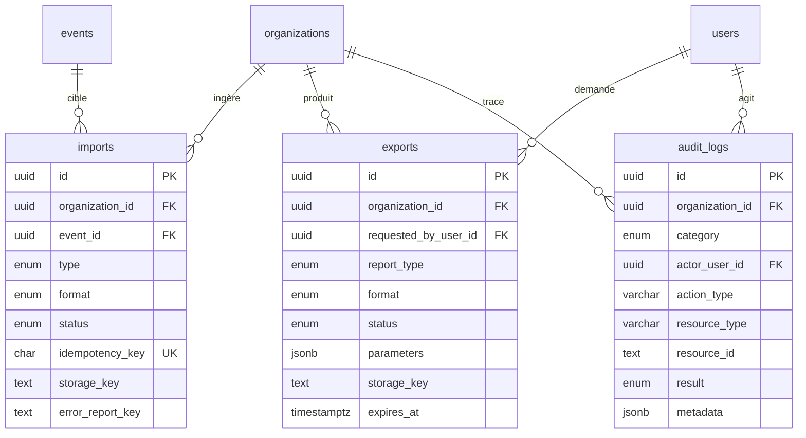

# DATABASE_DESIGN.md — EventPulse Analytics

**Phase :** 3 — Software Architecture & Database Design
**Version :** 1.0
**Date :** 2026-11-18
**Base :** PostgreSQL 16
**ORM :** Prisma (schéma conceptuel dans `PRISMA_SCHEMA_DESIGN.md`)
**Références :** PRD v1.1, `BUSINESS_RULES.md` v1.0, `KPI_DEFINITIONS.md` v1.0, Phase 2

---

## 1. Conventions

| Sujet | Convention |
|---|---|
| Nommage SQL | Tables et colonnes en `snake_case`, au pluriel pour les tables |
| Nommage Prisma | Modèles `PascalCase`, champs `camelCase`, mappés en `snake_case` |
| Clé primaire | `id uuid`, généré côté application ou `gen_random_uuid()` |
| Horodatage | `timestamptz(3)`, toujours UTC |
| Montants | `numeric(12,2)` ; devise `char(3)` limitée à `EUR` en V1 |
| Booléens | `boolean NOT NULL`, valeur par défaut explicite (`false`, sauf `users.is_active` à `true`) |
| Multi-tenant | `organization_id uuid NOT NULL` sur toute entité métier |
| Soft delete | `deleted_at timestamptz NULL` uniquement sur les entités éligibles |
| Timestamps | `created_at` sur toutes les tables ; `updated_at` sur les 14 entités mutables qui le portent |
| Immuabilité | `check_ins`, `refunds`, `audit_logs` : ni update ni delete |
| Emails | `citext` pour l'insensibilité à la casse, sans contrainte d'unicité pour les participants |
| Identifiants référencés | UUID ; `resource_id` d'audit en `text` pour accepter les références externes |

**Extensions PostgreSQL :** `citext` (obligatoire) et `pg_trgm` (obligatoire). Les deux sont créées par la migration initiale `20261121225300_init_database_schema` ; `20261122105000_trgm_indexes` dépend de `pg_trgm` et échouerait sans elle. Aucune migration ne supprime ces extensions (le scanner refuse `DROP EXTENSION pg_trgm`).

---

## 2. Vue d'ensemble

### 2.1 Domaines

| Domaine | Tables |
|---|---|
| Identité et accès | `users`, `sessions`, `password_reset_tokens` |
| Organisations | `organizations`, `memberships`, `invitations`, `api_keys` |
| Événements | `events`, `tickets` |
| Participants | `participants` |
| Inscriptions | `registrations` |
| Finances | `transactions`, `refunds` |
| Présence | `check_ins` |
| Exposants | `exhibitors`, `booths`, `booth_reservations` |
| Asynchrone | `imports`, `exports` |
| Traçabilité | `audit_logs` |

**Total : 20 tables métier**, hors table technique `_prisma_migrations` gérée par Prisma. Aucune table de cache, de snapshot KPI ou de file persistée n'est ajoutée : Redis/BullMQ couvre les files, PostgreSQL reste la source de vérité métier.

### 2.2 Choix structurants

1. **Un seul Event Manager responsable par événement** via `events.manager_membership_id`, conformément à la décision D-09/A-01 du 2026-11-18. La multi-assignation et la co-responsabilité ne sont pas prévues en V1. Lors d'un remplacement, la valeur est mise à jour : l'ancien responsable perd son affectation et le nouveau devient l'unique responsable.
2. **Aucune clé d'identité basée sur l'email.** `participants.email` est indexé mais non unique.
3. **Un remboursement est une entité indépendante**, jamais une modification du montant d'origine.
4. **Les check-ins invalides sont conservés** même lorsque le participant, l'inscription ou l'événement est introuvable : les clés étrangères correspondantes sont nullables.
5. **Les contraintes conditionnelles** (réservation active unique, check-in valide unique, transaction unique par inscription) sont implémentées par index partiels SQL, pas par Prisma.
6. **Les fichiers** d'import et d'export ne sont pas stockés en base ; seule leur clé de stockage et leurs métadonnées le sont.

---

## 3. Diagrammes ERD

### 3.1 Identité, organisations et accès



### 3.2 Événements, participants et opérations



### 3.3 Asynchrone et audit



---

## 4. Dictionnaire de données

Légende : `NN` = NOT NULL, `N` = NULL autorisé, `PK` = clé primaire, `FK` = clé étrangère.

### 4.1 `users`

| Champ | Type | Null | Contraintes / description |
|---|---|---|---|
| `id` | uuid | NN | PK |
| `email` | citext | NN | Unique global ; identifiant de connexion |
| `password_hash` | text | NN | Argon2id |
| `display_name` | varchar(150) | NN | Nom affiché |
| `is_active` | boolean | NN | Défaut `true` ; désactivation via membership |
| `last_login_at` | timestamptz(3) | N | Dernière connexion réussie |
| `created_at` | timestamptz(3) | NN | Défaut `now()` |
| `updated_at` | timestamptz(3) | NN | Mise à jour applicative |

**Index :** `users_email_uq` (unique sur `email`).
**Règles :** aucun soft delete utilisateur ; la suspension se fait par `memberships.status`.

### 4.2 `sessions`

| Champ | Type | Null | Contraintes / description |
|---|---|---|---|
| `id` | uuid | NN | PK |
| `user_id` | uuid | NN | FK `users.id` |
| `organization_id` | uuid | N | FK `organizations.id` ; contexte actif ; null avant sélection |
| `family_id` | uuid | NN | Famille de rotation pour détection de réutilisation |
| `refresh_token_hash` | text | NN | Unique ; jamais en clair |
| `expires_at` | timestamptz(3) | NN | Expiration glissante du refresh |
| `absolute_expires_at` | timestamptz(3) | NN | Plafond absolu de la session ; l'expiration effective est le minimum des deux |
| `revoked_at` | timestamptz(3) | N | Révocation |
| `replaced_by_session_id` | uuid | N | FK `sessions.id` ; chaîne de rotation |
| `ip_address` | inet | N | Contexte de connexion |
| `user_agent` | text | N | Contexte de connexion |
| `created_at` | timestamptz(3) | NN | Défaut `now()` |
| `last_used_at` | timestamptz(3) | N | Dernier refresh |

**Index :** unique `refresh_token_hash` ; `(user_id, revoked_at)` ; `(family_id)` ; `(expires_at)`.
**Règles :** une réutilisation d'un token révoqué révoque toute la famille. Le changement d'organisation crée une nouvelle session dans la même famille et révoque l'ancienne. La rotation repousse `expires_at` sans jamais dépasser `absolute_expires_at`, renseigné à la création de la session (30 jours par défaut).

### 4.3 `password_reset_tokens`

| Champ | Type | Null | Contraintes / description |
|---|---|---|---|
| `id` | uuid | NN | PK |
| `user_id` | uuid | NN | FK `users.id` |
| `token_hash` | text | NN | Unique |
| `expires_at` | timestamptz(3) | NN | Courte durée |
| `used_at` | timestamptz(3) | N | Usage unique |
| `created_at` | timestamptz(3) | NN | Défaut `now()` |

**Index :** unique `token_hash` ; `(user_id, expires_at)`.
**Règles :** jamais de token en clair ; un token utilisé ou expiré est refusé.

### 4.4 `organizations`

| Champ | Type | Null | Contraintes / description |
|---|---|---|---|
| `id` | uuid | NN | PK |
| `name` | varchar(150) | NN | Nom |
| `slug` | varchar(80) | NN | Unique, normalisé |
| `timezone` | varchar(64) | NN | IANA, défaut `Europe/Paris` |
| `currency` | char(3) | NN | Défaut `EUR` ; `CHECK (currency = 'EUR')` |
| `export_retention_days` | smallint | NN | Défaut 30 ; `CHECK (1..365)` |
| `created_at` | timestamptz(3) | NN | Défaut `now()` |
| `updated_at` | timestamptz(3) | NN | Mise à jour applicative |

**Index :** unique `slug`.
**Règles :** la devise n'est pas modifiable en V1 ; le fuseau est validé contre la base IANA.

### 4.5 `memberships`

| Champ | Type | Null | Contraintes / description |
|---|---|---|---|
| `id` | uuid | NN | PK |
| `organization_id` | uuid | NN | FK `organizations.id` |
| `user_id` | uuid | NN | FK `users.id` |
| `role` | enum `Role` | NN | `OWNER`, `ADMIN`, `EVENT_MANAGER`, `ANALYST`, `VIEWER` |
| `status` | enum `MembershipStatus` | NN | `ACTIVE`, `DISABLED` |
| `joined_at` | timestamptz(3) | NN | Défaut `now()` |
| `disabled_at` | timestamptz(3) | N | Renseigné si désactivé |
| `created_at` | timestamptz(3) | NN | Défaut `now()` |
| `updated_at` | timestamptz(3) | NN | Mise à jour applicative |

**Contraintes :** `UNIQUE (organization_id, user_id)` ; `UNIQUE (organization_id, id)` pour les FK composites.
**Index :** `(user_id, status)` ; `(organization_id, role, status)`.
**Règles :** un seul rôle par membership ; le dernier OWNER actif est protégé par transaction applicative et verrou d'organisation. La désactivation (`status = DISABLED`, `disabled_at`) révoque les sessions de l'utilisateur pour cette organisation dans la **même transaction** ; cette conséquence reste applicative, pas un trigger SQL. La création/rotation de session verrouille l'organisation (`FOR KEY SHARE`, cohérent avec la FK `sessions.organization_id`) puis la ligne de membership (`FOR UPDATE` avant le verrou utilisateur et l'insertion de session) : une désactivation concurrente et une émission de session ne peuvent pas s'entrelacer pour laisser une session active. Aucune colonne de version ni migration n'est nécessaire, le verrouillage suffit.

### 4.6 `invitations`

| Champ | Type | Null | Contraintes / description |
|---|---|---|---|
| `id` | uuid | NN | PK |
| `organization_id` | uuid | NN | FK `organizations.id` |
| `email` | citext | NN | Destinataire |
| `role` | enum `Role` | NN | Rôle proposé |
| `status` | enum `InvitationStatus` | NN | `PENDING`, `ACCEPTED`, `REVOKED`, `EXPIRED` |
| `token_hash` | text | NN | Unique |
| `invited_by_user_id` | uuid | NN | FK `users.id` |
| `expires_at` | timestamptz(3) | NN | Défaut applicatif |
| `accepted_at` | timestamptz(3) | N | Acceptation |
| `revoked_at` | timestamptz(3) | N | Révocation |
| `created_at` | timestamptz(3) | NN | Défaut `now()` |

**Index :** unique `token_hash` ; index partiel unique `(organization_id, email) WHERE status = 'PENDING'` ; `(organization_id, status, created_at)`.
**Règles :** le token est stocké uniquement sous forme de hash HMAC et sert de preuve d'email limitée à cette invitation ; il n'existe pas de colonne `email_verified` globale. Une invitation `PENDING` est consommée exactement une fois (`status = ACCEPTED`) dans la transaction qui crée ou réutilise le compte, crée le membership si nécessaire et émet la session. Les acceptations verrouillent l'organisation (`FOR UPDATE`) **avant** la ligne d'invitation (`FOR UPDATE`), le même ordre que la création/révocation : la course acceptation/révocation est sérialisée sans inversion de verrous. Un membership existant incompatible (statut ou rôle différent) ne consomme pas l'invitation ; un membre déjà actif avec le rôle invité consomme le token de façon idempotente, sans doublon de membership (même politique pour les flux public et authentifié). L'unicité partielle `(organization_id, email) WHERE status = 'PENDING'` et le verrou de ligne sur `token_hash` protègent les acceptations concurrentes. Un ADMIN ne peut pas inviter un OWNER.

### 4.7 `api_keys`

| Champ | Type | Null | Contraintes / description |
|---|---|---|---|
| `id` | uuid | NN | PK |
| `organization_id` | uuid | NN | FK `organizations.id` |
| `name` | varchar(100) | NN | Libellé |
| `key_prefix` | varchar(16) | NN | Préfixe affichable |
| `key_hash` | text | NN | Unique ; hash à sens unique |
| `scopes` | text[] | NN | Défaut `{ingestion:write}` ; `CHECK (scopes <@ ARRAY['ingestion:write'])` |
| `status` | enum `ApiKeyStatus` | NN | `ACTIVE`, `REVOKED` |
| `last_used_at` | timestamptz(3) | N | Dernier appel |
| `expires_at` | timestamptz(3) | N | Expiration optionnelle |
| `revoked_at` | timestamptz(3) | N | Révocation |
| `created_by_user_id` | uuid | NN | FK `users.id` |
| `created_at` | timestamptz(3) | NN | Défaut `now()` |
| `updated_at` | timestamptz(3) | NN | Mise à jour applicative |

**Index :** unique `key_hash` ; `(organization_id, status)`.
**Règles :** le secret n'est jamais stocké ni journalisé ; seul le hash et le préfixe sont conservés. `expires_at` est optionnel mais doit être strictement futur à la création/rotation ; une clé dont `expires_at <= now()` n'est plus valide. La rotation révoque l'ancienne ligne (`status = REVOKED`, `revoked_at`) et insère une nouvelle ligne dans la même transaction, en conservant `scopes` et, par défaut, `name`/`expires_at`.

### 4.8 `events`

| Champ | Type | Null | Contraintes / description |
|---|---|---|---|
| `id` | uuid | NN | PK |
| `organization_id` | uuid | NN | FK `organizations.id` |
| `name` | varchar(200) | NN | Nom |
| `type` | enum `EventType` | NN | `EXHIBITION`, `CONFERENCE`, `WORKSHOP`, `TRADE_SHOW`, `OTHER` |
| `status` | enum `EventStatus` | NN | Défaut `DRAFT` ; valeurs `DRAFT`, `PUBLISHED`, `ONGOING`, `COMPLETED`, `ARCHIVED`, `CANCELLED` |
| `start_at` | timestamptz(3) | NN | Début |
| `end_at` | timestamptz(3) | NN | Fin |
| `timezone` | varchar(64) | NN | Fuseau IANA |
| `location` | varchar(255) | N | Lieu |
| `description` | text | N | Description |
| `check_in_opens_offset_minutes` | integer | NN | Défaut `-120` |
| `check_in_closes_offset_minutes` | integer | NN | Défaut `120` |
| `manager_membership_id` | uuid | N | FK composite `(organization_id, id)` vers `memberships` |
| `created_at` | timestamptz(3) | NN | Défaut `now()` |
| `updated_at` | timestamptz(3) | NN | Mise à jour applicative |
| `deleted_at` | timestamptz(3) | N | Soft delete |

**Contraintes :**
- `CHECK (end_at > start_at)`.
- `CHECK (check_in_opens_offset_minutes <= check_in_closes_offset_minutes)`.
- `UNIQUE (organization_id, id)` pour les FK composites.
- FK composite `(organization_id, manager_membership_id)` → `memberships(organization_id, id)`.
**Index :** `(organization_id, status, start_at)` ; `(organization_id, type)` ; `(organization_id, manager_membership_id)` ; index GIN trigram `events_name_trgm_idx`.
**Règles :** le manager doit être un membership actif de la même organisation et de rôle `EVENT_MANAGER` ; le rôle est vérifié côté service. Un événement a au plus un manager responsable. Lors d'une réassignation, `manager_membership_id` est remplacé : l'ancien responsable perd l'affectation et le nouveau devient l'unique responsable. Transitions `DRAFT → PUBLISHED → ONGOING → COMPLETED → ARCHIVED`, annulation possible depuis `DRAFT`/`PUBLISHED`/`ONGOING` ; `CANCELLED` et `ARCHIVED` sont terminaux ; `ONGOING`, `COMPLETED` et `ARCHIVED` ne sont jamais supprimés ; `ARCHIVED` reste inclus dans l'historique analytique et exclu des vues de performance courante.

### 4.9 `tickets`

| Champ | Type | Null | Contraintes / description |
|---|---|---|---|
| `id` | uuid | NN | PK |
| `organization_id` | uuid | NN | FK `organizations.id` |
| `event_id` | uuid | NN | FK composite `(organization_id, event_id)` |
| `name` | varchar(100) | NN | Nom du billet |
| `price_amount` | numeric(12,2) | NN | `CHECK (price_amount >= 0)` |
| `currency` | char(3) | NN | Défaut `EUR` ; `CHECK = 'EUR'` |
| `created_at` | timestamptz(3) | NN | Défaut `now()` |
| `updated_at` | timestamptz(3) | NN | Mise à jour applicative |
| `deleted_at` | timestamptz(3) | N | Soft delete |

**Contraintes :** `UNIQUE (organization_id, id)`.
**Index :** `(organization_id, event_id)` ; index unique `(organization_id, event_id, id)` pour la cohérence événementielle.
**Règles :** suppression uniquement sans inscription ; le prix est figé dans la transaction au moment de sa création.

### 4.10 `participants`

| Champ | Type | Null | Contraintes / description |
|---|---|---|---|
| `id` | uuid | NN | PK |
| `organization_id` | uuid | NN | FK `organizations.id` |
| `first_name` | varchar(100) | NN | Prénom |
| `last_name` | varchar(100) | NN | Nom |
| `email` | citext | NN | Non unique ; normalisé à l'écriture |
| `phone` | varchar(30) | N | Optionnel |
| `country` | varchar(2) | N | ISO-3166 alpha-2 |
| `region` | varchar(100) | N | Optionnel |
| `city` | varchar(100) | N | Optionnel |
| `birth_year` | smallint | N | `CHECK (birth_year BETWEEN 1900 AND 2100)` |
| `gender` | enum `Gender` | N | `FEMALE`, `MALE`, `NON_BINARY`, `UNDISCLOSED`, `UNKNOWN` |
| `anonymized_at` | timestamptz(3) | N | Anonymisation irréversible |
| `erased_at` | timestamptz(3) | N | Effacement définitif des PII ; identifiant technique conservé si des références subsistent |
| `merged_into_participant_id` | uuid | N | FK self, cible de fusion |
| `created_at` | timestamptz(3) | NN | Défaut `now()` |
| `updated_at` | timestamptz(3) | NN | Mise à jour applicative |
| `deleted_at` | timestamptz(3) | N | Soft delete / participant absorbé |

**Contraintes :** `UNIQUE (organization_id, id)` ; `CHECK (merged_into_participant_id <> id)`.
**Index :** `(organization_id, email)` ; `(organization_id, last_name, first_name)` ; `(organization_id, country, region, city)` ; index GIN trigram `participants_first_name_trgm_idx`, `participants_last_name_trgm_idx` et `participants_email_trgm_idx` (expression `((email)::text)`).
**Règles :** email non unique ; fusion complète et auditée ; un participant fusionné n'est plus actif ; anonymisation et effacement définitif sont irréversibles et distincts.

### 4.11 `registrations`

| Champ | Type | Null | Contraintes / description |
|---|---|---|---|
| `id` | uuid | NN | PK |
| `organization_id` | uuid | NN | FK `organizations.id` |
| `event_id` | uuid | NN | FK composite |
| `participant_id` | uuid | NN | FK composite |
| `ticket_id` | uuid | NN | FK composite |
| `status` | enum `RegistrationStatus` | NN | `PENDING`, `CONFIRMED`, `CANCELLED`, `WAITLISTED` |
| `source` | enum `RegistrationSource` | NN | `MANUAL`, `IMPORT`, `INGESTION_API`, `PARTNER`, `OTHER` |
| `source_detail` | varchar(100) | N | Précision optionnelle |
| `registered_at` | timestamptz(3) | NN | Défaut `now()` ; date KPI |
| `cancelled_at` | timestamptz(3) | N | Renseigné si annulé |
| `created_at` | timestamptz(3) | NN | Défaut `now()` |
| `updated_at` | timestamptz(3) | NN | Mise à jour applicative |
| `deleted_at` | timestamptz(3) | N | Soft delete sans paiement ni check-in |

**Contraintes :** `UNIQUE (organization_id, id)` ; FK composites vers `events`, `participants`, `tickets` incluant `organization_id`.
**Index :** `(organization_id, event_id, status, registered_at)` ; `(organization_id, participant_id, registered_at)` ; `(organization_id, ticket_id)`.
**Règles :** le billet doit appartenir au même événement ; aucune contrainte d'unicité participant/événement (plusieurs inscriptions autorisées).

### 4.12 `transactions`

| Champ | Type | Null | Contraintes / description |
|---|---|---|---|
| `id` | uuid | NN | PK |
| `organization_id` | uuid | NN | FK `organizations.id` |
| `event_id` | uuid | NN | FK composite |
| `type` | enum `TransactionType` | NN | `TICKET`, `BOOTH` |
| `status` | enum `TransactionStatus` | NN | Défaut `PENDING` ; `PENDING`, `PAID`, `FAILED`, `CANCELLED`, `PARTIALLY_REFUNDED`, `REFUNDED` |
| `amount` | numeric(12,2) | NN | `CHECK (amount > 0)` |
| `currency` | char(3) | NN | Défaut `EUR` ; `CHECK = 'EUR'` |
| `registration_id` | uuid | N | FK composite ; requis si `TICKET` |
| `booth_reservation_id` | uuid | N | FK composite ; requis si `BOOTH` |
| `paid_at` | timestamptz(3) | N | Date KPI des revenus |
| `created_at` | timestamptz(3) | NN | Défaut `now()` |
| `updated_at` | timestamptz(3) | NN | Mise à jour applicative |

**Contraintes :**
- `CHECK ((type = 'TICKET' AND registration_id IS NOT NULL AND booth_reservation_id IS NULL) OR (type = 'BOOTH' AND booth_reservation_id IS NOT NULL AND registration_id IS NULL))`.
- `CHECK ((status IN ('PAID','PARTIALLY_REFUNDED','REFUNDED')) = (paid_at IS NOT NULL))`.
- `UNIQUE (organization_id, id)`.
- Index partiel unique `(registration_id) WHERE type = 'TICKET'`.
- Index partiel unique `(booth_reservation_id) WHERE type = 'BOOTH'`.
**Index :** `(organization_id, event_id, paid_at)` ; `(organization_id, type, status, paid_at)` ; `(organization_id, created_at)`.
**Règles :** aucun soft delete ; le montant original est immuable ; une inscription produit au plus une transaction `TICKET` en V1.

### 4.13 `refunds`

| Champ | Type | Null | Contraintes / description |
|---|---|---|---|
| `id` | uuid | NN | PK |
| `organization_id` | uuid | NN | FK `organizations.id` |
| `transaction_id` | uuid | NN | FK composite `(organization_id, transaction_id)` |
| `amount` | numeric(12,2) | NN | `CHECK (amount > 0)` |
| `currency` | char(3) | NN | Défaut `EUR` ; `CHECK = 'EUR'` |
| `refunded_at` | timestamptz(3) | NN | Défaut `now()` ; date KPI |
| `reason` | varchar(255) | N | Motif libre |
| `created_by_user_id` | uuid | N | FK `users.id` |
| `created_at` | timestamptz(3) | NN | Défaut `now()` |

**Contraintes :** `UNIQUE (organization_id, id)` ; cumul `SUM(refunds.amount) ≤ transactions.amount` garanti par trigger.
**Index :** `(organization_id, refunded_at)` ; `(organization_id, transaction_id, refunded_at)`.
**Règles :** immuable ; aucune modification ni suppression ; la transaction doit être `PAID` ou `PARTIALLY_REFUNDED`.

### 4.14 `check_ins`

| Champ | Type | Null | Contraintes / description |
|---|---|---|---|
| `id` | uuid | NN | PK |
| `organization_id` | uuid | NN | FK `organizations.id` |
| `event_id` | uuid | N | FK composite ; nullable si événement introuvable |
| `participant_id` | uuid | N | FK composite ; nullable si participant introuvable |
| `registration_id` | uuid | N | FK composite ; nullable si inscription introuvable |
| `status` | enum `CheckInStatus` | NN | `VALID`, `INVALID` |
| `reason` | enum `CheckInReason` | N | Requis si `INVALID`, interdit si `VALID` ; `OUTSIDE_WINDOW`, `DUPLICATE`, `REGISTRATION_CANCELLED`, `REGISTRATION_NOT_CONFIRMED`, `REGISTRATION_NOT_FOUND`, `PARTICIPANT_NOT_FOUND`, `EVENT_NOT_FOUND`, `EVENT_CANCELLED` |
| `source` | enum `CheckInSource` | NN | `MANUAL`, `CSV`, `INGESTION_API` |
| `checked_in_at` | timestamptz(3) | NN | Défaut `now()` ; date KPI |
| `created_by_user_id` | uuid | N | FK `users.id` ; null pour une source API |
| `created_at` | timestamptz(3) | NN | Défaut `now()` |

**Contraintes :**
- `CHECK ((status = 'VALID' AND reason IS NULL AND event_id IS NOT NULL AND participant_id IS NOT NULL AND registration_id IS NOT NULL) OR (status = 'INVALID' AND reason IS NOT NULL))`.
- `UNIQUE (organization_id, id)`.
- Index partiel unique `(organization_id, event_id, participant_id) WHERE status = 'VALID'`.
**Index :** `(organization_id, event_id, checked_in_at)` ; `(organization_id, participant_id, event_id)` ; `(organization_id, reason, checked_in_at)` ; `(organization_id, status, checked_in_at)`.
**Règles :** aucun update ni delete ; une correction crée une nouvelle ligne.

### 4.15 `exhibitors`

| Champ | Type | Null | Contraintes / description |
|---|---|---|---|
| `id` | uuid | NN | PK |
| `organization_id` | uuid | NN | FK `organizations.id` |
| `name` | varchar(150) | NN | Nom |
| `contact_name` | varchar(150) | N | Contact |
| `email` | citext | N | Contact |
| `phone` | varchar(30) | N | Contact |
| `website` | varchar(255) | N | Site |
| `description` | text | N | Description |
| `created_at` | timestamptz(3) | NN | Défaut `now()` |
| `updated_at` | timestamptz(3) | NN | Mise à jour applicative |
| `deleted_at` | timestamptz(3) | N | Soft delete |

**Contraintes :** `UNIQUE (organization_id, id)`.
**Index :** `(organization_id, name)` ; index GIN trigram `exhibitors_name_trgm_idx`.
**Règles :** un exposant peut réserver plusieurs stands et participer à plusieurs événements.

### 4.16 `booths`

| Champ | Type | Null | Contraintes / description |
|---|---|---|---|
| `id` | uuid | NN | PK |
| `organization_id` | uuid | NN | FK `organizations.id` |
| `event_id` | uuid | NN | FK composite |
| `code` | varchar(50) | NN | Numéro/code |
| `zone` | varchar(100) | N | Zone |
| `area_sqm` | numeric(8,2) | N | `CHECK (area_sqm >= 0)` |
| `status` | enum `BoothStatus` | NN | Défaut `AVAILABLE` |
| `price_amount` | numeric(12,2) | N | `CHECK (price_amount >= 0)` ; optionnel |
| `currency` | char(3) | NN | Défaut `EUR` ; `CHECK = 'EUR'` |
| `created_at` | timestamptz(3) | NN | Défaut `now()` |
| `updated_at` | timestamptz(3) | NN | Mise à jour applicative |
| `deleted_at` | timestamptz(3) | N | Soft delete |

**Contraintes :** `UNIQUE (organization_id, id)` ; index partiel unique `(organization_id, event_id, code) WHERE deleted_at IS NULL`.
**Index :** `(organization_id, event_id, status, zone)`.
**Règles :** `UNAVAILABLE` non réservable et exclu du dénominateur d'occupation ; un stand réservé ne peut pas devenir indisponible sans libération.

### 4.17 `booth_reservations`

| Champ | Type | Null | Contraintes / description |
|---|---|---|---|
| `id` | uuid | NN | PK |
| `organization_id` | uuid | NN | FK `organizations.id` |
| `event_id` | uuid | NN | FK composite |
| `booth_id` | uuid | NN | FK composite |
| `exhibitor_id` | uuid | NN | FK composite |
| `status` | enum `ReservationStatus` | NN | `ACTIVE`, `RELEASED` |
| `price_amount` | numeric(12,2) | N | Snapshot du prix au moment de la réservation |
| `currency` | char(3) | NN | Défaut `EUR` ; `CHECK = 'EUR'` |
| `reserved_at` | timestamptz(3) | NN | Défaut `now()` ; date KPI |
| `released_at` | timestamptz(3) | N | Renseigné si libéré |
| `created_by_user_id` | uuid | N | FK `users.id` |
| `created_at` | timestamptz(3) | NN | Défaut `now()` |
| `updated_at` | timestamptz(3) | NN | Mise à jour applicative |

**Contraintes :**
- `CHECK ((status = 'ACTIVE' AND released_at IS NULL) OR (status = 'RELEASED' AND released_at IS NOT NULL))`.
- `UNIQUE (organization_id, id)`.
- Index partiel unique `(booth_id) WHERE status = 'ACTIVE'`.
**Index :** `(organization_id, event_id, status)` ; `(organization_id, exhibitor_id, status)` ; `(organization_id, booth_id, status)`.
**Règles :** une seule réservation active par stand ; l'historique des réservations libérées est conservé.

### 4.18 `imports`

| Champ | Type | Null | Contraintes / description |
|---|---|---|---|
| `id` | uuid | NN | PK |
| `organization_id` | uuid | NN | FK `organizations.id` |
| `event_id` | uuid | N | FK composite ; contexte optionnel |
| `type` | enum `ImportType` | NN | `PARTICIPANTS`, `REGISTRATIONS`, `CHECKINS`, `PAYMENTS` |
| `format` | enum `ImportFormat` | NN | `CSV`, `XLSX` |
| `status` | enum `ImportStatus` | NN | Défaut `PENDING` |
| `idempotency_key` | char(64) | NN | Hash déterministe sans timestamp |
| `duplicate_strategy` | enum `DuplicateStrategy` | NN | `SKIP`, `UPDATE`, `ERROR` |
| `original_filename` | varchar(255) | NN | Nom d'origine |
| `storage_key` | text | NN | Fichier source privé |
| `preview_metadata` | jsonb | N | Colonnes, comptages, avertissements |
| `error_report_key` | text | N | Rapport d'erreurs privé |
| `total_rows` | integer | NN | Défaut 0 |
| `processed_rows` | integer | NN | Défaut 0 |
| `success_rows` | integer | NN | Défaut 0 |
| `error_rows` | integer | NN | Défaut 0 |
| `created_by_user_id` | uuid | NN | FK `users.id` |
| `started_at` | timestamptz(3) | N | Début de traitement |
| `completed_at` | timestamptz(3) | N | Fin |
| `error_code` | varchar(50) | N | Motif borné |
| `error_message` | varchar(500) | N | Message borné, sans PII |
| `created_at` | timestamptz(3) | NN | Défaut `now()` |
| `updated_at` | timestamptz(3) | NN | Mise à jour applicative |

**Contraintes :** `UNIQUE (organization_id, idempotency_key)`.
**Index :** `(organization_id, status, created_at)` ; `(organization_id, event_id)`.
**Règles :** aucune soft delete ; le fichier source et le rapport sont purgés selon la politique de rétention documentée (point ouvert).

### 4.19 `exports`

| Champ | Type | Null | Contraintes / description |
|---|---|---|---|
| `id` | uuid | NN | PK |
| `organization_id` | uuid | NN | FK `organizations.id` |
| `requested_by_user_id` | uuid | NN | FK `users.id` |
| `report_type` | enum `ReportType` | NN | `EVENT_PERFORMANCE`, `FINANCIAL`, `ATTENDANCE`, `EXHIBITORS`, `EVENT_COMPARISON` |
| `format` | enum `ExportFormat` | NN | `PDF`, `XLSX`, `CSV` |
| `status` | enum `ExportStatus` | NN | Défaut `PENDING` |
| `parameters` | jsonb | NN | Période, événements, KPI, options |
| `pseudonymized` | boolean | NN | `true` pour ANALYST et EVENT_MANAGER |
| `storage_key` | text | N | Fichier généré |
| `file_size_bytes` | bigint | N | Taille |
| `expires_at` | timestamptz(3) | N | `created_at + retention` |
| `generated_at` | timestamptz(3) | N | Fin de génération |
| `downloaded_at` | timestamptz(3) | N | Dernier téléchargement |
| `error_message` | varchar(500) | N | Motif borné |
| `created_at` | timestamptz(3) | NN | Défaut `now()` |
| `updated_at` | timestamptz(3) | NN | Mise à jour applicative |

**Index :** `(organization_id, status, created_at)` ; `(organization_id, requested_by_user_id, created_at)` ; `(status, expires_at)`.
**Règles :** le suivi backend est obligatoire ; l'interface d'historique est Should ; un export expiré renvoie 410.

### 4.20 `audit_logs`

| Champ | Type | Null | Contraintes / description |
|---|---|---|---|
| `id` | uuid | NN | PK |
| `organization_id` | uuid | NN | FK `organizations.id` |
| `category` | enum `AuditCategory` | NN | `AUTH`, `USERS_ROLES`, `ORGANIZATION`, `SENSITIVE_DATA`, `FINANCIAL`, `INGESTION` |
| `actor_user_id` | uuid | N | FK `users.id` ; null pour action système |
| `action_type` | varchar(80) | NN | Identifiant stable |
| `resource_type` | varchar(50) | NN | Type de ressource |
| `resource_id` | text | N | Identifiant ou référence |
| `result` | enum `AuditResult` | NN | `SUCCESS`, `FAILURE` |
| `metadata` | jsonb | NN | Défaut `{}` ; borné |
| `ip_address` | inet | N | Optionnel |
| `user_agent` | text | N | Optionnel |
| `created_at` | timestamptz(3) | NN | UTC |

**Contraintes :** `CHECK (pg_column_size(metadata) <= 8192)`.
**Index :** `(organization_id, created_at DESC)` ; `(organization_id, category, created_at DESC)` ; `(organization_id, actor_user_id, created_at DESC)` ; `(organization_id, resource_type, resource_id, created_at DESC)`.
**Règles :** append-only ; aucun update ni delete ; aucun secret ni PII brute.

---

## 5. Relations cardinales

| Relation | Cardinalité | Intégrité |
|---|---|---|
| Organization → Membership | 1..N | Un membership par couple org/utilisateur |
| Organization → Event | 1..N | `organization_id` obligatoire |
| Organization → Participant | 1..N | Identité interne scopée |
| Organization → Exhibitor | 1..N | — |
| User → Membership | 1..N | Un rôle par organisation |
| User → Session | 1..N | Familles rotatives |
| Membership → Event (manager) | 1..N | 0..1 manager par événement |
| Event → Ticket | 1..N | Billet mono-événement |
| Event → Registration | 1..N | — |
| Participant → Registration | 1..N | Plusieurs inscriptions autorisées |
| Ticket → Registration | 1..N | Billet du même événement |
| Registration → Transaction `TICKET` | 1..0..1 | Unicité partielle |
| BoothReservation → Transaction `BOOTH` | 1..0..1 | Unicité partielle |
| Transaction → Refund | 1..N | Cumul plafonné |
| Event → CheckIn | 1..N | Événement nullable pour motif introuvable |
| Participant → CheckIn | 1..N | Participant nullable pour motif introuvable |
| Event → Booth | 1..N | Code unique par événement |
| Booth → BoothReservation | 1..N | Une seule active |
| Exhibitor → BoothReservation | 1..N | Multi-événements |
| Organization → Import / Export | 1..N | Suivi asynchrone |
| Organization → AuditLog | 1..N | Append-only |

---

## 6. Contraintes d'intégrité

### 6.1 Isolation multi-tenant

1. `organization_id` est `NOT NULL` sur toutes les tables métier.
2. Les tables parents exposent `UNIQUE (organization_id, id)`.
3. Les 19 clés étrangères composites incluent `organization_id`. Parmi elles, **6 sont des FK à 3 colonnes de cohérence événementielle** (voir point 4) et 13 sont des FK composites à 2 colonnes. Les principales :
   - `registrations (organization_id, event_id) → events`
   - `registrations (organization_id, participant_id) → participants`
   - `registrations (organization_id, event_id, ticket_id) → tickets` (3 colonnes)
   - `transactions (organization_id, event_id, registration_id) → registrations` (3 colonnes)
   - `transactions (organization_id, event_id, booth_reservation_id) → booth_reservations` (3 colonnes)
   - `check_ins (organization_id, event_id) → events`
   - `check_ins (organization_id, event_id, registration_id) → registrations` (3 colonnes)
   - `check_ins (organization_id, participant_id, registration_id) → registrations` (3 colonnes)
   - `booths (organization_id, event_id) → events`
   - `booth_reservations (organization_id, event_id, booth_id) → booths` (3 colonnes)
   - `refunds (organization_id, transaction_id) → transactions`
4. Les FK 3 colonnes de cohérence événementielle référencent des contraintes uniques 3 colonnes (`tickets_org_event_id_uq`, `booths_org_event_id_uq`, `registrations_org_event_id_uq`, `registrations_org_participant_id_uq`, `booth_reservations_org_event_id_uq`) avec `ON UPDATE RESTRICT ON DELETE RESTRICT`. Elles empêchent qu'un billet, un stand, une inscription, une réservation ou un check-in référence une ligne d'un autre événement. Les FK composites à 2 colonnes qu'elles remplacent ont été supprimées dans `20261122101000_event_integrity_constraints`, avec directive explicite du scanner ; aucune FK simple parallèle ne subsiste pour ces relations.
5. Les colonnes nullables de `check_ins` utilisent `MATCH SIMPLE` : la cohérence s'applique dès qu'une référence est présente. Le CHECK `check_ins_status_reason_chk` exige les trois références pour un check-in `VALID`.
6. Une référence croisée entre organisations ou entre événements est impossible au niveau SQL, pas seulement applicatif.
7. Le catalogue effectif est contrôlé par `npm run db:verify:integrity` (19 FK composites, 6 index partiels, 25 CHECK, 5 contraintes uniques, 18 triggers, 5 index trigram, 3 tables immuables), soit 126 contrôles exécutés.

### 6.2 Contraintes conditionnelles (index partiels)

| Contrainte | Définition | Règle |
|---|---|---|
| Réservation active unique | `UNIQUE (booth_id) WHERE status = 'ACTIVE'` | BR-EXH-003 |
| Check-in valide unique | `UNIQUE (organization_id, event_id, participant_id) WHERE status = 'VALID'` | BR-CHK-005 |
| Transaction billet unique | `UNIQUE (registration_id) WHERE type = 'TICKET'` | BR-REG-001, KPI-REV-006 |
| Transaction stand unique | `UNIQUE (booth_reservation_id) WHERE type = 'BOOTH'` | BR-EXH-005 |
| Code stand unique | `UNIQUE (organization_id, event_id, code) WHERE deleted_at IS NULL` | BR-EXH-002 |
| Invitation en attente unique | `UNIQUE (organization_id, email) WHERE status = 'PENDING'` | US-ORG-01 |

Les six index partiels uniques sont créés par `20261121231500_integrity_constraints` et vérifiés par `npm run db:verify:integrity` (nom, table, définition et caractère unique).

### 6.3 Contraintes de vérification

- Dates d'événement cohérentes, offsets de check-in ordonnés.
- Montants strictement positifs pour transactions et remboursements ; prix de billet et de stand positifs ou nuls.
- Devise `EUR` uniquement.
- Cohérence type/référence de transaction.
- Cohérence statut payé/`paid_at`.
- Cohérence statut/réservation libérée.
- Check-in `VALID` complet et sans motif ; `INVALID` avec motif.
- Métadonnées d'audit bornées.

### 6.4 Triggers d'intégrité

| Trigger | Table | Rôle |
|---|---|---|
| `trg_refund_cap` | `refunds` | Verrouille la transaction, vérifie le cumul ≤ montant payé, refuse sinon |
| `trg_checkin_immutable` | `check_ins` | Refuse UPDATE et DELETE |
| `trg_audit_immutable` | `audit_logs` | Refuse UPDATE et DELETE |
| `trg_refund_immutable` | `refunds` | Refuse UPDATE et DELETE |
| `trg_touch_updated_at` | 14 tables mutables | Met à jour `updated_at` si la valeur est absente ou identique à l'ancienne |

**Sécurité de `enforce_refund_cap()` :** la fonction est créée avec `SET search_path = pg_catalog, public` et référence `public."transactions"` / `public."refunds"` explicitement (`20261122107000_refund_cap_search_path`). Une table temporaire masquant un nom de relation est neutralisée par la qualification ; un schéma persistant détourné est neutralisé par le `search_path` fixé. La sérialisation des inserts concurrents repose sur `SELECT … FOR UPDATE` sous le niveau d'isolation `READ COMMITTED` par défaut.

**Note :** les transitions de statut métier restent dans les services, pas dans les triggers, afin de conserver des messages d'erreur explicites et auditables.

**Sémantique exacte de `trg_touch_updated_at` :** le trigger est `BEFORE UPDATE`, `FOR EACH ROW`, et exécute :

```sql
IF NEW."updated_at" IS NOT DISTINCT FROM OLD."updated_at" THEN
  NEW."updated_at" := now();
END IF;
```

Conséquences :

- une mise à jour SQL directe qui omet `updated_at` est rafraîchie ;
- une valeur explicite différente est respectée ;
- une valeur explicite identique à l'ancienne est rafraîchie, car un trigger `BEFORE UPDATE` ne peut pas distinguer « omis » de « fourni identique » ;
- le trigger n'est jamais installé sur `check_ins`, `refunds` ni `audit_logs`, qui sont immuables.

**Immuabilité :** les triggers `prevent_immutable_mutation()` refusent toute opération `UPDATE` ou `DELETE` sur les trois tables d'historique, avec une exception SQL explicite (`restrict_violation`) mentionnant la table et l'opération. Les FK acteurs `ON DELETE SET NULL` restent en place ; supprimer un utilisateur référencé par une ligne immuable échoue donc, conformément à l'absence de suppression utilisateur (suspension via `memberships.status`).

---

## 7. Stratégie d'indexation

### 7.1 Index de liste et de filtre

| Table | Index | Usage |
|---|---|---|
| `events` | `(organization_id, status, start_at)` | Liste, dashboard, filtres |
| `participants` | `(organization_id, last_name, first_name)` | Recherche |
| `participants` | `(organization_id, email)` | Correspondance par email |
| `registrations` | `(organization_id, event_id, status, registered_at)` | Listes et KPI |
| `check_ins` | `(organization_id, event_id, checked_in_at)` | Historique et présence |
| `transactions` | `(organization_id, type, status, paid_at)` | Revenus |
| `refunds` | `(organization_id, refunded_at)` | Remboursements |
| `booths` | `(organization_id, event_id, status, zone)` | Occupation |
| `booth_reservations` | `(organization_id, exhibitor_id, status)` | Exposants |
| `imports` | `(organization_id, status, created_at)` | Suivi |
| `exports` | `(status, expires_at)` | Purge |
| `audit_logs` | `(organization_id, created_at DESC)` | Consultation |

### 7.2 Index de recherche textuelle

- `pg_trgm` sur `participants.first_name`, `participants.last_name`, `participants.email`, `exhibitors.name`, `events.name`.
- Les colonnes `varchar` utilisent l'opclasse `gin_trgm_ops`. `participants.email` est de type `citext` : l'index est une expression `((email)::text) gin_trgm_ops`.
- La recherche doit utiliser `(email)::text ILIKE %q%` pour employer l'index email ; un `ILIKE` directement sur `citext` peut ne pas le sélectionner.
- Recherche `ILIKE %q%` avec limite et tri ; pas de recherche plein texte en V1.

### 7.3 Règles

- Aucun index sur les colonnes peu sélectives seules (`status`, `type`).
- Les index composites placent `organization_id` en première position.
- Les index uniques partiels libèrent l'unicité après suppression logique lorsque la règle métier l'exige (code de stand, invitation en attente).
- Chaque index est justifié par une requête de liste, de KPI ou de purge.
- Les index sont vérifiés par `EXPLAIN (ANALYZE, BUFFERS)` sur le jeu de 50k inscriptions.

---

## 8. Multi-tenancy

### 8.1 Défense en profondeur

| Couche | Contrôle |
|---|---|
| Session | `organization_id` actif vérifié à chaque requête |
| Token | Claim `org` ; incohérence → 401/403 |
| Service | Contexte acteur obligatoire, aucune méthode sans `organizationId` |
| Repository | Filtre `organization_id` systématique ; aucun `findUnique(id)` nu |
| SQL | FK composites et `organization_id` NOT NULL |
| Tests | Suite cross-tenant obligatoire en CI |

### 8.2 Traitement des accès croisés

- Une ressource appartenant à une autre organisation est traitée comme **introuvable** (404), afin de ne pas révéler son existence.
- Une ressource connue mais interdite au rôle retourne **403**.
- Les identifiants d'organisation sont toujours dérivés de la session, jamais d'un paramètre client non vérifié.

---

## 9. Cycle de vie des données

| Entité | Soft delete | Anonymisation | Effacement physique |
|---|---|---|---|
| `events` | Oui, DRAFT/CANCELLED | Non | Jamais si COMPLETED |
| `participants` | Oui | Oui, PII remplacées | PII uniquement, données comptables conservées |
| `registrations` | Oui, sans paiement/check-in | Non | Non |
| `tickets` | Oui, sans inscription | Non | Non |
| `exhibitors` | Oui | Non | Non |
| `booths` | Oui, sans réservation active | Non | Non |
| `transactions` | Non | Non | Jamais |
| `refunds` | Non | Non | Jamais |
| `check_ins` | Non | Non | Jamais |
| `imports` | Non | Non | Fichiers selon rétention (point ouvert) |
| `exports` | Non | Fichier supprimé à expiration | Oui, fichier uniquement |
| `audit_logs` | Non | Non | Rétention non définie (point ouvert) |

**Participant fusionné :** `merged_into_participant_id` renseigné et `deleted_at` positionné ; toutes les références métier sont réaffectées au participant conservé.

**Participant anonymisé :** email, téléphone, nom, prénom, ville, région, pays et année de naissance remplacés par des valeurs pseudonymes ; `anonymized_at` renseigné ; l'identifiant interne est conservé.

**Participant effacé :** PII purgées et `erased_at` renseigné ; la ligne est supprimée physiquement si aucune référence métier ne subsiste. Un participant lié à une transaction ou un remboursement ne peut pas être effacé (BR-PAR-004, BR-DEL-003).

---

## 10. Contraintes nécessitant des migrations SQL personnalisées

| # | Élément | Raison |
|---|---|---|
| SQL-01 | Extension `citext` et `pg_trgm` | Non géré par le schéma Prisma de base |
| SQL-02 | Index partiels uniques (6 contraintes §6.2) | Prisma ne les exprime pas |
| SQL-03 | Trigger `trg_refund_cap` | Contrainte inter-lignes avec verrou |
| SQL-04 | Triggers d'immuabilité (`check_ins`, `refunds`, `audit_logs`) | Append-only |
| SQL-05 | Trigger `updated_at` | Uniformité |
| SQL-06 | Contraintes `CHECK` complexes (transactions, check-ins, réservations) | Support Prisma limité |
| SQL-07 | Index trigram | Recherche |
| SQL-08 | Rôle groupe `eventpulse_app` sans LOGIN ; privilèges runtime séparés du propriétaire | Défense supplémentaire |

**SQL-08 — rôles et privilèges effectifs :**

- le rôle de migration/propriétaire est `eventpulse` (superuser en développement Docker, à restreindre en production) ;
- `eventpulse_app` est un rôle groupe `NOLOGIN`, `NOSUPERUSER`, `NOCREATEDB`, `NOCREATEROLE`, `NOREPLICATION`, `NOBYPASSRLS`, sans mot de passe ;
- le login runtime est créé hors migration par l'exploitation et hérite de `eventpulse_app` ;
- `eventpulse_app` a `USAGE` (sans `CREATE`) sur `public` ;
- il a `SELECT, INSERT, UPDATE, DELETE` sur les 17 tables mutables ;
- il a uniquement `SELECT, INSERT` sur `check_ins`, `refunds`, `audit_logs` ;
- il n'a ni `TRUNCATE`, ni `REFERENCES`, ni `TRIGGER` sur aucune table ;
- toute nouvelle table doit être ajoutée explicitement aux grants, au manifeste et au vérificateur.

**Limite de protection :** ces privilèges protègent contre l'usage du rôle applicatif, pas contre un propriétaire privilégié. Un propriétaire du schéma, un superutilisateur ou un rôle disposant des droits adéquats peut désactiver un trigger, supprimer une contrainte, remplacer une fonction ou `TRUNCATE` une table. Les protections sont garanties par le rôle runtime, le scanner de migrations, le vérificateur de catalogue et la revue humaine ; l'exploitation doit restreindre les rôles disposant de ces droits.

En production, `DATABASE_RUNTIME_URL` est obligatoire et doit pointer vers un login membre de `eventpulse_app`. En développement uniquement, l'absence de cette variable provoque un fallback documenté sur `DATABASE_URL`.

Les migrations sont versionnées et revues ; aucune migration destructive n'est exécutée automatiquement en production.

---

## 11. Traçabilité

| Élément du modèle | Règle / source |
|---|---|
| `events.status` et transitions | BR-EVT-001, BR-EVT-003 |
| Fenêtre de check-in | BR-EVT-006, Q-08 |
| `participants.email` non unique | BR-PAR-002, H-02 |
| Fusion / anonymisation / effacement | BR-PAR-003/004, BR-DEL-002/003, H-06 |
| `registrations.status` | BR-REG-002, Q-03 |
| `transactions` / `refunds` | BR-PAY-001 à 009, Q-04, Q-05 |
| `check_ins` immuables et motifs | BR-CHK-001 à 007 |
| Réservation active unique | BR-EXH-003 |
| `imports.idempotency_key` | BR-IMP-004, Q-06 |
| `exports.expires_at` | BR-EXP-001/002, Q-14 |
| `audit_logs` 12 champs (catégorie incluse) | BR-AUD-003, PRD §18.3 |
| Soft delete / rétention | BR-DEL-001 à 004 |
| 24 KPI | `KPI_DEFINITIONS.md` |
| Isolation multi-org | BR-ORG-003, PRD §18.1 |

---

## 12. Points ouverts

- Rétention des fichiers d'import et du journal d'audit : non définie en Phase 1.
- Multi-assignation d'Event Managers : exclue par choix de conception (manager unique).
- Volume exact des erreurs d'import à conserver : fichier de rapport plutôt que table ligne par ligne.
- Normalisation des libellés géographiques : stratégie applicative à préciser en implémentation.

---

*Fin de DATABASE_DESIGN.md — Version 1.0.*
