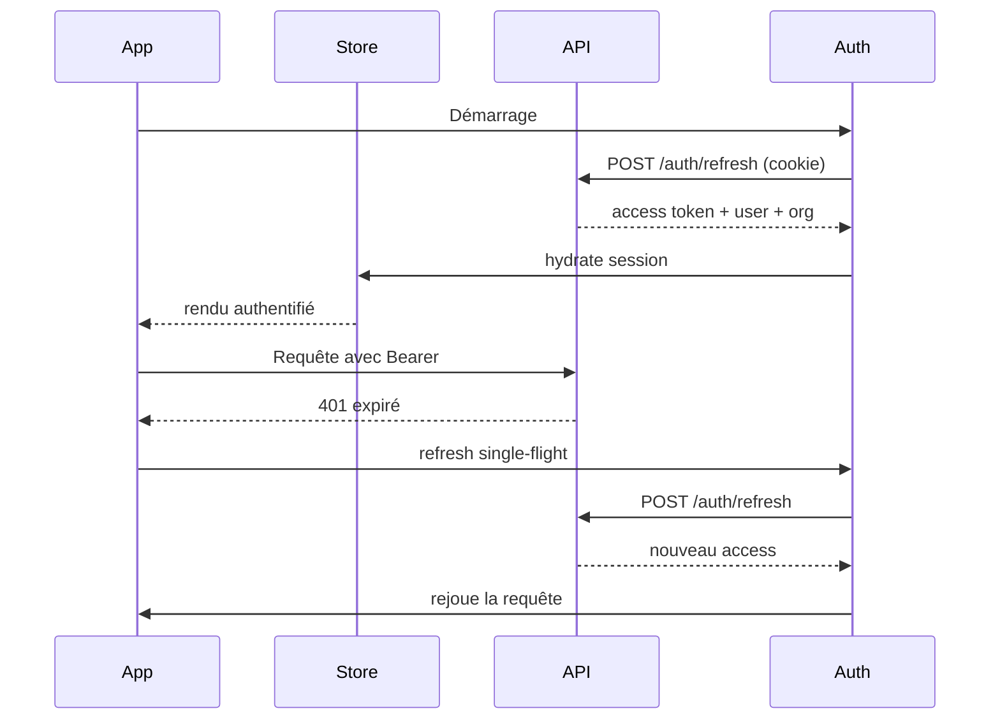

# FRONTEND_ARCHITECTURE.md — EventPulse Analytics

**Phase :** 3 — Software Architecture & Database Design
**Version :** 1.0
**Date :** 2026-11-18
**Stack :** React, TypeScript, Vite, Tailwind CSS, shadcn/ui, Recharts
**Design System :** `docs/phase-2-ui-ux/DESIGN_SYSTEM.md`
**Compléments :** `API_DESIGN.md`, `SECURITY_ARCHITECTURE.md`

> Ce document décrit l'architecture. Il ne contient aucun composant React, aucun JSX et aucune implémentation.

---

## 1. Principes

1. **Organisation par fonctionnalités** : chaque domaine possède ses pages, composants, hooks et appels API.
2. **Le Design System de la Phase 2 est la seule source de styles** : tokens, composants shadcn, typographie, espacements.
3. **L'URL est la source de vérité des filtres** : période, événement, onglet, recherche.
4. **Le serveur est la source de vérité des permissions et des KPI** : le frontend masque, le backend décide.
5. **Séparation stricte** : état serveur (TanStack Query), état de session/UI (Zustand), état de formulaire (React Hook Form), état d'URL (React Router).
6. **Aucun calcul de KPI côté client** : les valeurs affichées proviennent de l'API, y compris en temps réel.
7. **Accessibilité et résilience par défaut** : chargements, erreurs, vides et absence de permission sont des états de première classe.

---

## 2. Organisation des dossiers

```
apps/web/
  src/
    main.tsx
    app/
      App.tsx
      router.tsx
      providers.tsx
    config/
      env.ts
      navigation.ts
      permissions.ts
    lib/
      api/
        client.ts
        refresh.ts
        errors.ts
        query-client.ts
      format/
        dates.ts
        money.ts
        numbers.ts
      realtime/
        socket.ts
        invalidation.ts
      utils/
        cn.ts
        debounce.ts
        download.ts
    stores/
      session.store.ts
      ui.store.ts
    hooks/
      use-auth.ts
      use-permissions.ts
      use-active-organization.ts
      use-event-scope.ts
      use-url-filters.ts
      use-realtime-invalidation.ts
    components/
      layout/
        app-shell.tsx
        sidebar.tsx
        header.tsx
        breadcrumbs.tsx
        page-header.tsx
      ui/                      // shadcn/ui générés
      charts/
        chart-container.tsx
        line-kpi.tsx
        bar-kpi.tsx
        donut-kpi.tsx
        funnel-kpi.tsx
        chart-empty.tsx
        chart-accessible-table.tsx
      data-table/
        data-table.tsx
        pagination.tsx
        column-header.tsx
        empty-state.tsx
      feedback/
        query-state.tsx
        error-state.tsx
        skeleton-page.tsx
        confirm-dialog.tsx
        toast.tsx
      forms/
        form-field.tsx
        form-error.tsx
        date-range-picker.tsx
        event-select.tsx
      analytics/
        kpi-card.tsx
        kpi-grid.tsx
        period-filter.tsx
        comparison-badge.tsx
        na-value.tsx
      domain/
        event-status-badge.tsx
        registration-status-badge.tsx
        checkin-status-badge.tsx
        role-badge.tsx
        export-status-badge.tsx
    features/
      auth/
        pages/login-page.tsx
        components/login-form.tsx
        api/auth.api.ts
        hooks/use-login.ts
      organizations/
        pages/organization-select-page.tsx
        api/organizations.api.ts
      events/
        pages/events-list-page.tsx
        pages/event-form-page.tsx
        pages/event-details-page.tsx
        components/event-form.tsx
        components/event-summary.tsx
        components/event-tabs.tsx
        api/events.api.ts
        hooks/use-events.ts
        schemas/event.schema.ts
      participants/
        pages/participants-list-page.tsx
        pages/participant-details-page.tsx
        components/participant-form.tsx
        components/merge-dialog.tsx
        api/participants.api.ts
        hooks/use-participants.ts
        schemas/participant.schema.ts
      registrations/
        pages/registrations-list-page.tsx
        components/registration-form.tsx
        api/registrations.api.ts
        hooks/use-registrations.ts
      payments/
        pages/payments-page.tsx
        components/transaction-form.tsx
        components/refund-dialog.tsx
        api/finance.api.ts
        hooks/use-transactions.ts
      checkins/
        pages/checkins-page.tsx
        components/checkin-form.tsx
        api/checkins.api.ts
        hooks/use-checkins.ts
      exhibitors/
        pages/exhibitors-page.tsx
        components/exhibitor-form.tsx
        components/booth-form.tsx
        components/reservation-dialog.tsx
        api/exhibitors.api.ts
        hooks/use-exhibitors.ts
      ingestion/
        pages/ingestion-page.tsx
        components/import-upload.tsx
        components/import-preview.tsx
        components/import-jobs-table.tsx
        components/api-keys-panel.tsx
        api/imports.api.ts
        hooks/use-imports.ts
      analytics/
        pages/overview-page.tsx
        pages/event-analytics-page.tsx
        pages/revenue-analytics-page.tsx
        pages/audience-analytics-page.tsx
        pages/exhibitor-analytics-page.tsx
        pages/advanced-analytics-page.tsx
        components/analytics-filters.tsx
        components/revenue-breakdown.tsx
        components/audience-segments.tsx
        components/booth-occupancy.tsx
        components/advanced-comparison.tsx
        api/analytics.api.ts
        hooks/use-analytics.ts
      reports/
        pages/reports-page.tsx
        components/report-catalog.tsx
        components/export-form.tsx
        components/export-history.tsx
        api/exports.api.ts
        hooks/use-exports.ts
      admin/
        pages/members-page.tsx
        pages/organization-settings-page.tsx
        pages/audit-page.tsx
        components/member-table.tsx
        components/invite-member-dialog.tsx
        components/audit-filters.tsx
        api/admin.api.ts
        hooks/use-members.ts
        hooks/use-audit.ts
    routes/
      protected-route.tsx
      role-route.tsx
      event-scope-route.tsx
      not-found-page.tsx
      forbidden-page.tsx
    types/
      api.ts
      domain.ts
      permissions.ts
  tests/
    unit/
    integration/
  e2e/
    auth.spec.ts
    events.spec.ts
    checkins.spec.ts
    analytics.spec.ts
    exports.spec.ts
```

**Règles :**

- `features/*` ne s'importe pas mutuellement, sauf via `components/domain`, `lib` ou `stores`.
- `components/ui` est réservé aux composants shadcn non modifiés ou légèrement thémés.
- Aucun appel `fetch` hors de `lib/api` et des `*.api.ts`.
- Aucun token dans `localStorage`.

---

## 3. Routage

### 3.1 Arbre

| Route | Écran | Layout | Accès |
|---|---|---|---|
| `/login` | Connexion | Public | Public |
| `/organizations` | Sélection d'organisation | Org select | Authentifié |
| `/overview` | Vue d'ensemble | App | Tous |
| `/events` | Liste des événements | App | Tous (lecture) |
| `/events/new` | Création | App | O, A, EM |
| `/events/:eventId` | Détail | Event | Selon portée |
| `/events/:eventId/edit` | Édition | Event | O, A, EM assigné |
| `/participants` | Participants | App | O, A, EM assigné |
| `/participants/:participantId` | Fiche participant | App | O, A, EM assigné |
| `/registrations` | Inscriptions | App | O, A, EM assigné |
| `/payments` | Paiements et remboursements | App | O, A, EM assigné |
| `/check-ins` | Check-ins | App, événement requis | O, A, EM assigné |
| `/exhibitors` | Exposants et stands | App | O, A, EM assigné |
| `/ingestion` | Imports et ingestion | App | O, A, EM assigné |
| `/analytics/events` | Analytics événements | App | Tous |
| `/analytics/revenue` | Analytics revenus | App | Tous |
| `/analytics/audience` | Analytics audience | App | Tous |
| `/analytics/exhibitors` | Analytics exposants | App | Tous |
| `/analytics/advanced` | Analytics avancées (Should) | App | O, AN |
| `/reports` | Rapports et exports | App | O, A, EM, AN |
| `/admin/members` | Membres et rôles | App | O, A |
| `/admin/settings` | Paramètres organisation | App | O, A |
| `/admin/audit` | Journal d'audit | App | O, A |
| `*` | 404 | App/Public | — |

### 3.2 Gardes

| Garde | Rôle |
|---|---|
| `ProtectedRoute` | Vérifie la présence d'une session valide ; redirige vers `/login` avec `returnTo` |
| `OrganizationRoute` | Exige une organisation active ; sinon redirige vers `/organizations` |
| `RoleRoute` | Vérifie la permission de route ; affiche 403 sans révéler de données |
| `EventScopeRoute` | Exige un `eventId` et une portée autorisée |
| `ShouldRoute` | Désactive une route Should si le module est absent |

**Règles :**

- Un changement d'organisation réinitialise le contexte événement et invalide toutes les requêtes.
- Les filtres persistants sont dans l'URL : `from`, `to`, `eventId`, `status`, `q`, `tab`, `page`/`cursor`.
- Un `returnTo` est validé comme chemin interne ; les URLs externes sont refusées (open redirect).
- Le code de route est découpé par `lazy` ; les pages Analytics sont des chunks séparés.

### 3.3 Layouts

| Layout | Contenu |
|---|---|
| `PublicLayout` | Fond, carte centrée, aucune navigation applicative |
| `OrgSelectLayout` | Liste des organisations, déconnexion |
| `AppShell` | Sidebar, header, breadcrumbs, zone de contenu |
| `EventLayout` | En-tête événement, onglets, contenu |
| `SettingsLayout` | Sous-navigation Administration |

La sidebar respecte strictement la Phase 2 : sections masquées si vides, item actif `brand-100`/`brand-700`/bordure `brand-600`, badge discret pour les modules Should, panneau off-canvas mobile.

---

## 4. Pages

| # | Page | Responsabilité | États clés |
|---|---|---|---|
| 1 | Login | Authentification | Erreur uniforme, chargement |
| 2 | Organisation Select | Choix de l'organisation active | Vide, erreur |
| 3 | Overview | KPI globaux, tendances, alertes | Période, N/A, vide |
| 4 | Events List | Liste, filtres, actions | Vide, chargement, erreur |
| 5 | Event Form | Création/édition, transitions | Validation, conflit |
| 6 | Event Details | Synthèse et onglets métier | Onglet, portée, temps réel |
| 7 | Participants | Liste PII, doublons | Recherche, pagination, fusion |
| 8 | Participant Details | Fiche, inscriptions, historique | Anonymisation, fusion |
| 9 | Registrations | Liste et transitions | Statut, paiement |
| 10 | Payments | Transactions et remboursements | Plafond, conflit |
| 11 | Check-ins | Saisie et historique | Doublon, invalide, hors fenêtre |
| 12 | Exhibitors & Booths | Exposants, stands, réservations | Occupation, conflit |
| 13 | Event Analytics | KPI événementiels | Comparaison, N/A |
| 14 | Revenue Analytics | Revenus, remboursements, net | Agrégats, Viewer |
| 15 | Audience Analytics | Segments, démographie | Agrégats, N/A |
| 16 | Exhibitor Analytics | Occupation, revenus stands | Agrégats |
| 17 | Reports & Exports | Catalogue, export, historique | 202, 410, pseudonymisation |
| 18 | Ingestion | Upload, aperçu, jobs, clés API | Progression, erreurs |
| 19 | Members & Roles | Memberships, invitations | Dernier OWNER, restrictions |
| 20 | Organization Settings | Général, rétention, clés | Rôle, validation |
| — | Audit | Journal filtrable | Lecture seule |

Chaque page suit la spécification Phase 2 : hiérarchie, états, actions, messages et adaptations par rôle.

---

## 5. Composants

### 5.1 Catégories

| Catégorie | Contenu | Règles |
|---|---|---|
| `ui` | shadcn/ui : Button, Input, Select, Dialog, Tabs, Table, Tooltip, Sheet, Toast, Badge | Tokens Phase 2 ; variantes limitées |
| `layout` | AppShell, Sidebar, Header, Breadcrumbs, PageHeader | Navigation et structure uniquement |
| `charts` | Wrappers Recharts | Accessibilité, N/A, couleurs du DS |
| `data-table` | Tri, pagination curseur, colonnes, vide | Aucune logique métier |
| `feedback` | QueryState, ErrorState, Skeleton, ConfirmDialog | États homogènes |
| `forms` | Champs, erreurs, date range, sélecteur d'événement | React Hook Form |
| `analytics` | KpiCard, KpiGrid, PeriodFilter, ComparisonBadge, NaValue | Aucun calcul de KPI |
| `domain` | Badges de statut, badges de rôle | Mapping enum → libellé/couleur |

### 5.2 Règles de composition

- Un composant de page orchestre ; il ne contient pas de mise en page complexe réutilisable.
- Les composants de domaine sont sans accès réseau.
- Les wrappers Recharts reçoivent des séries déjà formatées par l'API.
- `NaValue` affiche « N/A » avec une infobulle de motif ; jamais `0`.
- Les tableaux de 50 000 lignes utilisent la virtualisation et la pagination serveur ; aucun chargement complet.
- Aucun `dangerouslySetInnerHTML` sur des données utilisateur.
- Les actions destructives passent par `ConfirmDialog` avec libellé explicite.

### 5.3 Graphiques

- Recharts : lignes, barres, aires, donuts, entonnoirs.
- Couleurs issues des tokens du Design System ; jamais de hexadécimal en dur.
- Chaque graphique possède un titre, une période, une unité et une alternative tabulaire accessible.
- Les valeurs manquantes sont des trous explicites, pas des zéros.
- Le tooltip formate les dates et montants via `lib/format`.
- Aucune animation si `prefers-reduced-motion`.

---

## 6. Hooks

| Hook | Responsabilité |
|---|---|
| `useAuth` | Session, login, logout, refresh silencieux |
| `usePermissions` | `can(action, resource)`, rôle, portée |
| `useActiveOrganization` | Organisation active, changement, invalidation globale |
| `useEventScope` | Événement courant, portée EVENT_MANAGER, événements autorisés |
| `useUrlFilters` | Lecture/écriture des filtres dans l'URL |
| `useRealtimeInvalidation` | Abonnement Socket.IO et invalidation ciblée |
| `useDebouncedValue` | Recherche |
| `usePagination` | Curseur, `hasMore`, retour arrière |
| `useQueryState` | Encapsulation loading/error/empty |

**Règles :**

- Les hooks de données utilisent TanStack Query avec des clés hiérarchiques : `['events', orgId, filters]`.
- Les mutations invalident les clés concernées, jamais tout le cache sans raison.
- Aucun hook ne stocke de données dérivées du serveur dans Zustand.

---

## 7. Services API

### 7.1 Client

- `lib/api/client.ts` : wrapper typé autour de `fetch`.
- Ajoute `Authorization`, `X-Request-Id`, `Content-Type`.
- Normalise les erreurs Problem Details en `ApiError { status, code, detail, fieldErrors }`.
- Gère `204`, `202`, `410`, `429`.
- Ne journalise jamais les corps sensibles.

### 7.2 Rafraîchissement

- Access token en mémoire uniquement.
- Sur `401`, une **seule** requête de refresh est lancée (single-flight) ; les autres attendent.
- Échec du refresh : purge de la session, redirection `/login`.
- Au démarrage, un refresh silencieux restaure la session via le cookie.
- Le refresh n'est jamais tenté sur `/auth/login` ou `/auth/refresh`.

### 7.3 Organisation active

- `POST /auth/switch-organization`, puis mise à jour de la session et invalidation de **tout** le cache.
- Le contexte événement est réinitialisé.
- Les filtres d'URL incompatibles sont retirés.
- Le changement est bloqué pendant une mutation en cours.

### 7.4 Contrats

- Les types DTO proviennent de `packages/shared` et/ou de la génération OpenAPI.
- Les schémas Zod partagés servent à la validation de formulaire et à la vérification de réponse en développement.
- Aucun type dupliqué à la main entre frontend et backend.

---

## 8. Gestion de l'état

| Type d'état | Outil | Exemples |
|---|---|---|
| Serveur | TanStack Query | événements, participants, KPI, exports |
| Session | Zustand | utilisateur, rôle, organisation active |
| UI local | Zustand / état local | sidebar, modales, onglets temporaires |
| URL | React Router | période, eventId, statut, recherche, curseur |
| Formulaire | React Hook Form + Zod | création, édition, filtres avancés |

**Règles :**

- Pas de duplication d'état serveur dans Zustand.
- Les filtres partageables vont dans l'URL, pas dans un store.
- Les données sensibles ne sont jamais persistées dans `localStorage`.
- La persistance éventuelle se limite à des préférences non sensibles (sidebar).
- Une mutation en cours désactive les actions concurrentes critiques.

---

## 9. Authentification



- Access token en mémoire, jamais dans le stockage persistant.
- Cookie de refresh uniquement côté API.
- Déconnexion : appel serveur, purge du cache Query, purge du store, redirection.
- Plusieurs onglets : un `BroadcastChannel` optionnel propage la déconnexion ; le refresh reste centralisé par onglet.
- Le rôle affiché provient de `/auth/me` et est rafraîchi au changement d'organisation.

---

## 10. Permissions

- `usePermissions` expose `can(action, resource)` avec les mêmes clés que le backend.
- Le frontend masque les actions interdites ; il ne les sécurise pas.
- Un accès direct à une route interdite affiche `403` sans requête de données.
- Les actions « restreintes » affichent leur portée : « Vos événements », badge événement.
- EVENT_MANAGER : sélecteur d'événement limité aux événements assignés ; `eventId` requis sur les écrans concernés.
- VIEWER : navigation Analytics complète, Revenue incluse ; aucun bouton d'export, aucune colonne PII, aucun drill-down.
- ANALYST : exports visibles mais marqués pseudonymisés ; aucun écran nominatif.
- Les boutons désactivés expliquent le motif via infobulle ; les boutons interdits sont absents lorsque leur existence révélerait une fonction non autorisée.

---

## 11. Erreurs et chargements

### 11.1 Chargements

- Squelettes par page, pas de spinner plein écran.
- `keepPreviousData` lors d'un changement de filtre pour éviter le clignotement.
- Progression explicite pour imports et exports : `PENDING`, `PROCESSING`, `COMPLETED`, `FAILED` ; `EXPIRED` pour un export dont le fichier a expiré.
- Les jobs asynchrones sont suivis par polling maîtrisé ou Socket.IO, avec repli polling.

### 11.2 Erreurs

| Statut | Comportement |
|---|---|
| 400 | Erreurs de champ dans le formulaire |
| 401 | Refresh, puis redirection si échec |
| 403 | Écran ou message d'accès refusé |
| 404 | État « introuvable », sans détail |
| 409 | Message de conflit, rafraîchissement des données |
| 410 | Export expiré, proposition de régénérer |
| 422 | Message métier et action corrective |
| 429 | Message avec délai |
| 500/503 | État d'erreur avec `requestId` et réessai |

- `ErrorBoundary` par route pour les erreurs de rendu.
- Aucune stack technique affichée.
- Les toasts ne remplacent pas les erreurs persistantes de page.

### 11.3 Vides

- « Aucun événement », « Aucune inscription sur cette période », « Aucun participant ».
- Un état vide explique l'action suivante, sans inventer de données.
- Un KPI sans dénominateur affiche N/A et son motif.

---

## 12. Formulaires

- React Hook Form + `zodResolver`.
- Schémas partagés avec le backend lorsque possible.
- Validation au blur et à la soumission ; erreurs serveur mappées par champ.
- Champs monétaires en chaîne décimale, jamais en flottant.
- Sélecteurs d'événement filtrés par portée.
- Confirmation obligatoire pour fusion, anonymisation, effacement définitif, suppression, remboursement.
- Soumission désactivée pendant la requête ; double soumission empêchée.
- Les formulaires longs conservent les valeurs en cas d'erreur serveur.
- Aucune donnée PII préremplie au-delà du strict nécessaire.

---

## 13. Temps réel

- Module **Should**.
- Socket.IO client authentifié par access token ; room `org:{organizationId}` et `event:{eventId}`.
- Les événements serveur sont des **invalidations**, pas des payloads KPI.
- À réception : invalidation des clés Query concernées + refetch.
- Indicateur « En direct » sur Event Details et Event Analytics.
- Déconnexion : passage en mode polling, message discret, reconnexion automatique.
- Aucun calcul local de KPI, aucune divergence avec REST.
- VIEWER reçoit les invalidations compatibles avec ses droits, sans PII.

---

## 14. Performance

| Mesure | Cible |
|---|---|
| Dashboard | < 2 s sur le jeu de démonstration |
| Lazy loading | Chaque page et chaque écran Analytics |
| Tables | Pagination serveur + virtualisation |
| Recherche | Debounce 300 ms, annulation des requêtes obsolètes |
| Cache | TanStack Query, `staleTime` par domaine |
| Re-renders | Sélecteurs Zustand, mémoïsation ciblée |
| Graphiques | Données pré-agrégées côté serveur |
| Bundle | Découpage par route, pas de dépendance lourde inutile |
| Images | Aucune image métier lourde ; icônes Lucide |

---

## 15. Accessibilité

- WCAG 2.2 AA, conformément au Design System.
- Navigation clavier complète, focus visible.
- Libellés explicites, erreurs associées aux champs.
- `aria-live` pour les jobs et les résultats asynchrones.
- Contrastes vérifiés sur les badges de statut.
- Graphiques accompagnés d'un tableau alternatif.
- `prefers-reduced-motion` respecté.
- Langue française, formats `fr-FR` pour dates et montants, devise EUR.

---

## 16. Configuration

| Variable | Usage |
|---|---|
| `VITE_API_URL` | Base `/api/v1` |
| `VITE_SOCKET_URL` | Socket.IO |
| `VITE_SENTRY_DSN` | Erreurs frontend (optionnel) |
| `VITE_APP_ENV` | Environnement |

Validation Zod au démarrage du bundle. Aucune variable secrète dans le frontend.

---

## 17. Tests

| Niveau | Outil | Portée |
|---|---|---|
| Unitaires | Vitest | Formatage, hooks, gardes, permissions |
| Composants | Vitest + Testing Library | Formulaires, tables, états |
| Intégration | MSW | Flux API, erreurs, refresh |
| E2E | Playwright | Login, événement, import, check-in, dashboard, export |
| Accessibilité | axe | Pages principales |

Les tests E2E couvrent les cinq rôles et les parcours critiques. Voir `TESTING_STRATEGY.md`.

---

## 18. Traçabilité

| Élément | Source |
|---|---|
| Routes et navigation | `INFORMATION_ARCHITECTURE.md` |
| 20 écrans | `SCREEN_SPECIFICATIONS.md` |
| Tokens et composants | `DESIGN_SYSTEM.md` |
| 5 rôles | PRD §11.1, Annexe A |
| Viewer Revenue | Arbitrage post-Phase 2 |
| KPI sans calcul local | BR-KPI, BR-RT-001 |
| Exports pseudonymisés | A.10 |
| 410 export | Q-14 |
| Imports suivis | A.8 |

---

## 19. Points ouverts

- Choix définitif React Router vs TanStack Router : React Router retenu conceptuellement.
- Génération des types OpenAPI vs package partagé : les deux sont prévus, l'arbitrage final appartient à la Phase 4.
- Virtualisation des tables : bibliothèque à confirmer.
- Persistance de la période sélectionnée entre sessions : non retenue.
- Comportement multi-onglets sur le refresh : BroadcastChannel optionnel.

---

*Fin de FRONTEND_ARCHITECTURE.md — Version 1.0.*
