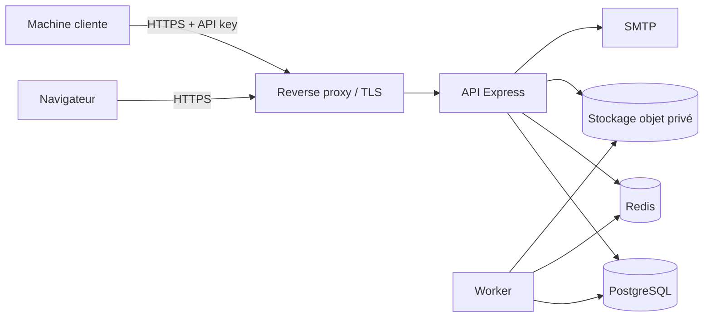

# SECURITY_ARCHITECTURE.md — EventPulse Analytics

**Phase :** 3 — Software Architecture & Database Design
**Version :** 1.0
**Date :** 2026-11-18
**Périmètre :** authentification, sessions, RBAC, multi-tenancy, protection des données, journalisation
**Compléments :** `API_DESIGN.md`, `DATABASE_DESIGN.md`, `BACKEND_ARCHITECTURE.md`

> Projet portfolio à données synthétiques. Les sujets de conformité d'exploitation réelle (DPA, certification, HDS) sont hors périmètre V1. Les mesures décrites restent néanmoins celles attendues d'un SaaS B2B professionnel.

---

## 1. Modèle de menaces

### 1.1 Actifs

| Actif | Sensibilité |
|---|---|
| Données personnelles des participants | Élevée |
| Transactions et remboursements | Élevée |
| Journal d'audit | Élevée (intégrité) |
| Clés API et secrets | Critique |
| Refresh tokens | Critique |
| Agrégats analytiques | Moyenne |
| Exports générés | Élevée |
| Configuration d'organisation | Moyenne |

### 1.2 Frontières de confiance

Points de contrôle :

1. Edge : TLS, taille de requête, en-têtes de sécurité, rate limit réseau.
2. API : authentification, tenant, RBAC, validation, audit.
3. Base : isolation par contraintes, immuabilité, privilèges.
4. Stockage : bucket privé, URLs signées courtes.
5. Worker : mêmes contrôles de tenant, aucune confiance implicite dans le payload.

### 1.3 Menaces principales

| Menace | Vecteur | Réponse |
|---|---|---|
| Accès cross-tenant | IDOR, token d'une autre organisation | Contexte serveur, FK composites, 404 |
| Élévation de privilèges | Modification de rôle, invitation OWNER | RBAC serveur, restrictions ADMIN |
| Vol de session | XSS, cookie, token | Access en mémoire, cookie HttpOnly, rotation |
| Rejeu de refresh token | Vol puis réutilisation | Détection de famille, révocation |
| Force brute | Login, reset | Rate limit, verrouillage temporaire, réponses uniformes |
| Fuite PII | Exports, logs, audit, réponses API | Projection par rôle, pseudonymisation, redaction |
| Injection SQL | Paramètres | Prisma paramétré, aucune concaténation |
| Injection CSV | Cellules d'export | Neutralisation des formules |
| Upload malveillant | CSV/XLSX | Type, taille, analyse, stockage hors webroot |
| Fuite de secret | Logs, erreurs, dépôt | Redaction, validation d'env, secrets hors code |
| Déni de service applicatif | Imports massifs, exports répétés | Files, quotas, limites, rate limit |
| Altération de l'audit | UPDATE/DELETE | Triggers, privilèges, append-only |
| SSRF | URL d'exposant | Aucune récupération serveur d'URL externe |

---

## 2. Authentification

### 2.1 Politique de mot de passe

- Longueur minimale : 12 caractères ; maximale : 128.
- Aucune composition imposée ; les caractères Unicode sont acceptés.
- Hachage **Argon2id** : mémoire 64 MiB, itérations 3, parallélisme 1.
- Le mot de passe n'est jamais journalisé, ni inclus dans une erreur, ni stocké ailleurs.
- Le formulaire de connexion ne révèle pas si l'email existe.

### 2.2 Connexion

1. Rate limit par IP et par email haché.
2. Recherche de l'utilisateur par email `citext`.
3. Vérification Argon2id même si l'utilisateur n'existe pas (hash factice) pour uniformiser le temps de réponse.
4. Refus si `users.is_active = false` ou membership absent/`DISABLED`.
5. Création d'une session et d'une famille de refresh.
6. Journalisation d'audit `AUTH` avec `SUCCESS` ou `FAILURE` (sans mot de passe).
7. Verrouillage temporaire progressif après échecs répétés : seuil configurable (5 par défaut), durée 60 s doublée à chaque palier, plafond 24 h, compteurs Redis atomiques. Le verrouillage est indexé sur **compte + IP** : connaître un email ne suffit pas à rendre le compte indisponible depuis une autre IP. Le quota login par IP+compte (10/15 min) reste en vigueur ; un attaquant distribué peut toujours tenter le mot de passe depuis de nombreuses IP, mais aucune IP unique ne peut verrouiller durablement le compte pour sa victime. Le compte désactivé n'est révélé qu'après une vérification de mot de passe réussie.

### 2.3 Jetons

| Jeton | Format | Durée | Stockage client |
|---|---|---|---|
| Access token | JWT signé | 15 minutes | Mémoire JavaScript uniquement |
| Refresh token | Chaîne opaque 256 bits | 7 jours glissants | Cookie `HttpOnly` |
| Session absolue | — | 30 jours | Révoquée au-delà |

**Access token — claims :**

| Claim | Contenu |
|---|---|
| `sub` | Identifiant utilisateur |
| `sid` | Identifiant de session |
| `org` | Organisation active |
| `role` | Rôle au moment de l'émission (indicatif) |
| `jti` | Identifiant unique du jeton |
| `iat`, `exp` | Émission, expiration |
| `typ` | `access` |
| `kid` | Identifiant de clé active |
| `iss`, `aud` | Émetteur et audience attendus |

**Règles :**

- Le rôle du token n'est **jamais** la seule source d'autorisation : le membership est rechargé à chaque requête.
- Un token dont `org` ne correspond pas à l'organisation résolue est rejeté (401).
- Un token `typ != access` est rejeté sur les routes métier.
- Signature HS256 avec secret fort ; la vérification impose l'algorithme HS256, l'émetteur, l'audience, le `kid` actif et la présence de `sub`, `sid`, `org`, `role`, `jti`, `exp` et `iat`. `sub`, `sid`, `org` et `jti` doivent être des UUID canoniques. La rotation de clé s'effectue par changement de `kid` et de secret.
- Aucune donnée PII dans le JWT.

**Refresh token :**

- Chaîne aléatoire cryptographique, jamais un JWT.
- Stocké uniquement sous forme de hash (`sessions.refresh_token_hash`), avec un pepper serveur `REFRESH_TOKEN_PEPPER`.
- Cookie `ep_rt` : `HttpOnly`, `Secure` en production, `SameSite=Strict`, `Path=/api/v1/auth`.
- Rotation à chaque usage : nouveau token, ancien révoqué, `replacedBySessionId` renseigné.
- **Détection de réutilisation :** si un token déjà révoqué est présenté, toute la famille (`familyId`) est révoquée et l'événement est audité `FAILURE`.
- Un changement d'organisation crée un nouveau couple de jetons dans la même famille et révoque l'ancien.
- La déconnexion révoque la session courante ; `logout-all` révoque toutes les sessions de l'utilisateur.
- La désactivation d'un membership révoque toutes les sessions de l'utilisateur **dans cette organisation** dans la **même transaction** que la mise à jour du statut. Un échec de révocation annule la désactivation. La création et la rotation de session verrouillent l'organisation (`FOR KEY SHARE`) puis la membership (`FOR UPDATE`) avant d'émettre le jeton : une désactivation ou un login concurrent ne peut donc pas laisser de session active après le commit. L'ancien access token échoue (`401 AUTH_SESSION_REVOKED`) et l'ancien refresh token ne peut plus créer de session. Si l'écriture d'audit échoue, la désactivation reste effective.
- L'expiration effective est `MIN(now + REFRESH_SLIDING_TTL_SECONDS, sessions.absolute_expires_at)`, avec un plafond absolu `SESSION_ABSOLUTE_TTL_SECONDS` (30 jours par défaut) : le refresh ne peut jamais prolonger une session au-delà.
- Le nombre de sessions actives par utilisateur est borné ; les plus anciennes sont révoquées.
- Deux refresh concurrents avec le même jeton ne produisent qu'un succès. Le perdant est traité comme un rejeu et révoque toute la famille, y compris la session gagnante. La protection est conservée telle quelle ; le frontend devra sérialiser ses refresh (single-flight). Ce compromis sécurité/UX est documenté et testé côté backend.
- `sessions.organization_id` reste nullable transitoirement. Une session dont l'organisation est nulle est rejetée par le refresh, qui révoque sa famille, et par les middlewares Bearer requis ou optionnels. Aucune migration `NOT NULL` n'est faite avant l'analyse du module Organizations.

### 2.4 Réinitialisation de mot de passe

- Token aléatoire 256 bits, stocké haché avec `PASSWORD_RESET_TOKEN_PEPPER`, expiration 30 minutes, usage unique.
- Une nouvelle demande **acceptée** invalide les jetons précédents non utilisés du même utilisateur. Une demande refusée par le quota par compte retourne avant toute recherche utilisateur et avant `PasswordResetService.request()` : aucun jeton valide n'est invalidé.
- Réponse toujours identique, que l'email existe, soit inconnu, désactivé ou throttlé. Un plancher de latence de 250 ms (0 ms dans les tests unitaires) réduit les écarts entre chemins actifs et non actifs ; il ne garantit pas une égalité temporelle absolue et ne remplace pas une file asynchrone.
- L'utilisation révoque toutes les sessions existantes.
- L'événement est audité sans révéler le token.
- Aucun lien de réinitialisation n'est journalisé.
- Le lien est remis à `MailPort` ; `NullMailPort` échoue explicitement en production **avant** la création du jeton, plutôt que de simuler un envoi. Aucun faux jeton ni faux succès d'envoi n'est produit. La réponse HTTP reste un `204` générique pour l'anti-énumération et ne garantit pas la livraison.
- L'absence de fournisseur mail est visible via `GET /health/ready` (`passwordResetEmail.deliveryEnabled=false`, `provider=none`, `reason=no_provider_configured`) et un avertissement structuré au démarrage. Le processus reste prêt ; il ne s'agit pas d'une indisponibilité totale de l'API.
- Limite assumée : un quota par compte peut être épuisé par un tiers connaissant l'email, retardant l'envoi de nouveaux liens sans invalider le dernier jeton valide. Ce compromis anti-énumération/anti-abus n'est pas résolu par une file dans cette phase.

### 2.5 Invitations

- Token aléatoire 256 bits remis uniquement par email, expiration 7 jours, usage unique. La base ne stocke que son hash HMAC avec `INVITATION_TOKEN_PEPPER` ; aucune journalisation du token brut.
- Une invitation en attente est unique par couple `(organisation, email)`.
- Un ADMIN ne peut pas inviter avec le rôle OWNER.
- **Preuve d'email limitée à l'invitation :** le token public (`POST /invitations/accept-token`) prouve la possession de l'adresse pour cette invitation et cette organisation seulement. Aucun flag global `emailVerified` n'est créé ou modifié, et le flux ne permet pas de changer l'email d'un compte existant. Le flux authentifié (`POST /invitations/accept`) vérifie en plus une correspondance stricte entre l'email du compte et celui de l'invitation.
- **Atomicité :** pour le flux public, le compte (si nouveau), le membership, la consommation de l'invitation, la session et `last_login_at` sont écrits dans une seule transaction. Aucune session sans `organization_id` n'est créée ; l'organisation provient exclusivement de l'invitation, jamais du client.
- **Ordre de verrouillage :** l'invitation est d'abord lue sans verrou pour découvrir l'organisation, puis l'organisation est verrouillée (`SELECT ... FOR UPDATE`) avant la ligne d'invitation (`SELECT ... FOR UPDATE`). Cet ordre `organisation → invitation` est partagé avec la création et la révocation, ce qui évite toute inversion de verrous et sérialise une acceptation avec une révocation/désactivation concurrente.
- **Trois cas :** nouvel email → compte + membership + session ; compte existant sans membership → compte réutilisé, **mot de passe jamais modifié**, membership + session ; compte déjà membre actif avec le rôle invité → token consommé et session émise sans doublon ; rôle/statut incompatible → aucune consommation, aucune session, `409 MEMBERSHIP_ALREADY_EXISTS`. Le flux authentifié applique la même politique pour un membre actif de même rôle (token consommé, aucun nouveau membership), et retourne le même `409` sans consommer le token si rôle ou statut diffère.
- **Rejeu et concurrence :** le statut `PENDING`, l'expiration et la consommation sont verrouillés (`SELECT ... FOR UPDATE`) puis revérifiés dans la transaction. Deux acceptations simultanées du même token produisent un seul succès ; un rejeu retourne `400 INVITATION_INVALID`. Deux invitations simultanées pour le même email dans deux organisations convergent vers un seul compte, grâce à `INSERT ... ON CONFLICT` qui ne touche jamais un hash existant.
- **Anti-énumération :** token inconnu, expiré, révoqué, déjà accepté et compte inactif partagent le même code public ; la route est rate-limitée par IP (20 / 15 min par défaut, configurable) avant toute logique métier. Des tests HTTP exercent le middleware réel (seuil, `429`, `503 AUTH_REDIS_UNAVAILABLE` en fail-closed).
- **Livraison :** si l'envoi échoue, l'invitation est révoquée (3 tentatives) et la requête retourne `503 INVITATION_DELIVERY_FAILED`. Si les tentatives échouent, un log `INVITATION_REVOCATION_FAILED` marque `requiresManualRevocation: true`, sans token ni email. Limite résiduelle documentée : un arrêt du processus entre l'échec d'envoi et la révocation peut laisser une invitation `PENDING` ; aucune outbox/queue n'a été introduite pour ce point. La révocation manuelle reste possible par OWNER/ADMIN.
- L'acceptation journalise `INVITATION_ACCEPTED` (rôle, `accountCreated`) sans token ni secret ; l'audit est best-effort.

---

## 3. Autorisation — RBAC

### 3.1 Modèle

- Un rôle par membership, cinq valeurs : `OWNER`, `ADMIN`, `EVENT_MANAGER`, `ANALYST`, `VIEWER`.
- Le contrôle est **serveur**, appliqué à trois niveaux :
  1. **Route** : rôle minimal (`authorize`).
  2. **Portée** : organisation active et, pour EVENT_MANAGER, événement assigné.
  3. **Objet** : appartenance de la ressource au tenant et à la portée.
- Refus par défaut : une route sans politique explicite est inaccessible.
- Aucune permission n'est déduite du frontend.

### 3.2 Règles structurantes

| Règle | Application |
|---|---|
| OWNER unique garant | Dernier OWNER actif protégé par transaction et verrou |
| ADMIN ne touche pas OWNER | Modification, désactivation, rôle refusés |
| ADMIN ne crée pas d'OWNER | Invitation et attribution refusées |
| EVENT_MANAGER scopé | Toute requête exige un `eventId` assigné |
| ANALYST agrégats | Aucun endpoint nominatif, exports pseudonymisés |
| VIEWER lecture seule | Aucune écriture, aucun export, aucune PII, aucune administration |
| VIEWER Revenue Analytics | Lecture des agrégats autorisée, sans drill-down détaillé |
| Auto-modification | Un utilisateur ne peut pas élever son propre rôle |

### 3.3 Politique par ressource

| Ressource | OWNER | ADMIN | EVENT_MANAGER | ANALYST | VIEWER |
|---|---|---|---|---|---|
| Organisation | complet | opérationnel restreint | lecture | lecture | lecture |
| Memberships | complet | hors OWNER | — | — | — |
| Événements | complet | complet | assignés | publiés/archivés | publiés/archivés |
| Participants (PII) | complet | complet | assignés | — | — |
| Inscriptions (PII) | complet | complet | assignés | — | — |
| Transactions (détail) | complet | complet | assignés | — | — |
| Check-ins (détail) | complet | complet | assignés | — | — |
| Exposants (détail) | complet | complet | assignés | — | — |
| Imports | complet | complet | assignés | — | — |
| Exports | complet | complet | pseudonymisés, assignés | pseudonymisés | — |
| Dashboards | complet | complet | assignés | agrégats | agrégats |
| Advanced Analytics | oui | non | non | oui | non |
| Audit | oui | oui | — | — | — |
| Clés API | oui | oui | — | — | — |

La référence complète reste la matrice PRD Annexe A. Cette table en est la synthèse de sécurité.

### 3.4 Vérification de portée événement

Pour un EVENT_MANAGER :

1. Le `eventId` est obligatoire.
2. L'événement doit appartenir à l'organisation active.
3. `events.manager_membership_id` doit correspondre au membership actif de l'utilisateur ; un événement a au plus un responsable `EVENT_MANAGER`, sans co-responsabilité en V1 (D-09/A-01).
4. Sinon : 404 si l'événement est hors tenant, 403 si l'événement est dans l'organisation mais non assigné.

Pour OWNER/ADMIN, la portée est l'organisation entière.

---

## 4. Multi-tenancy

### 4.1 Organisation active

- Résolue depuis la session (`sessions.organization_id`).
- Vérifiée à chaque requête contre un membership `ACTIVE`.
- Jamais lue depuis un paramètre de requête, un body ou un en-tête non signé.
- Le changement d'organisation est une opération explicite et auditée.

### 4.2 Défense en profondeur

| Couche | Mesure |
|---|---|
| Session | Membership actif obligatoire |
| Contexte | `ActorContext { userId, organizationId, membershipId, role }` |
| Service | Aucun cas d'usage sans `organizationId` |
| Repository | Filtre `organization_id` systématique |
| SQL | `organization_id NOT NULL`, FK composites |
| API | 404 pour toute ressource hors tenant |
| Tests | Suite d'isolation bloquante en CI |

### 4.3 Interdictions de code

- `findUnique({ where: { id } })` sans filtre d'organisation est interdit.
- Toute recherche par identifiant passe par `where: { id, organizationId }`.
- Les mises à jour et suppressions vérifient l'appartenance avant exécution.
- Aucun identifiant d'organisation fourni par le client n'est accepté sans vérification.

### 4.4 Réponses

- Ressource d'une autre organisation : **404**, identique à une ressource inexistante.
- Ressource de l'organisation mais interdite au rôle : **403**.
- Aucun corps d'erreur ne distingue les deux cas par un message détaillé.

---

## 5. Protection des données personnelles

### 5.1 Classification

| Catégorie | Exemples | Accès |
|---|---|---|
| Identifiant | `userId`, `participantId` | Technique |
| PII directe | email, téléphone, nom, prénom | OWNER, ADMIN, EVENT_MANAGER assigné |
| PII quasi-identifiante | ville, région, pays, année de naissance | Même périmètre |
| Données financières | montants, remboursements | OWNER, ADMIN, EVENT_MANAGER assigné |
| Agrégats | compteurs, taux, revenus agrégés | Tous les rôles |
| Journal | actions, acteur, ressource | OWNER, ADMIN |

### 5.2 Minimisation

- Les dashboards n'exposent jamais de PII.
- Un EVENT_MANAGER ne reçoit que les participants liés à ses événements.
- VIEWER et ANALYST n'ont aucun endpoint nominatif.
- Les réponses API projettent uniquement les champs nécessaires.
- Les exports ANALYST et EVENT_MANAGER sont pseudonymisés.

### 5.3 Pseudonymisation des exports

- Identifiant pseudonyme = `HMAC-SHA256(clé_pseudonymisation_org, participantId)`, tronqué et encodé.
- La clé est secrète, par organisation, stockée hors base.
- Aucun nom, email, téléphone, adresse ni identifiant brut.
- Les attributs démographiques restent exploitables (pays, région, ville, année, genre) car nécessaires à l'analyse, sous réserve de la politique de granularité.
- La pseudonymisation est stable au sein d'une organisation : les analyses restent cohérentes entre exports.
- Elle est irréversible sans la clé.

### 5.4 Anonymisation

- Suppression ou remplacement des PII directes et quasi-identifiantes.
- `anonymized_at` ou `erased_at` renseigné selon le mécanisme.
- Irréversible et auditée.
- Les données comptables agrégées sont conservées.

### 5.5 Logs et audit

- Jamais de mot de passe, token, clé API, cookie.
- Emails et téléphones redactés dans les logs applicatifs.
- Métadonnées d'audit bornées, sans PII brute.
- Les erreurs ne contiennent jamais de payload complet.
- Les journaux Sentry excluent les corps de requête et les variables d'environnement.

---

## 6. Sécurité des API

### 6.1 Validation

- Zod sur `params`, `query`, `body` et champs sensibles des en-têtes.
- Rejet des propriétés inconnues.
- Limites de taille : corps JSON 1 Mo, import 10 Mo configurables, lot d'ingestion borné.
- UUID validés avant requête.
- Dates validées et normalisées UTC.
- Montants validés en chaîne décimale, sans flottant.

### 6.2 Contrôle d'accès

- Deny by default.
- Toute route déclare explicitement ses rôles.
- Les routes d'action (`publish`, `release`, `refund`) revérifient l'état et la portée.
- Les API keys sont confinées au préfixe `/ingestion`.
- Un utilisateur ne peut pas agir sur sa propre élévation de privilèges.

### 6.3 En-têtes et navigateur

| Mesure | Valeur |
|---|---|
| `Strict-Transport-Security` | `max-age=31536000; includeSubDomains` |
| `Content-Security-Policy` | Frontend : `default-src 'self'`, pas de script inline non autorisé |
| `X-Content-Type-Options` | `nosniff` |
| `Referrer-Policy` | `strict-origin-when-cross-origin` |
| `X-Frame-Options` | `DENY` |
| `Permissions-Policy` | Fonctionnalités non utilisées désactivées |
| CORS | Allowlist explicite via `CORS_ALLOWED_ORIGINS`, `credentials: true`, aucun joker |
| CSRF | `SameSite=Strict` + vérification d'origine sur `/auth/refresh` et sur tout logout par cookie |

Le refresh token étant un cookie, `/auth/refresh` vérifie l'origine et ne retourne jamais de contenu sensible en cas d'échec. `TRUST_PROXY_HOPS` fixe le nombre exact de proxys de confiance afin que l'IP utilisée par le rate limiting ne soit pas usurpable ; la valeur booléenne `true` est refusée.

### 6.4 Rate limiting

| Route | Limite |
|---|---|
| `POST /auth/login` | 10 / 15 min / IP + identifiant haché |
| `POST /auth/password/forgot` | 5 / heure / IP et 5 / heure / compte |
| `POST /auth/refresh` | 60 / heure / session |
| Routes utilisateur | 300 / min / utilisateur |
| `POST /invitations/accept-token` | 20 / 15 min / IP (public) |
| Verrouillage progressif | seuil 5 échecs, 60 s puis doublement, plafond 24 h, portée compte + IP |
| API ingestion | 60 / min / clé |
| Création d'export | 10 / heure / utilisateur |
| Upload | 20 / heure / organisation |

Les limites sont configurables (`AUTH_LOGIN_*`, `AUTH_FORGOT_*`, `AUTH_REFRESH_*`, `AUTH_LOCKOUT_*`) ; Redis porte les compteurs atomiques et distribués, avec des identifiants hachés et préfixés. En production, `REDIS_URL` est obligatoire et une indisponibilité Redis produit `503 AUTH_REDIS_UNAVAILABLE` (`AUTH_RATE_LIMIT_FAIL_CLOSED=true`) au lieu de désactiver silencieusement les protections. En développement et en test, un store mémoire est utilisé en l'absence de Redis. `AUTH_RATE_LIMIT_FAIL_CLOSED=false` est rejeté au démarrage en production.

L'écriture d'audit d'authentification est best-effort et ne bloque pas la réponse : un échec est journalisé avec des champs nettoyés (`errorName`, `errorCode`, `statusCode`) sans message brut en production. Les événements qui exigent une organisation résolvable (`audit_logs.organization_id NOT NULL`) sont ignorés avec un avertissement lorsqu'aucune organisation ne peut être déterminée, par exemple un échec de connexion pour un compte sans appartenance active ; aucune ligne anonyme n'est créée. Les événements de succès sont écrits avant la réponse, tandis que les échecs de connexion et les demandes de réinitialisation sont écrits en arrière-plan. Lors de l'arrêt gracieux, ces écritures sont attendues avec un timeout borné (3 s par défaut) avant la fermeture de Prisma ; un timeout ou un échec est journalisé (`Auth audit flush timed out` / `Auth audit flush failed`) avec le nombre d'audits encore en attente, sans secret. L'audit reste best-effort en cas d'arrêt brutal ou de panne durable de la base : il n'existe ni Outbox ni tenant système, et cette limite d'atomicité est assumée.

### 6.5 Uploads

- Types MIME et extensions contrôlés (CSV, XLSX).
- Taille bornée.
- Lecture en flux vers un stockage privé, jamais dans le webroot.
- Noms de fichiers générés, nom d'origine conservé en métadonnée.
- Détection de bombe ZIP pour XLSX (taille décompressée bornée).
- Analyse ligne par ligne avec limites de colonnes et de longueur.
- Aucune exécution de macro.

### 6.6 Exports et téléchargements

- Bucket privé, aucun accès public.
- URL signée de 15 minutes, générée après vérification des droits.
- Expiration métier à 30 jours par défaut, configurable.
- `410 Gone` après expiration.
- En-tête `Content-Disposition: attachment`.
- Neutralisation des formules CSV/Excel (cellules commençant par `=`, `+`, `-`, `@`, tabulation, retour chariot).
- Les exports ANALYST et EVENT_MANAGER sont pseudonymisés avant génération.

### 6.7 API keys

| Propriété | Mesure |
|---|---|
| Format | Préfixe lisible + secret aléatoire 256 bits |
| Stockage | Hash SHA-256 avec pepper serveur |
| Affichage | Une seule fois, à la création ou à la rotation |
| Scope | `ingestion:write` uniquement ; contrôle applicatif requis pour refuser `{}` et les doublons, acceptés par le `CHECK` SQL. La rotation conserve les scopes |
| Expiration | Optionnelle, date future stricte ; une clé expirée n'est plus validée |
| Révocation | Immédiate et conditionnelle (`status = ACTIVE`) |
| Rotation | Atomique : verrou de l'ancienne clé, révocation, création de la nouvelle avec les mêmes scopes ; l'ancien secret est invalide dès le commit et deux rotations concurrentes n'en laissent qu'une aboutir |
| Traçabilité | `last_used_at`, audit de création/révocation/rotation ; jamais de hash ni de secret |
| Rate limit | Dédié |

Une clé compromise ne donne accès ni à la lecture, ni aux exports, ni à l'administration.

---

## 7. Secrets et cryptographie

| Secret | Stockage | Rotation |
|---|---|---|
| `JWT_ACCESS_SECRET` | Gestionnaire de secrets / env | 90 jours, support `kid` |
| Pepper refresh | Gestionnaire de secrets | 180 jours |
| Pepper API key | Gestionnaire de secrets | 180 jours |
| Clé de pseudonymisation | Gestionnaire de secrets, par organisation | Annuelle |
| Accès base | Gestionnaire de secrets | 90 jours |
| Accès S3 | Rôle de service ou secret | 90 jours |
| SMTP | Gestionnaire de secrets | Selon fournisseur |

Règles :

- Aucun secret dans le dépôt, l'image Docker ou les logs.
- Validation d'environnement au démarrage ; refus de démarrer sans secret.
- Longueur minimale des secrets : 32 octets aléatoires.
- HTTPS obligatoire ; TLS terminé au proxy.
- Chiffrement au repos assuré par le volume/bucket managé.
- Les mots de passe et jetons ne sont jamais réversibles.

---

## 8. Journalisation et audit

### 8.1 Journal applicatif

- Pino JSON, `requestId`, `userId`, `organizationId`, route, statut, durée.
- Redaction des champs sensibles et PII.
- Niveau configurable ; `debug` interdit en production.
- Rétention opérationnelle courte, non définie contractuellement.

### 8.2 Journal d'audit

- 6 catégories : `AUTH`, `USERS_ROLES`, `ORGANIZATION`, `SENSITIVE_DATA`, `FINANCIAL`, `INGESTION`.
- 12 champs : identifiant, organisation, catégorie, acteur, type d'action, type de ressource, identifiant de ressource, résultat, métadonnées, IP, user-agent, horodatage UTC.
- `SUCCESS` ou `FAILURE`.
- Append-only, triggers et privilèges.
- Métadonnées ≤ 8 Ko, sans secret ni PII brute.
- Consultation réservée OWNER/ADMIN.
- Aucune modification ni suppression via API.
- Écriture best-effort pour les opérations d'administration : un échec du journal n'annule ni la mise à jour d'organisation, ni celle d'un membership, ni la création/révocation/rotation d'une clé API, ni l'acceptation d'une invitation. L'échec est journalisé via des champs nettoyés (`errorName`, `errorCode`, `statusCode`) ; le message brut et la stack ne sont jamais émis sur ces chemins sensibles.
- Limite assumée : sans Outbox, une panne durable de la base d'audit peut faire perdre l'événement ; la réponse métier reste cohérente et aucune donnée secrète n'est journalisée en compensation.

### 8.3 Événements audités

Connexion, déconnexion, échec d'authentification, réinitialisation, invitation, changement de rôle, désactivation, création/modification/suppression d'événement, fusion, anonymisation, remboursement, import, export, création/révocation de clé API, changement de paramètres.

---

## 9. Sécurité des workers

- Le worker ne fait jamais confiance au payload pour le tenant : il recharge l'entité et vérifie `organization_id`.
- Les jobs sont scopés par organisation ; les clés de stockage incluent l'organisation.
- Les jobs d'export vérifient le rôle demandeur au moment de la génération.
- Aucun secret n'est écrit dans le payload du job.
- Les erreurs de job sont journalisées sans PII.
- Les fichiers temporaires sont supprimés après traitement.
- Un job rejoué ne crée pas de doublon (idempotence).
- Les workers tournent avec un utilisateur non-root et un accès minimal.

---

## 10. Sécurité de l'infrastructure

| Élément | Mesure |
|---|---|
| Conteneurs | Image distroless ou alpine, utilisateur non-root, FS read-only |
| Réseau | Base et Redis non exposés publiquement |
| PostgreSQL | Rôle applicatif à privilèges minimaux ; `UPDATE/DELETE` révoqués sur tables immuables |
| Redis | Authentification, réseau privé, pas de données métier durables |
| Stockage | Bucket privé, chiffrement, versioning optionnel |
| CI/CD | Secrets masqués, environnements protégés, revue obligatoire |
| Dépendances | Lockfile, audit automatique, Dependabot |
| Images | Scan Trivy en CI |
| Logs | Pas de secrets, accès restreint |

---

## 11. Tests de sécurité

| Test | Niveau | Attendu |
|---|---|---|
| Isolation cross-tenant | Intégration | 404 sur chaque ressource |
| RBAC 5 rôles × routes sensibles | Intégration | 200/403 conformes à la matrice |
| Portée EVENT_MANAGER | Intégration | Refus hors événements assignés |
| Rejeu de refresh | Intégration | Famille révoquée |
| Expiration access | Intégration | 401 |
| Rate limit | Intégration | 429 |
| Upload malveillant | Intégration | 400/413 |
| Export expiré | Intégration | 410 |
| Export ANALYST sans PII | Intégration | Aucun champ PII |
| Injection CSV | Unitaire | Formules neutralisées |
| Redaction des logs | Unitaire | Aucun secret |
| Last OWNER | Intégration | 409/422 |
| Validation Zod | API | 400 sans requête SQL |

**Scan :**

- SAST en CI (ESLint sécurité + Semgrep).
- `npm audit` et Dependabot.
- ZAP baseline sur l'environnement de démonstration.
- Revue manuelle des routes ajoutées.

---

## 12. Réponse aux incidents (périmètre portfolio)

1. Révocation des sessions et clés API concernées.
2. Rotation des secrets.
3. Conservation du journal d'audit.
4. Identification du périmètre via `requestId`, `organizationId`, acteur.
5. Correction, test de non-régression, post-mortem interne.

Aucune procédure contractuelle, SLA ou notification réglementaire n'est définie en V1.

---

## 13. Traçabilité

| Mesure | Source |
|---|---|
| 5 rôles et restrictions | PRD §11.1, Annexe A |
| Viewer read-only sans PII/export | Q-11 + arbitrage post-Phase 2 |
| Argon2 | PRD §18.4 |
| Access + refresh rotation | PRD §18.4 |
| RBAC serveur | PRD §18.2 |
| API keys scopées | PRD §18.4, A.8 |
| Audit 6 catégories / 12 champs | PRD §18.3, BR-AUD-003 |
| Exports pseudonymisés | H-09, A.10 |
| 410 export expiré | Q-14 |
| Isolation multi-tenant | PRD §18.1, BR-ORG-003 |
| Check-ins immuables | BR-CHK-006 |

---

## 14. Points ouverts

- Rétention du journal d'audit : non définie en Phase 1.
- Vérification de mot de passe compromis (liste hors ligne) : optionnelle, non retenue en V1.
- MFA : hors périmètre V1.
- Gestion de secrets concrète (Vault, SSM, Docker secrets) : à choisir au déploiement.
- Politique de granularité géographique dans les exports pseudonymisés : à affiner.
- Durée exacte du verrouillage de connexion : à calibrer.

---

*Fin de SECURITY_ARCHITECTURE.md — Version 1.0.*
