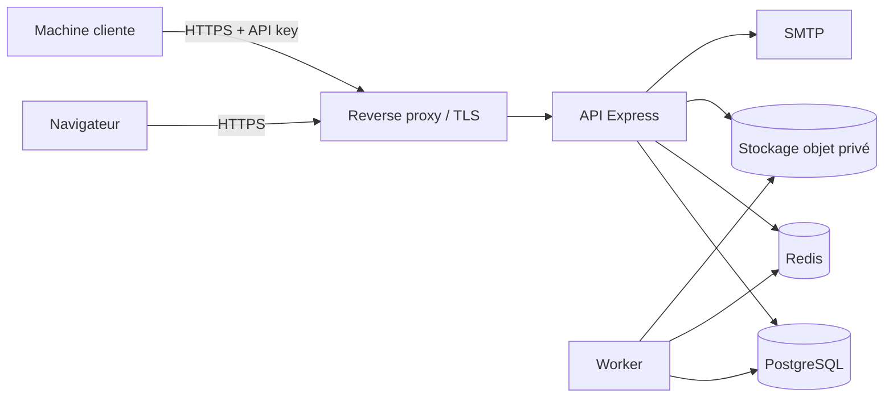

# SECURITY_ARCHITECTURE.md — EventPulse Analytics

**Phase :** 3 — Software Architecture & Database Design
**Version :** 1.0
**Date :** 2026-11-18
**Périmètre :** authentification, sessions, RBAC, multi-tenancy, protection des données, journalisation
**Compléments :** `API_DESIGN.md`, `DATABASE_DESIGN.md`, `BACKEND_ARCHITECTURE.md`

> Projet portfolio à données synthétiques. Les sujets de conformité d'exploitation réelle (DPA, certification, HDS) sont hors périmètre V1. Les mesures décrites restent néanmoins celles attendues d'un SaaS B2B professionnel.

---

## 1. Modèle de menaces

### 1.1 Actifs

| Actif | Sensibilité |
|---|---|
| Données personnelles des participants | Élevée |
| Transactions et remboursements | Élevée |
| Journal d'audit | Élevée (intégrité) |
| Clés API et secrets | Critique |
| Refresh tokens | Critique |
| Agrégats analytiques | Moyenne |
| Exports générés | Élevée |
| Configuration d'organisation | Moyenne |

### 1.2 Frontières de confiance

Points de contrôle :

1. Edge : TLS, taille de requête, en-têtes de sécurité, rate limit réseau.
2. API : authentification, tenant, RBAC, validation, audit.
3. Base : isolation par contraintes, immuabilité, privilèges.
4. Stockage : bucket privé, URLs signées courtes.
5. Worker : mêmes contrôles de tenant, aucune confiance implicite dans le payload.

### 1.3 Menaces principales

| Menace | Vecteur | Réponse |
|---|---|---|
| Accès cross-tenant | IDOR, token d'une autre organisation | Contexte serveur, FK composites, 404 |
| Élévation de privilèges | Modification de rôle, invitation OWNER | RBAC serveur, restrictions ADMIN |
| Vol de session | XSS, cookie, token | Access en mémoire, cookie HttpOnly, rotation |
| Rejeu de refresh token | Vol puis réutilisation | Détection de famille, révocation |
| Force brute | Login, reset | Rate limit, verrouillage temporaire, réponses uniformes |
| Fuite PII | Exports, logs, audit, réponses API | Projection par rôle, pseudonymisation, redaction |
| Injection SQL | Paramètres | Prisma paramétré, aucune concaténation |
| Injection CSV | Cellules d'export | Neutralisation des formules |
| Upload malveillant | CSV/XLSX | Type, taille, analyse, stockage hors webroot |
| Fuite de secret | Logs, erreurs, dépôt | Redaction, validation d'env, secrets hors code |
| Déni de service applicatif | Imports massifs, exports répétés | Files, quotas, limites, rate limit |
| Altération de l'audit | UPDATE/DELETE | Triggers, privilèges, append-only |
| SSRF | URL d'exposant | Aucune récupération serveur d'URL externe |

---

## 2. Authentification

### 2.1 Politique de mot de passe

- Longueur minimale : 12 caractères ; maximale : 128.
- Aucune composition imposée ; les caractères Unicode sont acceptés.
- Hachage **Argon2id** : mémoire 64 MiB, itérations 3, parallélisme 1.
- Le mot de passe n'est jamais journalisé, ni inclus dans une erreur, ni stocké ailleurs.
- Le formulaire de connexion ne révèle pas si l'email existe.

### 2.2 Connexion

1. Rate limit par IP et par email haché.
2. Recherche de l'utilisateur par email `citext`.
3. Vérification Argon2id même si l'utilisateur n'existe pas (hash factice) pour uniformiser le temps de réponse.
4. Refus si `users.is_active = false` ou membership absent/`DISABLED`.
5. Création d'une session et d'une famille de refresh.
6. Journalisation d'audit `AUTH` avec `SUCCESS` ou `FAILURE` (sans mot de passe).
7. Verrouillage temporaire progressif après échecs répétés (rate limit durable Redis).

### 2.3 Jetons

| Jeton | Format | Durée | Stockage client |
|---|---|---|---|
| Access token | JWT signé | 15 minutes | Mémoire JavaScript uniquement |
| Refresh token | Chaîne opaque 256 bits | 7 jours glissants | Cookie `HttpOnly` |
| Session absolue | — | 30 jours | Révoquée au-delà |

**Access token — claims :**

| Claim | Contenu |
|---|---|
| `sub` | Identifiant utilisateur |
| `sid` | Identifiant de session |
| `org` | Organisation active |
| `role` | Rôle au moment de l'émission (indicatif) |
| `jti` | Identifiant unique du jeton |
| `iat`, `exp` | Émission, expiration |
| `typ` | `access` |

**Règles :**

- Le rôle du token n'est **jamais** la seule source d'autorisation : le membership est rechargé à chaque requête.
- Un token dont `org` ne correspond pas à l'organisation résolue est rejeté (401).
- Un token `typ != access` est rejeté sur les routes métier.
- Signature HS256 avec secret fort ; rotation par `kid` possible.
- Aucune donnée PII dans le JWT.

**Refresh token :**

- Chaîne aléatoire cryptographique, jamais un JWT.
- Stocké uniquement sous forme de hash (`sessions.refresh_token_hash`).
- Cookie `ep_rt` : `HttpOnly`, `Secure`, `SameSite=Strict`, `Path=/api/v1/auth`.
- Rotation à chaque usage : nouveau token, ancien révoqué, `replacedBySessionId` renseigné.
- **Détection de réutilisation :** si un token déjà révoqué est présenté, toute la famille (`familyId`) est révoquée et l'événement est audité `FAILURE`.
- Un changement d'organisation crée un nouveau couple de jetons dans la même famille et révoque l'ancien.
- La déconnexion révoque la session courante ; `logout-all` révoque toutes les sessions de l'utilisateur.

### 2.4 Réinitialisation de mot de passe

- Token aléatoire 256 bits, stocké haché, expiration 30 minutes, usage unique.
- Réponse toujours identique, que l'email existe ou non.
- L'utilisation révoque toutes les sessions existantes.
- L'événement est audité sans révéler le token.
- Aucun lien de réinitialisation n'est journalisé.

### 2.5 Invitations

- Token haché, expiration 7 jours, usage unique.
- Une invitation acceptée crée un membership `ACTIVE` et journalise l'action.
- Une invitation en attente est unique par couple `(organisation, email)`.
- Un ADMIN ne peut pas inviter avec le rôle OWNER.
- L'acceptation vérifie que l'email du compte correspond à l'invitation.

---

## 3. Autorisation — RBAC

### 3.1 Modèle

- Un rôle par membership, cinq valeurs : `OWNER`, `ADMIN`, `EVENT_MANAGER`, `ANALYST`, `VIEWER`.
- Le contrôle est **serveur**, appliqué à trois niveaux :
  1. **Route** : rôle minimal (`authorize`).
  2. **Portée** : organisation active et, pour EVENT_MANAGER, événement assigné.
  3. **Objet** : appartenance de la ressource au tenant et à la portée.
- Refus par défaut : une route sans politique explicite est inaccessible.
- Aucune permission n'est déduite du frontend.

### 3.2 Règles structurantes

| Règle | Application |
|---|---|
| OWNER unique garant | Dernier OWNER actif protégé par transaction et verrou |
| ADMIN ne touche pas OWNER | Modification, désactivation, rôle refusés |
| ADMIN ne crée pas d'OWNER | Invitation et attribution refusées |
| EVENT_MANAGER scopé | Toute requête exige un `eventId` assigné |
| ANALYST agrégats | Aucun endpoint nominatif, exports pseudonymisés |
| VIEWER lecture seule | Aucune écriture, aucun export, aucune PII, aucune administration |
| VIEWER Revenue Analytics | Lecture des agrégats autorisée, sans drill-down détaillé |
| Auto-modification | Un utilisateur ne peut pas élever son propre rôle |

### 3.3 Politique par ressource

| Ressource | OWNER | ADMIN | EVENT_MANAGER | ANALYST | VIEWER |
|---|---|---|---|---|---|
| Organisation | complet | opérationnel restreint | lecture | lecture | lecture |
| Memberships | complet | hors OWNER | — | — | — |
| Événements | complet | complet | assignés | publiés/archivés | publiés/archivés |
| Participants (PII) | complet | complet | assignés | — | — |
| Inscriptions (PII) | complet | complet | assignés | — | — |
| Transactions (détail) | complet | complet | assignés | — | — |
| Check-ins (détail) | complet | complet | assignés | — | — |
| Exposants (détail) | complet | complet | assignés | — | — |
| Imports | complet | complet | assignés | — | — |
| Exports | complet | complet | pseudonymisés, assignés | pseudonymisés | — |
| Dashboards | complet | complet | assignés | agrégats | agrégats |
| Advanced Analytics | oui | non | non | oui | non |
| Audit | oui | oui | — | — | — |
| Clés API | oui | oui | — | — | — |

La référence complète reste la matrice PRD Annexe A. Cette table en est la synthèse de sécurité.

### 3.4 Vérification de portée événement

Pour un EVENT_MANAGER :

1. Le `eventId` est obligatoire.
2. L'événement doit appartenir à l'organisation active.
3. `events.manager_membership_id` doit correspondre au membership actif de l'utilisateur ; un événement a au plus un responsable `EVENT_MANAGER`, sans co-responsabilité en V1 (D-09/A-01).
4. Sinon : 404 si l'événement est hors tenant, 403 si l'événement est dans l'organisation mais non assigné.

Pour OWNER/ADMIN, la portée est l'organisation entière.

---

## 4. Multi-tenancy

### 4.1 Organisation active

- Résolue depuis la session (`sessions.organization_id`).
- Vérifiée à chaque requête contre un membership `ACTIVE`.
- Jamais lue depuis un paramètre de requête, un body ou un en-tête non signé.
- Le changement d'organisation est une opération explicite et auditée.

### 4.2 Défense en profondeur

| Couche | Mesure |
|---|---|
| Session | Membership actif obligatoire |
| Contexte | `ActorContext { userId, organizationId, membershipId, role }` |
| Service | Aucun cas d'usage sans `organizationId` |
| Repository | Filtre `organization_id` systématique |
| SQL | `organization_id NOT NULL`, FK composites |
| API | 404 pour toute ressource hors tenant |
| Tests | Suite d'isolation bloquante en CI |

### 4.3 Interdictions de code

- `findUnique({ where: { id } })` sans filtre d'organisation est interdit.
- Toute recherche par identifiant passe par `where: { id, organizationId }`.
- Les mises à jour et suppressions vérifient l'appartenance avant exécution.
- Aucun identifiant d'organisation fourni par le client n'est accepté sans vérification.

### 4.4 Réponses

- Ressource d'une autre organisation : **404**, identique à une ressource inexistante.
- Ressource de l'organisation mais interdite au rôle : **403**.
- Aucun corps d'erreur ne distingue les deux cas par un message détaillé.

---

## 5. Protection des données personnelles

### 5.1 Classification

| Catégorie | Exemples | Accès |
|---|---|---|
| Identifiant | `userId`, `participantId` | Technique |
| PII directe | email, téléphone, nom, prénom | OWNER, ADMIN, EVENT_MANAGER assigné |
| PII quasi-identifiante | ville, région, pays, année de naissance | Même périmètre |
| Données financières | montants, remboursements | OWNER, ADMIN, EVENT_MANAGER assigné |
| Agrégats | compteurs, taux, revenus agrégés | Tous les rôles |
| Journal | actions, acteur, ressource | OWNER, ADMIN |

### 5.2 Minimisation

- Les dashboards n'exposent jamais de PII.
- Un EVENT_MANAGER ne reçoit que les participants liés à ses événements.
- VIEWER et ANALYST n'ont aucun endpoint nominatif.
- Les réponses API projettent uniquement les champs nécessaires.
- Les exports ANALYST et EVENT_MANAGER sont pseudonymisés.

### 5.3 Pseudonymisation des exports

- Identifiant pseudonyme = `HMAC-SHA256(clé_pseudonymisation_org, participantId)`, tronqué et encodé.
- La clé est secrète, par organisation, stockée hors base.
- Aucun nom, email, téléphone, adresse ni identifiant brut.
- Les attributs démographiques restent exploitables (pays, région, ville, année, genre) car nécessaires à l'analyse, sous réserve de la politique de granularité.
- La pseudonymisation est stable au sein d'une organisation : les analyses restent cohérentes entre exports.
- Elle est irréversible sans la clé.

### 5.4 Anonymisation

- Suppression ou remplacement des PII directes et quasi-identifiantes.
- `anonymized_at` ou `erased_at` renseigné selon le mécanisme.
- Irréversible et auditée.
- Les données comptables agrégées sont conservées.

### 5.5 Logs et audit

- Jamais de mot de passe, token, clé API, cookie.
- Emails et téléphones redactés dans les logs applicatifs.
- Métadonnées d'audit bornées, sans PII brute.
- Les erreurs ne contiennent jamais de payload complet.
- Les journaux Sentry excluent les corps de requête et les variables d'environnement.

---

## 6. Sécurité des API

### 6.1 Validation

- Zod sur `params`, `query`, `body` et champs sensibles des en-têtes.
- Rejet des propriétés inconnues.
- Limites de taille : corps JSON 1 Mo, import 10 Mo configurables, lot d'ingestion borné.
- UUID validés avant requête.
- Dates validées et normalisées UTC.
- Montants validés en chaîne décimale, sans flottant.

### 6.2 Contrôle d'accès

- Deny by default.
- Toute route déclare explicitement ses rôles.
- Les routes d'action (`publish`, `release`, `refund`) revérifient l'état et la portée.
- Les API keys sont confinées au préfixe `/ingestion`.
- Un utilisateur ne peut pas agir sur sa propre élévation de privilèges.

### 6.3 En-têtes et navigateur

| Mesure | Valeur |
|---|---|
| `Strict-Transport-Security` | `max-age=31536000; includeSubDomains` |
| `Content-Security-Policy` | Frontend : `default-src 'self'`, pas de script inline non autorisé |
| `X-Content-Type-Options` | `nosniff` |
| `Referrer-Policy` | `strict-origin-when-cross-origin` |
| `X-Frame-Options` | `DENY` |
| `Permissions-Policy` | Fonctionnalités non utilisées désactivées |
| CORS | Origine frontend explicite, `credentials: true` |
| CSRF | `SameSite=Strict` + vérification d'origine sur `/auth/refresh` |

Le refresh token étant un cookie, `/auth/refresh` vérifie l'origine et ne retourne jamais de contenu sensible en cas d'échec.

### 6.4 Rate limiting

| Route | Limite indicative |
|---|---|
| `POST /auth/login` | 10 / 15 min / IP + identifiant |
| `POST /auth/password/forgot` | 5 / heure / IP |
| `POST /auth/refresh` | 60 / heure / session |
| Routes utilisateur | 300 / min / utilisateur |
| API ingestion | 60 / min / clé |
| Création d'export | 10 / heure / utilisateur |
| Upload | 20 / heure / organisation |

Les limites sont configurables ; Redis porte les compteurs distribués.

### 6.5 Uploads

- Types MIME et extensions contrôlés (CSV, XLSX).
- Taille bornée.
- Lecture en flux vers un stockage privé, jamais dans le webroot.
- Noms de fichiers générés, nom d'origine conservé en métadonnée.
- Détection de bombe ZIP pour XLSX (taille décompressée bornée).
- Analyse ligne par ligne avec limites de colonnes et de longueur.
- Aucune exécution de macro.

### 6.6 Exports et téléchargements

- Bucket privé, aucun accès public.
- URL signée de 15 minutes, générée après vérification des droits.
- Expiration métier à 30 jours par défaut, configurable.
- `410 Gone` après expiration.
- En-tête `Content-Disposition: attachment`.
- Neutralisation des formules CSV/Excel (cellules commençant par `=`, `+`, `-`, `@`, tabulation, retour chariot).
- Les exports ANALYST et EVENT_MANAGER sont pseudonymisés avant génération.

### 6.7 API keys

| Propriété | Mesure |
|---|---|
| Format | Préfixe lisible + secret aléatoire 256 bits |
| Stockage | Hash SHA-256 avec pepper serveur |
| Affichage | Une seule fois, à la création |
| Scope | `ingestion:write` uniquement |
| Expiration | Optionnelle |
| Révocation | Immédiate |
| Traçabilité | `last_used_at`, audit de création/révocation |
| Rate limit | Dédié |

Une clé compromise ne donne accès ni à la lecture, ni aux exports, ni à l'administration.

---

## 7. Secrets et cryptographie

| Secret | Stockage | Rotation |
|---|---|---|
| `JWT_ACCESS_SECRET` | Gestionnaire de secrets / env | 90 jours, support `kid` |
| Pepper refresh | Gestionnaire de secrets | 180 jours |
| Pepper API key | Gestionnaire de secrets | 180 jours |
| Clé de pseudonymisation | Gestionnaire de secrets, par organisation | Annuelle |
| Accès base | Gestionnaire de secrets | 90 jours |
| Accès S3 | Rôle de service ou secret | 90 jours |
| SMTP | Gestionnaire de secrets | Selon fournisseur |

Règles :

- Aucun secret dans le dépôt, l'image Docker ou les logs.
- Validation d'environnement au démarrage ; refus de démarrer sans secret.
- Longueur minimale des secrets : 32 octets aléatoires.
- HTTPS obligatoire ; TLS terminé au proxy.
- Chiffrement au repos assuré par le volume/bucket managé.
- Les mots de passe et jetons ne sont jamais réversibles.

---

## 8. Journalisation et audit

### 8.1 Journal applicatif

- Pino JSON, `requestId`, `userId`, `organizationId`, route, statut, durée.
- Redaction des champs sensibles et PII.
- Niveau configurable ; `debug` interdit en production.
- Rétention opérationnelle courte, non définie contractuellement.

### 8.2 Journal d'audit

- 6 catégories : `AUTH`, `USERS_ROLES`, `ORGANIZATION`, `SENSITIVE_DATA`, `FINANCIAL`, `INGESTION`.
- 11 champs : identifiant, organisation, catégorie, acteur, type d'action, type de ressource, identifiant de ressource, résultat, métadonnées, IP, user-agent (horodatage UTC inclus).
- `SUCCESS` ou `FAILURE`.
- Append-only, triggers et privilèges.
- Métadonnées ≤ 8 Ko, sans secret ni PII brute.
- Consultation réservée OWNER/ADMIN.
- Aucune modification ni suppression via API.

### 8.3 Événements audités

Connexion, déconnexion, échec d'authentification, réinitialisation, invitation, changement de rôle, désactivation, création/modification/suppression d'événement, fusion, anonymisation, remboursement, import, export, création/révocation de clé API, changement de paramètres.

---

## 9. Sécurité des workers

- Le worker ne fait jamais confiance au payload pour le tenant : il recharge l'entité et vérifie `organization_id`.
- Les jobs sont scopés par organisation ; les clés de stockage incluent l'organisation.
- Les jobs d'export vérifient le rôle demandeur au moment de la génération.
- Aucun secret n'est écrit dans le payload du job.
- Les erreurs de job sont journalisées sans PII.
- Les fichiers temporaires sont supprimés après traitement.
- Un job rejoué ne crée pas de doublon (idempotence).
- Les workers tournent avec un utilisateur non-root et un accès minimal.

---

## 10. Sécurité de l'infrastructure

| Élément | Mesure |
|---|---|
| Conteneurs | Image distroless ou alpine, utilisateur non-root, FS read-only |
| Réseau | Base et Redis non exposés publiquement |
| PostgreSQL | Rôle applicatif à privilèges minimaux ; `UPDATE/DELETE` révoqués sur tables immuables |
| Redis | Authentification, réseau privé, pas de données métier durables |
| Stockage | Bucket privé, chiffrement, versioning optionnel |
| CI/CD | Secrets masqués, environnements protégés, revue obligatoire |
| Dépendances | Lockfile, audit automatique, Dependabot |
| Images | Scan Trivy en CI |
| Logs | Pas de secrets, accès restreint |

---

## 11. Tests de sécurité

| Test | Niveau | Attendu |
|---|---|---|
| Isolation cross-tenant | Intégration | 404 sur chaque ressource |
| RBAC 5 rôles × routes sensibles | Intégration | 200/403 conformes à la matrice |
| Portée EVENT_MANAGER | Intégration | Refus hors événements assignés |
| Rejeu de refresh | Intégration | Famille révoquée |
| Expiration access | Intégration | 401 |
| Rate limit | Intégration | 429 |
| Upload malveillant | Intégration | 400/413 |
| Export expiré | Intégration | 410 |
| Export ANALYST sans PII | Intégration | Aucun champ PII |
| Injection CSV | Unitaire | Formules neutralisées |
| Redaction des logs | Unitaire | Aucun secret |
| Last OWNER | Intégration | 409/422 |
| Validation Zod | API | 400 sans requête SQL |

**Scan :**

- SAST en CI (ESLint sécurité + Semgrep).
- `npm audit` et Dependabot.
- ZAP baseline sur l'environnement de démonstration.
- Revue manuelle des routes ajoutées.

---

## 12. Réponse aux incidents (périmètre portfolio)

1. Révocation des sessions et clés API concernées.
2. Rotation des secrets.
3. Conservation du journal d'audit.
4. Identification du périmètre via `requestId`, `organizationId`, acteur.
5. Correction, test de non-régression, post-mortem interne.

Aucune procédure contractuelle, SLA ou notification réglementaire n'est définie en V1.

---

## 13. Traçabilité

| Mesure | Source |
|---|---|
| 5 rôles et restrictions | PRD §11.1, Annexe A |
| Viewer read-only sans PII/export | Q-11 + arbitrage post-Phase 2 |
| Argon2 | PRD §18.4 |
| Access + refresh rotation | PRD §18.4 |
| RBAC serveur | PRD §18.2 |
| API keys scopées | PRD §18.4, A.8 |
| Audit 6 catégories / 11 champs | PRD §18.3, BR-AUD-003 |
| Exports pseudonymisés | H-09, A.10 |
| 410 export expiré | Q-14 |
| Isolation multi-tenant | PRD §18.1, BR-ORG-003 |
| Check-ins immuables | BR-CHK-006 |

---

## 14. Points ouverts

- Rétention du journal d'audit : non définie en Phase 1.
- Vérification de mot de passe compromis (liste hors ligne) : optionnelle, non retenue en V1.
- MFA : hors périmètre V1.
- Gestion de secrets concrète (Vault, SSM, Docker secrets) : à choisir au déploiement.
- Politique de granularité géographique dans les exports pseudonymisés : à affiner.
- Durée exacte du verrouillage de connexion : à calibrer.

---

*Fin de SECURITY_ARCHITECTURE.md — Version 1.0.*
