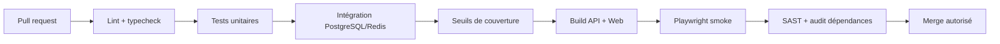

# TESTING_STRATEGY.md — EventPulse Analytics

**Phase :** 3 — Software Architecture & Database Design
**Version :** 1.0
**Date :** 2026-11-18
**Outils :** Vitest, Supertest, Testing Library, MSW, Playwright
**Compléments :** `BUSINESS_RULES.md`, `KPI_DEFINITIONS.md`, `API_DESIGN.md`, `SECURITY_ARCHITECTURE.md`

---

## 1. Objectifs

1. Prouver le respect des **77 règles métier**.
2. Prouver l'exactitude des **24 KPI**.
3. Prouver l'**isolation multi-tenant**.
4. Prouver la **matrice des 5 rôles** sur les routes sensibles.
5. Prouver les **flux asynchrones** (imports, exports, purge).
6. Prouver les **parcours critiques** de bout en bout.
7. Détecter les régressions sans rendre la CI instable.

La couverture de code est un indicateur, jamais une finalité. La priorité est la couverture **des règles et des risques**, mesurée par une matrice de traçabilité.

---

## 2. Pyramide et outils

| Niveau | Outil | Volume cible | Dépendances |
|---|---|---|---|
| Unitaires | Vitest | Élevé | Aucune |
| Intégration backend | Vitest + Supertest + PostgreSQL réel | Moyen | Docker |
| Contrats | Vitest + OpenAPI | Faible | API démarrée |
| Composants web | Vitest + Testing Library + MSW | Moyen | Aucune |
| E2E | Playwright | Faible, ciblé | Stack complète |
| Performance | Script dédié, non bloquant | Ponctuel | Dataset de démonstration |

**Choix :**

- **Vitest** partout, pour unifier la configuration et la vitesse.
- **Supertest** pour les routes sans serveur réseau réel.
- **MSW** pour les appels API frontend.
- **Playwright** pour les parcours navigateur, avec un projet par rôle si nécessaire.
- **PostgreSQL réel** en intégration : aucun mock de Prisma pour les règles et contraintes.
- **Redis réel** pour les tests de workers et de rate limit.

---

## 3. Environnements de test

| Élément | Stratégie |
|---|---|
| PostgreSQL | Instance Docker locale, base dédiée persistante `eventpulse_test` (suffixe `_test` obligatoire), migrée une fois par exécution. Un conteneur éphémère par exécution est une cible non implémentée. |
| Redis | Conteneur éphémère par suite de workers |
| Stockage | Adaptateur mémoire ou MinIO de test |
| SMTP | Transport mémoire |
| Horloge | Port `Clock` injecté pour DST et expirations |
| Données | Factories déterministes, UUID uniques, aucun réseau |
| Nettoyage | Aucun `TRUNCATE` ni reset automatique : données uniques par exécution, base conservée entre exécutions |

**Règles :**

- Aucun test ne dépend de l'ordre d'exécution.
- Aucun test ne dépend d'une date réelle non injectée.
- Aucun test n'utilise les données de production.
- Aucun test ne contacte un service externe.

---

## 4. Tests unitaires

### 4.1 Périmètre

- Services métier et transitions.
- Calculateurs de KPI (fonctions pures).
- Mappers DTO.
- Validations Zod.
- Politique d'inclusion des événements.
- Résolution de période et DST.
- Neutralisation CSV.
- Hachage et pseudonymisation (avec clés de test).
- Gardes de permissions frontend.

### 4.2 Règles

- Pas de base de données.
- Pas de réseau.
- Un test = un comportement.
- Les cas limites de `BUSINESS_RULES.md` sont explicites.
- Les erreurs attendues sont vérifiées par code, pas seulement par statut.

---

## 5. Tests d'intégration backend

### 5.1 Périmètre

- Repositories et contraintes PostgreSQL.
- Routes + middlewares + services.
- Transactions et verrous.
- Triggers d'immuabilité et plafond de remboursement.
- Index partiels et conflits.
- Audit écrit dans la même transaction.

### 5.2 Base de données

- Migrations réelles, y compris SQL personnalisées.
- Contraintes testées au niveau SQL, pas seulement applicatif.
- Un test d'isolation utilise deux organisations complètes.
- Les triggers sont testés par tentative directe d'`UPDATE`/`DELETE`.
- Les tests d'intégrité utilisent une base dédiée `eventpulse_test` (suffixe `_test` obligatoire), créée si absente et migrée avec `prisma migrate deploy`. Elle n'est jamais reset, drop ou truncate. Le garde-fou refuse une URL malformée, un nom de base dangereux (par exemple `eventpulse_prod_test`), un hôte distant sans `ALLOW_REMOTE_TEST_DATABASE=true` explicite et une taille de pool hors bornes.
- Le catalogue PostgreSQL est vérifié sur la base réelle : FK composites, index partiels, CHECK, contraintes uniques, triggers, index trigram et privilèges effectifs du rôle `eventpulse_app`. Cette vérification de catalogue (126 contrôles) est complétée par des tests de comportement SQL réels : toute protection déclarée est aussi exercée par une tentative d'écriture, car un objet présent mais inefficace passerait une vérification purement structurelle.
- Le scanner de migrations analyse les fichiers SQL et refuse tout `DROP` non autorisé d'un objet protégé. Il s'agit d'une analyse lexicale, pas d'un parseur PostgreSQL : le SQL dynamique (`DO`/`EXECUTE`) n'est pas évalué et la revue humaine reste obligatoire.
- Les tests de concurrence (remboursements) s'exécutent sous le niveau d'isolation `READ COMMITTED` par défaut, celui sur lequel repose la garantie du `SELECT … FOR UPDATE`. Aucune isolation `SERIALIZABLE` n'est supposée.
- Un login runtime externe n'est contrôlé que si `TEST_RUNTIME_LOGIN_ROLE` est défini ; sinon l'appartenance et les attributs réels du login ne sont pas vérifiés par la suite.

### 5.3 Exemples obligatoires

| Cas | Attendu |
|---|---|
| `UNIQUE (booth_id) WHERE ACTIVE` | Deuxième réservation active refusée |
| `UNIQUE (org, event, participant) WHERE VALID` | Deuxième check-in valide refusé |
| `UNIQUE (registration_id) WHERE TICKET` | Deuxième transaction billet refusée |
| Plafond de remboursement | Dépassement refusé par trigger |
| Immuabilité check-in | `UPDATE` et `DELETE` refusés |
| FK composite | Référence cross-org impossible |
| FK 3 colonnes événementielle | Billet, stand, inscription, transaction ou check-in d'un autre événement refusé |
| Soft delete + unicité partielle | Code de stand réutilisable après suppression |
| `api_keys.scopes` | Scope inventé et élément `NULL` refusés (`23514`) ; `ingestion:write`, tableau vide et doublons acceptés par le CHECK |
| `updated_at` | Mise à jour SQL directe rafraîchie ; valeur explicite différente respectée |
| Privilèges runtime | `UPDATE`/`DELETE` refusés sur tables immuables, `UPDATE` mutable autorisé |
| Index trigram | Définitions `gin_trgm_ops` vérifiées, index email utilisé par `EXPLAIN` |
| Concurrence remboursement | Deux inserts concurrents de 60 sur 100 : un seul accepté |
| Dernier OWNER | Désactivation refusée |

### 5.4 Suite d'intégrité SQL automatisée

Commandes :

```bash
npm run db:check:migrations   # scanner statique des migrations
npm run test:integration       # base eventpulse_test + migrations + tests
npm run db:verify:integrity    # catalogue de la base de développement
```

Fichiers :

- `apps/api/test/integration/schema-integrity.test.ts` — manifeste complet contre le catalogue, avec compteur réel (126 contrôles) ;
- `refund-cap.test.ts` — cumul exact, dépassement de 0,01, statuts inéligibles, concurrence, `SQLSTATE 23514`, neutralisation `search_path`/table temporaire ;
- `immutability.test.ts` — `UPDATE`/`DELETE` refusés par SQL direct et par le modèle Prisma, `SQLSTATE 23001`, suppression utilisateur référencé refusée (y compris `audit_logs` via `SET NULL`) ;
- `event-integrity.test.ts` — matrice de couverture des 19 FK composites : chaque FK du manifeste est exercée par une écriture cross-org ou cross-event refusée ;
- `api-key-scopes.test.ts` — CHECK, NOT NULL, doublons acceptés, élément `NULL` refusé ;
- `updated-at.test.ts` — liste exacte des 14 tables, structure du trigger, sémantique « si inchangé », absence sur tables immuables ;
- `privileges.test.ts` — attributs du rôle, matrice de privilèges, `SET ROLE` réel, contrôle optionnel du login via `TEST_RUNTIME_LOGIN_ROLE` ;
- `indexes.test.ts` — catalogue trigram et plans `EXPLAIN` (prénom, nom, exposant, événement, email) ;
- `partial-indexes.test.ts` — les 6 index partiels documentés.

Les tests unitaires `integrity-manifest.test.ts` et `migration-safety.test.ts` protègent les identités exactes du manifeste (noms, colonnes, définitions, compteurs), le scanner et la protection des index de contraintes uniques, sans PostgreSQL. `test-database-guard.test.ts` couvre les garde-fous de la base de test et les erreurs de création concurrente.

---

## 6. Tests API

- Supertest sur l'application Express complète.
- Vérification des statuts, du format Problem Details, des codes métier et des en-têtes.
- Vérification de la pagination par curseur.
- Vérification des filtres, tris et paramètres inconnus.
- Vérification des dates `[from, to)`.
- Vérification des montants sérialisés en chaîne.
- Vérification des réponses `202`, `204`, `302`, `410`.
- Vérification qu'aucune erreur 500 ne fuit de détail interne.

**Contrats OpenAPI :**

- Le document OpenAPI est généré en test.
- Chaque route possède une opération documentée.
- Les réponses déclarées correspondent aux réponses observées.
- Un champ retiré ou renommé casse le test de contrat.

---

## 7. Isolation multi-tenant

### 7.1 Principe

Chaque ressource majeure est créée dans l'organisation A, puis attaquée avec un acteur de l'organisation B.

### 7.2 Attaques testées

| Attaque | Attendu |
|---|---|
| `GET /events/{idA}` avec token B | 404 |
| `PATCH /participants/{idA}` avec token B | 404 |
| `POST /check-ins` avec `eventId` de A | 404 |
| `POST /transactions/{idA}/refunds` | 404 |
| `GET /audit-logs` avec token B | Données de B uniquement |
| Filtre `organizationId` forgé | Ignoré ou rejeté |
| `eventId` d'une autre organisation | 404 |
| Export d'un autre tenant | 404 |
| Job forgé avec `organizationId` incohérent | `FAILED`, aucun écrit |

### 7.3 Vérifications complémentaires

- Toute réponse d'une organisation ne contient aucun identifiant de l'autre.
- Les compteurs d'audit ne mélangent pas les organisations.
- Les clés de stockage sont préfixées par l'organisation.
- Les tests d'isolation sont **bloquants** en CI.

---

## 8. Tests RBAC

### 8.1 Matrice

Pour chaque route sensible, cinq acteurs :

- OWNER, ADMIN, EVENT_MANAGER assigné, EVENT_MANAGER non assigné, ANALYST, VIEWER.

Cela produit une matrice d'environ **200 cas** sur les routes critiques :

- organisations et memberships ;
- événements et billets ;
- participants, inscriptions, transactions ;
- check-ins ;
- exposants et stands ;
- imports ;
- exports ;
- analytics ;
- audit ;
- clés API.

### 8.2 Vérifications spécifiques

| Règle | Test |
|---|---|
| ADMIN ne modifie pas OWNER | 403 |
| ADMIN ne promeut pas OWNER | 403 |
| Dernier OWNER protégé | 409/422 |
| EVENT_MANAGER hors assignation | 403 |
| EVENT_MANAGER réassigné (ancien responsable) | 403 |
| Assignation d'un second responsable | 422/409 ; un seul EVENT_MANAGER responsable |
| Remplaçant non-EVENT_MANAGER | 422 |
| EVENT_MANAGER cross-tenant | 404 |
| ANALYST sur endpoint PII | 403 |
| ANALYST export | Pseudonymisé |
| VIEWER écriture | 403 |
| VIEWER export | 403 |
| VIEWER Revenue Analytics | 200, agrégats uniquement |
| VIEWER DRAFT/CANCELLED | 404 ou absent de la liste |
| Advanced Analytics OWNER / ANALYST | 200 |
| Advanced Analytics ADMIN | 403 |
| Advanced Analytics EVENT_MANAGER / VIEWER | 403 |
| Audit EVENT_MANAGER | 403 |

### 8.3 Règle de test

Le test vérifie **le statut et l'absence de données**, pas seulement le statut. Une réponse 403 ne doit contenir aucun extrait de la ressource.

---

## 9. Tests des règles métier

Les 77 règles sont organisées par famille de tests. La matrice 1:1 `règle → test` est un livrable de Phase 4 ; elle n'est pas encore produite et n'est pas déclarée existante.

| Famille | Règles | Exemples de tests |
|---|---|---|
| BR-EVT | Statuts, transitions, fenêtre, soft delete | `DRAFT → PUBLISHED`, `ARCHIVED` terminal, suppression refusée |
| BR-PAR | Email non unique, fusion, anonymisation, effacement | Deux participants même email, fusion auditée, effacement refusé avec transaction |
| BR-TIC | Billet mono-événement, suppression | Billet d'un autre événement refusé |
| BR-REG | Structure, transitions, suppression | `WAITLISTED → CONFIRMED`, suppression avec paiement refusée |
| BR-PAY | Transitions, remboursements, brut/net | Remboursement cumulé, brut stable |
| BR-CHK | Fenêtre, éligibilité, motifs, doublons, immuabilité | 8 motifs, doublon VALID, événement annulé |
| BR-EXH | Réservation active, indisponibilité, prix | Deux réservations actives refusées |
| BR-ORG | Isolation, rôles, dernier OWNER | Cross-tenant, ADMIN/OWNER |
| BR-IMP | Sources, aperçu, idempotence | Même fichier deux fois → 409 |
| BR-EXP | Formats, pseudonymisation, expiration | 410 après expiration |
| BR-AUD | 6 catégories, 11 champs, append-only | UPDATE refusé |
| BR-DEL | Soft delete, anonymisation, effacement | Historique comptable conservé, effacement physique conditionnel |
| BR-KPI | Périodes, dates, N/A, inclusion | Cas de référence |
| BR-RT | Invalidations uniquement | Aucun KPI dans le payload |

**Traçabilité :** la matrice 1:1 `règle → test` sera produite et vérifiée en Phase 4. Une règle sans test sera un défaut bloquant.

---

## 10. Tests KPI

### 10.1 Cas de référence

Les 10 cas de `KPI_DEFINITIONS.md` §9 sont obligatoires :

1. Période sans données → N/A.
2. Dénominateur nul → N/A pour les taux.
3. Transaction remboursée → brut stable, net diminué.
4. Remboursements cumulés égaux au montant → `REFUNDED`.
5. Participant multi-événements → décompte unique et paires corrects.
6. Check-in hors fenêtre, doublon, non confirmé, événement annulé.
7. Stand indisponible exclu du dénominateur.
8. Réservation sans prix → valeur partielle, pas 0 €.
9. Valeurs démographiques inconnues exclues.
10. Frontières de période et DST.

### 10.2 Couverture des 24 KPI

- Chaque KPI possède au moins :
  - un cas nominal ;
  - un cas N/A ;
  - un cas zéro ;
  - un cas de filtre.
- Les KPI dérivés vérifient leur cohérence avec leurs composants.
- Les agrégats multi-événements vérifient les paires et les sommes de taux.
- Les exports vérifient l'égalité avec l'API à l'arrondi près.

### 10.3 Temps réel

- Une invalidation ne transporte aucun KPI.
- Après refetch, les valeurs correspondent à un appel REST direct.
- Aucun calcul local n'est possible dans le client.

---

## 11. Tests des workers

| Test | Attendu |
|---|---|
| Import nominal | Statut `COMPLETED`, compteurs exacts |
| Import avec lignes invalides | `COMPLETED`, `errorRows` correct, rapport généré |
| Fichier invalide | `FAILED`, non réessayé |
| Même fichier deux fois | 409 à l'acceptation, un seul import |
| Rejeu du même job | Aucun doublon |
| Crash en cours de transaction | Rollback complet, rejeu propre |
| Perte de connexion | Retry, puis succès |
| Épuisement des tentatives | `FAILED`, alerte |
| Export nominal | Fichier présent, `expiresAt` correct |
| Export expiré | 410, fichier supprimé |
| Export ANALYST | Aucune PII dans le fichier |
| Export VIEWER | 403 |
| Purge | Idempotente, statut `EXPIRED` |
| Job cross-tenant | `FAILED`, aucune écriture |
| Payload sans secret | Vérification structurelle |

**Outils :** BullMQ en mode test avec Redis réel, workers instanciés en processus de test, horloge injectée.

---

## 12. Tests E2E Playwright

### 12.1 Parcours

| # | Parcours | Rôles |
|---|---|---|
| 1 | Connexion, sélection d'organisation, déconnexion | OWNER |
| 2 | Changement d'organisation et rechargement | Multi-org |
| 3 | Création et publication d'un événement | OWNER |
| 4 | Création participant + inscription + paiement | OWNER |
| 5 | Remboursement partiel puis total | OWNER |
| 6 | Check-in valide, doublon, hors fenêtre | EVENT_MANAGER |
| 7 | Import CSV avec erreurs et téléchargement du rapport | ADMIN |
| 8 | Dashboard Revenue et comparaison | ANALYST |
| 9 | Export PDF/XLSX et téléchargement | OWNER |
| 10 | Export expiré → message 410 | OWNER |
| 11 | VIEWER consulte Revenue, aucun bouton d'export, aucune PII | VIEWER |
| 12 | EVENT_MANAGER ne voit que ses événements | EVENT_MANAGER |
| 13 | ADMIN ne peut pas modifier un OWNER | ADMIN |
| 14 | Dernier OWNER protégé | OWNER |
| 15 | Session expirée et refresh silencieux | OWNER |

### 12.2 Règles

- Données créées par API ou factories avant le parcours, pas par l'interface, sauf si le parcours teste la création.
- Un parcours = un objectif utilisateur.
- Sélecteurs accessibles (`role`, `label`), pas de CSS fragile.
- Aucun `waitForTimeout` arbitraire.
- Capture d'écran et trace à l'échec.
- Tests exécutés sur Chromium en CI ; WebKit et Firefox en option.

---

## 13. Tests frontend

| Type | Portée |
|---|---|
| Unitaires | Formatage, hooks, permissions, gardes |
| Composants | Formulaires, tableaux, états N/A, erreurs |
| Intégration | MSW : chargement, erreur, refresh, pagination |
| Accessibilité | axe sur les pages principales |
| Visuel (optionnel) | Non bloquant |

**Vérifications clés :**

- Un VIEWER ne voit aucun bouton d'export.
- Un ANALYST voit la mention « pseudonymisé ».
- Un KPI N/A affiche « N/A » et non `0`.
- Une erreur 403 n'affiche aucune donnée.
- Le changement d'organisation vide le cache.
- Le refresh sur 401 rejoue la requête une seule fois.
- Les filtres sont reflétés dans l'URL.

---

## 14. Couverture

### 14.1 Cibles

| Périmètre | Lignes | Branches | Justification |
|---|---|---|---|
| Services métier backend | 85 % | 80 % | Cœur des 77 règles |
| Repositories et contraintes | 80 % | — | Risque de régression SQL |
| Routes et middlewares | 80 % | 75 % | Surface d'attaque |
| Workers | 75 % | 70 % | Asynchrone et idempotence |
| Frontend | 60 % | 55 % | UI évolutive, E2E sur les parcours |
| Global API | 75 % | 70 % | Seuil de garde |
| Global web | 60 % | 55 % | Seuil de garde |

**Cas critiques à 100 % de couverture fonctionnelle (pas de pourcentage de lignes) :**

- 5 rôles sur les routes sensibles.
- Isolation cross-tenant.
- Plafond de remboursement.
- Doublon de check-in valide.
- Réservation active unique.
- Dernier OWNER.
- Idempotence d'import.
- Expiration d'export.
- Pseudonymisation ANALYST.
- N/A vs 0.

### 14.2 Ce que la couverture ne prouve pas

- L'absence de faille d'autorisation.
- La justesse d'une formule.
- La cohérence UX.
- La performance.

Ces aspects ont leurs propres tests.

---

## 15. Performance

| Test | Cible |
|---|---|
| Overview sur 50k inscriptions | < 2 s |
| Revenue Analytics | < 2 s |
| Liste paginée | < 500 ms |
| Import 50k lignes | < 10 min |
| Export 50k lignes | < 2 min |
| Recherche participant | < 500 ms |

- Dataset synthétique de démonstration.
- Mesure avec `EXPLAIN (ANALYZE, BUFFERS)` sur les requêtes critiques.
- Tests de performance non bloquants en CI, exécutés avant livraison.
- Une régression > 20 % déclenche une revue.

---

## 16. Sécurité

| Test | Niveau |
|---|---|
| Rejeu de refresh token | Intégration |
| Expiration d'access token | Intégration |
| Rate limit login | Intégration |
| Upload malveillant | Intégration |
| Formule CSV neutralisée | Unitaire |
| Redaction des logs | Unitaire |
| Export expiré | Intégration |
| Aucune PII dans les exports pseudonymisés | Intégration |
| Aucun secret dans les réponses d'erreur | API |
| SAST et audit de dépendances | CI |

Un scan ZAP baseline est exécuté sur l'environnement de démonstration avant livraison finale.

---

## 17. CI/CD



**Règles :**

- Aucun merge si lint, typecheck, unitaires ou isolation échouent.
- Les tests E2E complets tournent sur la branche principale et avant livraison.
- Les tests instables sont identifiés et corrigés, pas ignorés.
- Un test ignoré doit porter une justification et une échéance.
- Les artefacts (rapports, traces) sont conservés.

---

## 18. Données de test

- Factories typées par entité.
- Identifiants déterministes par seed.
- Deux organisations complètes pour l'isolation.
- Jeu de démonstration : 20 événements, 50 000 inscriptions, 30 000 check-ins, 200 exposants, 500 stands, 24 mois.
- Aucune PII réelle.
- Les dates sont relatives à une horloge fixe.
- Les cas DST utilisent des dates de changement d'heure européennes.

---

## 19. Définition de « testé »

Une fonctionnalité est considérée testée lorsque :

1. Ses règles métier ont un test.
2. Ses autorisations ont un test par rôle concerné.
3. Son isolation tenant a un test.
4. Ses erreurs ont un test.
5. Son état N/A ou vide a un test si applicable.
6. Ses effets asynchrones ont un test si applicable.
7. Les tests passent en CI sans intervention manuelle.

---

## 20. Traçabilité

| Élément | Source |
|---|---|
| 77 règles | `BUSINESS_RULES.md` |
| 24 KPI | `KPI_DEFINITIONS.md` |
| 53 User Stories | `USER_STORIES.md` |
| 5 rôles | PRD Annexe A |
| Isolation | PRD §18.1 |
| Exports 410 | Q-14 |
| Imports idempotents | BR-IMP-004 |
| Check-ins immuables | BR-CHK-006 |
| Audit append-only | BR-AUD-003 |
| Parcours UX | Phase 2 |

---

## 21. Points ouverts

- Choix d'un outil de performance (script maison vs outil dédié).
- Exécution multi-navigateurs en CI : Chromium seul ou matrice complète.
- Seuils de couverture définitifs après le premier cycle d'implémentation.
- Tests visuels : non retenus en V1.
- Stratégie de tests de charge au-delà de la volumétrie de démonstration : hors périmètre.

---

*Fin de TESTING_STRATEGY.md — Version 1.0.*
