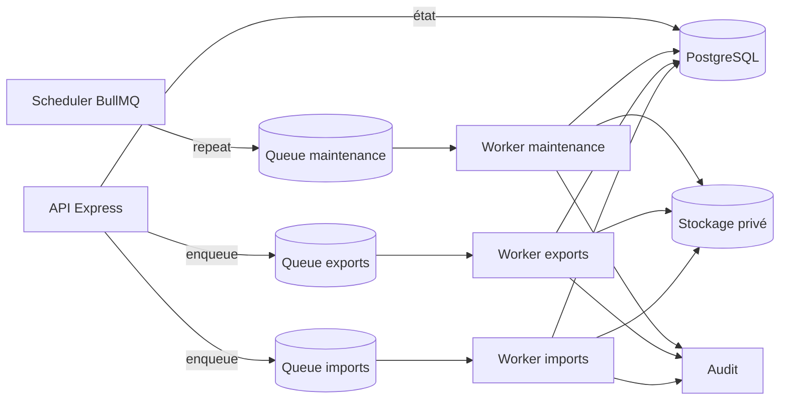
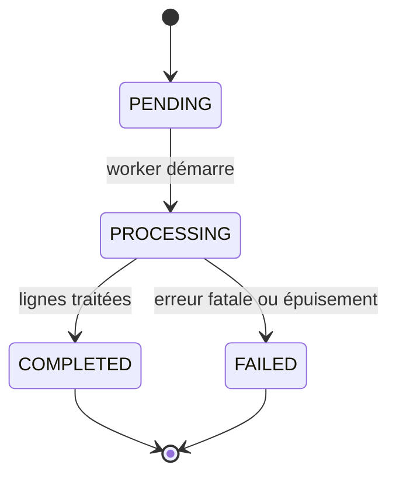
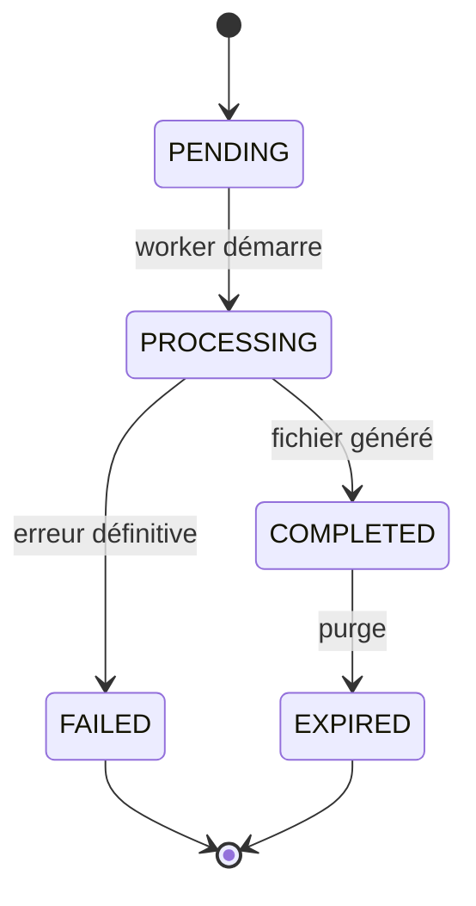

# WORKERS_ARCHITECTURE.md — EventPulse Analytics

**Phase :** 3 — Software Architecture & Database Design
**Version :** 1.0
**Date :** 2026-11-18
**Technologies :** Redis, BullMQ, worker Node.js/TypeScript dédié
**Compléments :** `BACKEND_ARCHITECTURE.md`, `DATABASE_DESIGN.md`, `SECURITY_ARCHITECTURE.md`

---

## 1. Rôle du worker

Le worker exécute les traitements longs hors du cycle HTTP :

- imports CSV et Excel ;
- exports PDF, Excel et CSV ;
- purge des exports expirés ;
- nettoyage des sessions et tokens expirés ;
- notifications différées (Should, non bloquant).

Il partage le même code métier que l'API via des packages internes, mais **s'exécute dans un processus séparé**. Il ne sert aucune requête HTTP et ne diffuse pas directement les KPI.



---

## 2. Topologie

| Composant | Instance | Rôle |
|---|---|---|
| API | 1+ | Authentification, validation, création des jobs, lecture des statuts |
| Worker imports | 1 | Parsing et écriture métier |
| Worker exports | 1 | Génération de fichiers |
| Worker maintenance | 1 | Purge et nettoyage |
| Redis | 1 | Files, compteurs, rate limit, scheduler |
| Scheduler BullMQ | 1 (dans le worker maintenance) | Jobs répétables |

**Principes :**

- Un seul type de worker par conteneur, afin d'isoler les ressources et les pannes.
- Les workers peuvent être scalés horizontalement sans changement de code.
- Redis est obligatoire pour BullMQ ; il n'est pas une source de vérité métier.
- Aucun état métier durable dans Redis.

---

## 3. Queues

| Queue | Jobs | Concurrence | Priorité |
|---|---|---|---|
| `imports` | `import.process` | 2 | Normale |
| `exports` | `export.generate` | 2 | Normale |
| `maintenance` | `export.purge`, `session.cleanup`, `import-file.purge` (à valider) | 1 | Basse |
| `mail` (Should) | `invitation.send`, `password-reset.send` | 2 | Normale |

**Conventions :**

- Nom de queue au pluriel ; nom de job au format `domaine.action`.
- `jobId` = identifiant de l'entité (`importId`, `exportId`) pour empêcher les doublons.
- Les jobs sont supprimés après succès au-delà d'un quota ; les échecs sont conservés pour diagnostic.
- Aucun payload ne contient de secret ni de PII brute.

---

## 4. Import

### 4.1 Cycle

1. L'API reçoit le fichier, valide type, taille et extension.
2. Le fichier est déposé dans le stockage privé sous `imports/{organizationId}/{importId}/source`.
3. L'API calcule la clé d'idempotence déterministe et crée `imports` en `PENDING`.
4. L'API enqueue `import.process` avec `{ importId, organizationId }` et retourne **202**.
5. Le worker passe l'import en `PROCESSING`, télécharge le fichier et le parse en flux.
6. Les lignes sont validées, normalisées et écrites via les services métier.
7. Les lignes en erreur sont collectées et un rapport CSV est généré.
8. L'import passe en `COMPLETED` ou `FAILED` avec compteurs et motif borné.
9. L'audit et l'événement `import.completed` / `import.failed` sont émis.



### 4.2 Payload conceptuel

```json
{
  "importId": "018f...",
  "organizationId": "018f...",
  "requestedByUserId": "018f..."
}
```

Le worker **recharge** l'import en base et vérifie que `organizationId` correspond. Aucun autre champ métier n'est transporté.

### 4.3 Idempotence

Deux niveaux :

1. **Acceptation** : `UNIQUE (organization_id, idempotency_key)` sur `imports`. Un second dépôt identique renvoie 409 avec l'import existant.
2. **Exécution** : le job est identifié par `importId`. Un rejeu du même job ne crée pas un second import.

**Clé d'idempotence :** hash SHA-256 de `(type d'import, organizationId, version de schéma, contenu du fichier normalisé)`. Aucun timestamp, aucun identifiant de requête. Le nom du fichier n'entre pas dans le hash. Conformément à BR-IMP-004, un fichier modifié produit une nouvelle clé et est traité comme un nouvel import.

**Écriture atomique :** le traitement d'un import s'exécute dans **une transaction PostgreSQL unique**. Si le worker s'arrête, la transaction est annulée et un rejeu repart d'un état propre. Les erreurs de ligne n'annulent pas la transaction : elles sont comptabilisées et ignorées selon la stratégie.

> Conséquence : un import de 50 000 lignes tient dans une transaction longue. Ce choix privilégie la correction à la granularité de reprise. Il est accepté pour la volumétrie de démonstration et documenté comme limite.

### 4.4 Stratégies de doublons

| Stratégie | Comportement |
|---|---|
| `SKIP` | Ligne existante conservée |
| `UPDATE` | Ligne existante mise à jour selon les champs autorisés |
| `ERROR` | Ligne signalée en erreur, import continue |

La détection de doublon dépend du type d'import et est déléguée aux services métier. Aucune règle n'est réimplémentée dans le worker.

### 4.5 Types d'import

| Type | Service cible | Remarques |
|---|---|---|
| `PARTICIPANTS` | `attendees.importRows` | Email non unique ; déduplication par règle métier |
| `REGISTRATIONS` | `attendees.importRows` | Résolution participant/événement/billet |
| `CHECKINS` | `checkins.importRows` | Chaque ligne applique l'éligibilité et les motifs |
| `PAYMENTS` | `finance.importRows` | Transactions et statuts |

Le worker ne contourne jamais les services : il appelle leurs interfaces d'import, qui portent les règles.

### 4.6 Parsing

- CSV : UTF-8 avec ou sans BOM, séparateur détecté (`;` ou `,`), en-têtes obligatoires, colonnes inconnues signalées.
- Excel : **Should**, première feuille, limites de lignes et de colonnes, protection contre les bombes ZIP.
- Taille maximale configurable ; rejet en 413 avant enqueue.
- Normalisation : trim, dates ISO, montants décimaux, enums stricts.
- Aucune exécution de formule ni de macro.

### 4.7 Rapport d'erreurs

- CSV : `row_number`, `column`, `error_code`, `message`.
- Stocké sous `imports/{organizationId}/{importId}/errors.csv`.
- Téléchargement via URL signée, réservé aux rôles autorisés sur l'événement.
- Aucune donnée secrète ; les valeurs PII nécessaires à la correction sont limitées au strict nécessaire et le fichier est privé.
- Le rapport n'est pas un journal d'audit.

### 4.8 Compteurs

- `totalRows`, `processedRows`, `successRows`, `errorRows` mis à jour dans la transaction finale.
- La progression fine (pourcentage) est diffusée via `job.updateProgress` et relayée par Socket.IO ou polling.
- Une incohérence de compteurs est un défaut bloquant en test.

---

## 5. Export

### 5.1 Cycle

1. L'API valide la demande, le rôle, la période, les événements et le format.
2. Elle force `pseudonymized=true` pour ANALYST et EVENT_MANAGER.
3. Elle crée `exports` en `PENDING` avec `parameters` figés.
4. Elle enqueue `export.generate` et retourne **202**.
5. Le worker passe en `PROCESSING` et demande le jeu de données à `AnalyticsFacade`.
6. Il génère le fichier, le dépose dans le stockage privé.
7. Il renseigne `storageKey`, `fileSizeBytes`, `generatedAt`, `expiresAt`.
8. Il passe en `COMPLETED` et émet l'événement.
9. À l'expiration, la maintenance passe en `EXPIRED` et supprime le fichier.



### 5.2 Payload conceptuel

```json
{
  "exportId": "018f...",
  "organizationId": "018f..."
}
```

### 5.3 Formats

| Format | Usage | Contraintes |
|---|---|---|
| PDF | Rapports directionnels | En-tête, période, organisation, pagination, graphiques |
| XLSX | Analyse tabulaire | Feuilles par section, formats numériques, pas de macro |
| CSV | Réutilisation | UTF-8, séparateur `;`, neutralisation des formules |

**Moteur PDF :** rendu HTML/CSS via navigateur headless, afin de réutiliser les tokens du Design System. Alternative de repli : moteur PDF natif pour les tableaux simples. Le choix final est confirmé en Phase 4.

### 5.4 Contenu et sécurité

- Les 5 rapports prédéfinis sont les seuls jeux de données exposés.
- Les exports ANALYST et EVENT_MANAGER sont pseudonymisés avant écriture du fichier.
- Aucune requête opérationnelle directe : le worker consomme `AnalyticsFacade`.
- Aucun secret, token ou identifiant de session dans le fichier.
- Les URLs signées sont générées par l'API, jamais par le worker.
- Les fichiers sont privés, chiffrés au repos, nommés par identifiant d'export.

### 5.5 Idempotence

- `jobId = exportId` : un seul job actif par export.
- Si l'export est déjà `COMPLETED`, le job est un no-op.
- Si l'export est `PROCESSING`, un doublon est ignoré.
- La clé de stockage est déterministe : `exports/{organizationId}/{exportId}.{format}` ; un rejeu écrase le même objet.
- `expiresAt` est calculé une seule fois, à la première génération.

### 5.6 Expiration

- `expiresAt = generatedAt + organizations.exportRetentionDays`.
- 30 jours par défaut, configurable par OWNER/ADMIN.
- L'API renvoie 410 après expiration.
- La purge supprime l'objet puis marque `EXPIRED` ; l'ordre inverse est interdit.

---

## 6. Maintenance

### 6.1 Jobs répétables

| Job | Fréquence | Action |
|---|---|---|
| `export.purge` | Toutes les heures | Supprime les fichiers expirés, passe `EXPIRED` |
| `session.cleanup` | Quotidienne | Supprime les sessions expirées/révoquées anciennes |
| `password-reset.cleanup` | Quotidienne | Supprime les tokens expirés |
| `import-file.purge` | Quotidienne (à valider) | Supprime les fichiers sources selon rétention |

### 6.2 Règles de purge

- Toujours vérifier `expires_at < now()`.
- Supprimer l'objet de stockage avant de mettre à jour le statut.
- Un objet déjà absent n'est pas une erreur.
- La purge est idempotente.
- Chaque purge est tracée en audit avec acteur nul et catégorie `SENSITIVE_DATA` (suppression de fichiers d'export) ou `ORGANIZATION` (nettoyage de sessions).
- Aucune purge de données métier, d'audit ou de check-in.

### 6.3 Rétention non définie

La rétention des fichiers d'import et du journal d'audit n'est pas fixée par la Phase 1. Le job correspondant est paramétré mais désactivé par défaut tant que la décision n'est pas prise.

---

## 7. Retries et erreurs

### 7.1 Politique

| Paramètre | Valeur |
|---|---|
| Tentatives | 3 |
| Backoff | Exponentiel, 5 s, 30 s, 2 min |
| Jobs conservés en échec | Oui |
| Jobs réussis conservés | 1 000 derniers |
| Timeout import | 15 min |
| Timeout export | 10 min |

### 7.2 Erreurs réessayables

- Perte de connexion PostgreSQL ou Redis.
- Timeout réseau vers le stockage.
- Verrou temporaire.
- Rate limit d'une dépendance.

### 7.3 Erreurs non réessayables

- Fichier illisible, format non supporté, en-têtes invalides.
- Validation métier systématique.
- Autorisation insuffisante détectée.
- Dépassement de taille.
- Paramètres d'export invalides.

Ces erreurs passent l'entité en `FAILED` immédiatement et ne consomment pas les tentatives.

### 7.4 Dead-letter

- Pas de table DLQ dédiée.
- Les jobs échoués restent dans l'ensemble `failed` de BullMQ.
- L'entité `imports` ou `exports` porte le statut, le code et le message borné.
- Une alerte Sentry est émise après épuisement.
- Une reprise manuelle consiste à créer une nouvelle demande, jamais à modifier l'entité terminée.

---

## 8. Isolation par organisation

1. Le payload ne contient que `organizationId` et l'identifiant d'entité.
2. Le worker recharge l'entité et vérifie la correspondance.
3. Toutes les écritures passent par des services qui exigent un contexte d'organisation.
4. Les clés de stockage incluent `organizationId`.
5. Aucune requête globale inter-organisations hors maintenance explicitement scopée.
6. Les jobs d'export relisent le rôle du demandeur et appliquent la pseudonymisation.
7. Un job dont l'organisation ne correspond pas est marqué `FAILED` et audité.

---

## 9. Traçabilité

| Élément | Contenu |
|---|---|
| `imports` | Statut, compteurs, idempotence, rapport, acteur, dates |
| `exports` | Statut, paramètres, format, pseudonymisation, expiration, acteur |
| Audit | Création, démarrage, succès, échec, purge |
| Logs | `jobId`, `importId`/`exportId`, `organizationId`, durée |
| Sentry | Exception, job, tentative, organisation |
| BullMQ | Tentatives, timestamps, échec |

Aucun log ne contient de PII brute ni de contenu de fichier.

---

## 10. Performance et dimensionnement

| Élément | Cible |
|---|---|
| Import 50 000 inscriptions | < 10 min sur l'environnement de démonstration |
| Export 50 000 lignes | < 2 min |
| Mémoire worker | Streaming, pas de chargement intégral |
| Concurrence imports | 2 |
| Concurrence exports | 2 |
| Redis | Files et progression uniquement |
| PostgreSQL | Transactions bornées, index ciblés |

**Limites connues :**

- Transaction unique par import : longue, mais atomique.
- PDF headless : coût mémoire, pool limité.
- Les gros exports sont découpés en feuilles ou sections pour rester lisibles.

---

## 11. Sécurité du worker

- Utilisateur non-root, système de fichiers en lecture seule hors temporaires.
- Aucun port exposé.
- Accès réseau limité à PostgreSQL, Redis et stockage.
- Secrets injectés à l'exécution.
- Fichiers temporaires supprimés après traitement.
- Aucun payload de job journalisé intégralement.
- Validation stricte du payload et rechargement en base.
- Un job ne peut pas lire une organisation qu'il ne sert pas.

---

## 12. Observabilité

| Mesure | Usage |
|---|---|
| `job_duration_seconds` | Durée par type |
| `job_failures_total` | Échecs par queue |
| `queue_waiting` | Profondeur de file |
| `import_rows_total` | Volume traité |
| `export_bytes_total` | Volume généré |
| `purge_deleted_total` | Fichiers purgés |

- Sentry capture les exceptions avec tags `queue`, `jobId`, `organizationId`.
- Une file qui dépasse un seuil déclenche une alerte.
- Les logs de job sont corrélés par `jobId` et `requestId` d'origine lorsqu'il existe.

---

## 13. Arrêt et reprise

- **Arrêt gracieux :** le worker cesse de prendre des jobs, termine le job courant, ferme les connexions.
- **Reprise :** BullMQ réinjecte les jobs interrompus ; l'idempotence garantit l'absence de doublon.
- **Crash :** la transaction PostgreSQL est annulée ; le statut reste `PROCESSING` puis est repris ou marqué `FAILED` après épuisement.
- **Redémarrage Redis :** BullMQ nécessite la persistance Redis (AOF recommandé) ; à défaut, les jobs en attente sont perdus et les entités restent `PENDING`, ce qui doit être détecté par supervision.

---

## 14. Traçabilité documentaire

| Élément | Source |
|---|---|
| Imports asynchrones | BR-IMP-001, Q-06 |
| CSV Must / Excel Should | Q-07, H-08 |
| Idempotence imports | BR-IMP-004 |
| Exports PDF/Excel/CSV | Q-07 |
| Expiration 30 jours | Q-14, H-10 |
| 410 Gone | Q-14 |
| Purge | PRD §13.1 |
| Pseudonymisation | H-09 |
| Audit | BR-AUD-003 |
| Isolation | BR-ORG-003 |

---

## 15. Points ouverts

- Rétention des fichiers d'import : non définie.
- Moteur PDF définitif : headless Chromium vs moteur natif.
- Stratégie de résolution des participants dans un import d'inscriptions : à préciser (email non unique).
- Persistance Redis : AOF obligatoire en démonstration ? à confirmer.
- Découpage des imports supérieurs à 50 000 lignes : hors volumétrie cible.
- Reprise manuelle d'un import `FAILED` : nouvelle demande, pas de reprise en place.

---

*Fin de WORKERS_ARCHITECTURE.md — Version 1.0.*
